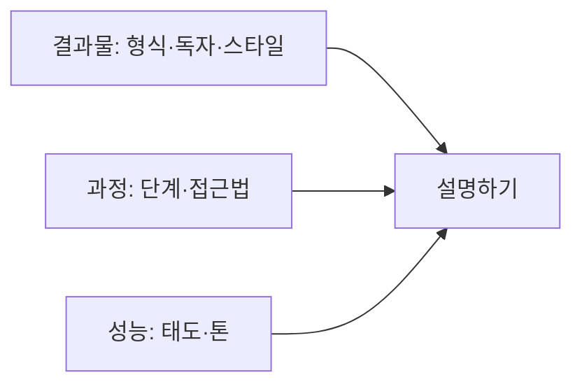
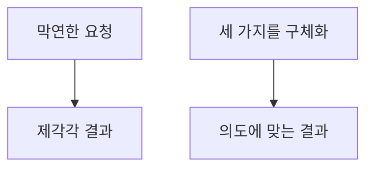

# 설명하기 역량

> **AI에게 목표와 방식을 정확히 전하는 역량**(Description). 무엇을 원하는지(결과물), 어떻게 접근하길 원하는지(과정), 협업 중 어떻게 행동하길 원하는지(성능)를 말로 정의한다. (Anthropic AI Fluency 용어 요약 열람 2026-11-28)

## 쉽게 말하면
신입에게 일을 시킬 때 "보고서 써 줘"만 하면 결과가 제각각이다. "임원용 한 장, 근거 수치 포함, 비판적 시각으로"처럼 구체적으로 설명하면 결과가 달라진다.

## 자세히
- 정의(문서): AI와 **효과적으로 소통**하는 것. 결과물을 명확히 정의하고, AI의 처리 과정을 안내하며, 원하는 AI 행동과 상호작용을 지정한다.
- 세 하위 요소(문서):
  - **결과물 설명(Product Description)**: 산출물의 **형식, 독자, 스타일** 정의.
  - **과정 설명(Process Description)**: AI가 요청에 접근하는 방식 정의(예: 단계별 지시).
  - **성능 설명(Performance Description)**: 협업 중 AI의 행동 정의(예: 간결/상세, 도전적/지지적).
- 위임(Delegation)과의 관계: 무엇을 AI에게 맡길지 정한 뒤([협업 모드](#collaboration-modes)) 그 일을 어떻게 설명할지가 이 역량이다. 설명이 부족하면 평가 단계에서 문제가 드러난다([결과물 평가](#product-discernment)).
- 점검표(내 정리): ① 목적(왜) ② 독자 ③ 형식·길이 ④ 포함·제외할 것 ⑤ 단계 지시 ⑥ AI의 태도(반론하라/동의하라) ⑦ 모르면 질문하라는 지시.
- 한계: 이 문서는 개념 정의이며 실험적 효과 크기는 제시하지 않는다.

## 그림으로 보기



## 예시
```text
[결과물] 임원용 1쪽 요약, 불릿 5개, 숫자 근거 포함
[과정] 먼저 핵심 쟁점 3개를 뽑고 각각 근거를 찾아라
[성능] 내 가정에 반론도 제시해라
```
- 교육: 같은 업무를 막연한 요청과 위 3요소 요청으로 비교해 보는 실습.

## 헷갈리는 것과 비교
| 개념 | 차이 |
|---|---|
| 설명하기 | 요청을 구체화하는 입력 쪽 역량 |
| [결과물 평가](#product-discernment) | 출력을 점검하는 쪽 역량 |
| 프롬프트 엔지니어링 | 설명하기를 포함하는 기술적 실천 |

## 더 읽을거리
- [AI Fluency 용어 요약(Anthropic PDF)](https://www-cdn.anthropic.com/4396730ed190e691a3712cf2fd6bfe35509deca2.pdf) — Description 정의(읽음).
