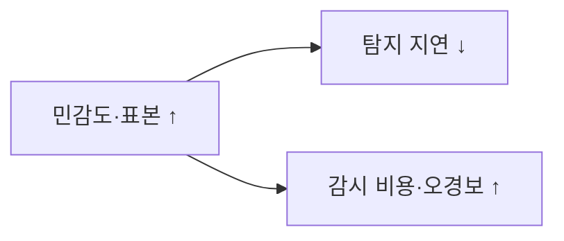
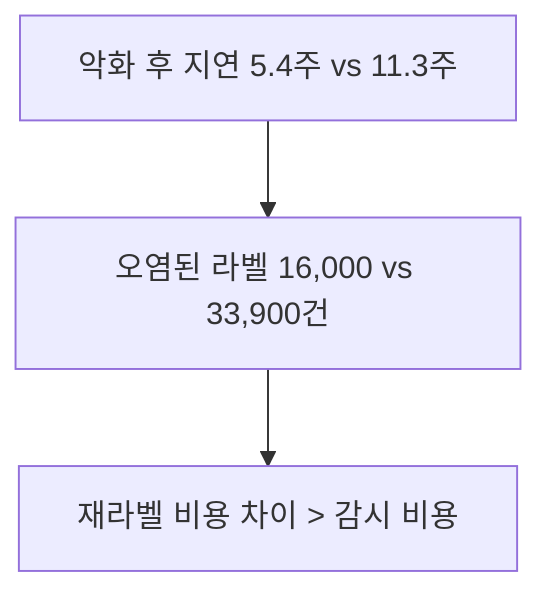

# 탐지 지연과 비용

> 탐지 지연과 비용은 라벨 품질 하락을 감시할 때 "얼마나 빨리 알아채는가"와 "감시에 드는 비용(이중 라벨 수·오경보)"이 서로 맞바꾸기 관계라는 뜻이다. 빨리 잡으려면 표본·민감도를 높여야 하고, 그러면 비용과 오경보가 늘어난다.

## 쉽게 말하면
화재 경보기를 아주 민감하게 하면 불이 나기 전에 울리지만 요리 연기에도 울려 소방서 출동 비용이 든다. 둔감하게 하면 조용하지만 불이 커진 뒤에야 울린다.

## 자세히
- **ARL 관점(Wikipedia, CUSUM)**: 정상일 때 평균 런 길이(ARL)는 오경보 비용, 이상일 때 ARL은 탐지 지연이라는 두 지표로 감시 성능을 표현한다.
- **직접 시뮬레이션(주 100개 이중 라벨, 기준 불일치율 15%, 20%로 악화)**:

| 감시 방식 | 정상일 때 오경보까지(주) | 악화 후 탐지까지(주) |
| --- | --- | --- |
| CUSUM h=0.08 | 79 | 3.9 |
| CUSUM h=0.12 | 253 | 5.4 |
| Shewhart 3σ | 233 | 11.3 |

  민감하게(h=0.08) 하면 3.9주 만에 잡지만 오경보가 79주마다 난다. h=0.12면 5.4주 걸리지만 오경보는 253주마다다([누적합(CUSUM) 감시](#cusum-for-agreement)).
- **표본 크기와 합산(직접 시뮬레이션, 주 50개 이중 라벨, 정확도 0.92→0.82)**: 주간 kappa(기준 0.50)는 1.3주 만에 경보하지만 정상 12주 중 29%에서 오경보, 4주 합산 kappa(기준 0.55)는 2.6주 걸리고 오경보 1.3%다([이동 평균 kappa](#moving-average-kappa)).
- **비용 계산(해석, 가정 단가)**: 이중 라벨 1건 비용을 1로 두면 주 100건 = 주 100 단위, 연 5,200 단위다. 표본을 주 100에서 200으로 늘리면 연 5,200 단위가 더 든다. 탐지가 빨라져 줄어드는 오염된 라벨 수와 비교한다. 예: 하락 후 5.4주 만에 잡으면 그 기간 라벨이 주 3,000건일 때 잠재적으로 오염된 라벨 수는 약 16,000건(5.4×3,000)이고, 11.3주면 약 33,900건이다. 재라벨 단가가 1이면 탐지 지연 차이 약 17,900 단위가 감시 비용(연 5,200)보다 크므로 민감한 설계가 유리하다(가정 계산).
- **설계 순서(해석)**: ① 놓치면 안 되는 최소 악화 크기(예: 불일치율 +5%p) ② 허용 지연(주) ③ 허용 오경보 간격(주) ④ 이를 만족하는 표본 수·규칙을 시뮬레이션으로 찾는다 ⑤ 위험이 큰 작업일수록 지연 허용을 줄인다([재보정 조건](#recalibration-trigger)).

## 그림으로 보기

## 예시
- 주 3,000건을 라벨링하는 프로젝트에서 지연 6주 단축 = 오염 라벨 약 18,000건 감소(가정). 감시 표본을 주 100건 더 늘리는 비용(연 5,200 단위)보다 효과가 큰지 비교한다.
- 교육 활용: 지연·오경보·비용 세 값을 표에 적고 팀의 허용선을 정하게 한다.

## 헷갈리는 것과 비교
| 개념 | 차이 |
| --- | --- |
| 탐지 지연 | 하락 후 경보까지 시간 |
| 오경보 | 정상인데 울리는 경보 |
| [누적합(CUSUM) 감시](#cusum-for-agreement) | 지연을 줄이는 기법 |
| [라벨링 비용 모델](#annotation-cost-model) | 방식별 비용 비교 |

## 더 읽을거리
- [CUSUM (Wikipedia)](https://en.wikipedia.org/wiki/CUSUM) — ARL, 정상·이상 ARL의 의미
- [Control chart (Wikipedia)](https://en.wikipedia.org/wiki/Control_chart) — 오경보 간격
