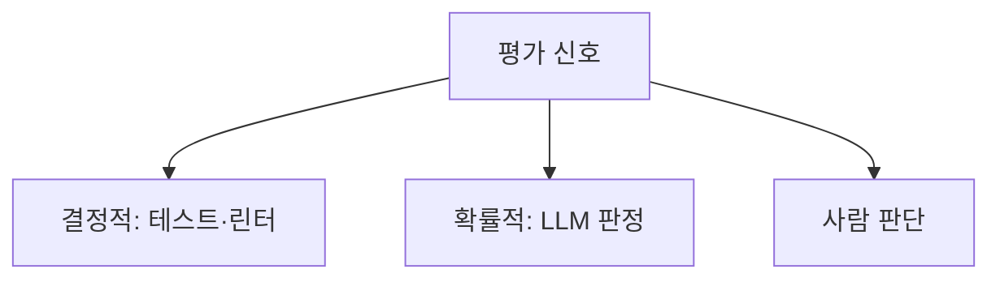

# 결정적 피드백

> 같은 입력이면 항상 같은 판정을 내리는 검사기(테스트·린터·타입체커·스키마 검증)의 결과를 에이전트의 평가 신호로 쓰는 방식. LLM 판정과 달리 흔들리지 않는다.

## 쉽게 말하면
시험 채점을 사람 선생님의 기분에 맡기면 점수가 들쭉날쭉하지만, 객관식 OMR 채점기는 늘 같은 점수를 낸다. 결정적 피드백은 OMR 채점기 같은 신호다. AI가 쓴 코드를 AI가 "좋아 보인다"고 평가하는 대신, 테스트가 통과했는지로 판단한다.

## 자세히
- **Anthropic 기준**: 에이전트는 각 단계에서 도구 결과나 코드 실행 같은 환경의 "ground truth"를 받아 진행도를 판단해야 하고, 코딩은 자동 테스트로 검증 가능해 결과를 피드백 삼아 반복 개선할 수 있다.
- **evaluator-optimizer 루프**: 한 LLM이 생성하고 다른 쪽이 평가·피드백한다. 평가 기준이 명확하고 반복 개선의 가치가 측정 가능할 때 잘 맞는다. 평가자를 LLM 대신 테스트/린터로 바꾸면 결정적이 된다.
- **종류**: 단위·통합 테스트, 린터, 포매터, 타입체커, 빌드 성공 여부, JSON 스키마 검증, 정규식/정답 일치 검사.
- **장점**: 재현 가능, 싸다(토큰 0), 판정이 설명 가능. **한계**: 테스트가 말하지 않는 품질(가독성·UX·요구사항 적합성)은 못 잡고, 테스트 자체가 틀리면 틀린 방향으로 수렴한다. AI가 테스트를 약하게 고쳐 통과시키는 반칙도 막아야 한다.
- **조합**: 결정적 검사로 먼저 거르고, 남은 주관적 부분만 LLM 판정이나 사람이 본다.

## 그림으로 보기

## 예시
"구현 후 `pytest`와 `ruff`를 실행하고, 실패하면 로그를 읽어 고쳐라. 최대 5회 반복. 테스트 파일은 수정하지 마라." — 마지막 문장이 반칙 방지 장치다.

## 헷갈리는 것과 비교
| 개념 | 차이 |
| --- | --- |
| 결정적 피드백 | 항상 같은 판정(코드 기반) |
| LLM-as-judge | 모델이 채점, 편차 있음 |
| [AI 코드 리뷰 습관](#code-review-ai) | 사람이 위험 지점을 보는 절차. 결정적 검사와 함께 쓴다 |
| [LLM-as-judge](#llm-as-judge) | 모델이 채점, 편차 있음 |
| 평가자-최적화 | 구조(루프). 결정적 피드백은 그 평가자의 한 종류 |

## 더 읽을거리
- [Anthropic: Building effective agents](https://www.anthropic.com/engineering/building-effective-agents) — evaluator-optimizer와 ground truth
