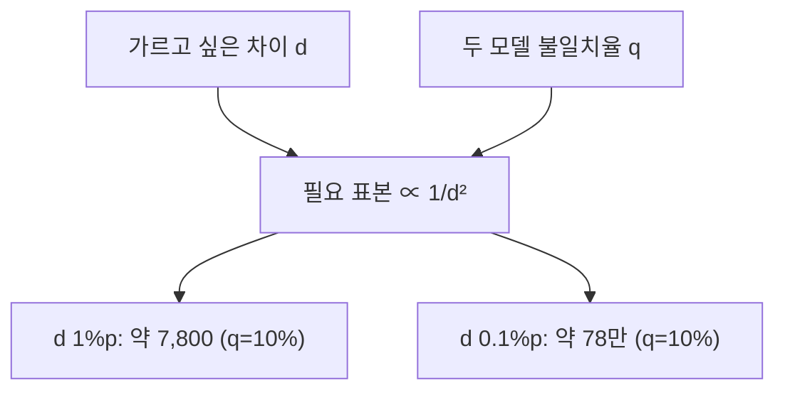
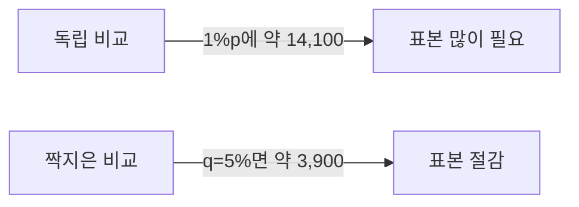

# 작은 차이를 가를 개발 세트 크기

> 두 모델의 정확도 차이가 작을수록 그 차이를 "우연이 아니다"라고 가려내는 데 필요한 개발 세트가 **차이의 제곱에 반비례해 급증**한다. 차이를 반으로 줄이면 필요한 표본은 약 4배다.

## 쉽게 말하면
키가 1cm 다른 두 사람 중 누가 큰지는 눈으로 알 수 없다. 1mm 차이는 정밀 측정이 필요하다. 모델 비교도 같다. 차이가 작을수록 더 많은 예시로 재야 한다.

## 자세히
- **Ng의 가이드(Machine Learning Yearning 초안 7장, 본문 확인)**: 개발 세트는 시도하는 알고리즘 간 **차이를 감지할 만큼** 커야 한다. A 90.0% vs B 90.1%의 0.1% 차이는 100개 개발 세트로는 감지 못 한다. 1,000~10,000개가 흔하며 10,000개면 0.1% 개선을 감지할 좋은 가능성이 있다고 한다. 광고·검색처럼 0.01% 개선도 이익에 직결되는 성숙한 서비스는 10,000개보다 훨씬 크게 잡는다. 각주: 이론상 통계 검정을 할 수 있지만 대부분의 팀은(논문 제외) 하지 않고 중간 진행 평가에 유용하다고 보지 않는다. 시험 세트는 전체 성능에 확신을 줄 만큼이면 되고, 30% 관행은 100~10,000개에서 괜찮지만 큰 데이터에선 비율이 줄고 절대 개수는 는다.
- **직접 계산한 필요 표본**(같은 시험 세트에서 두 모델을 짝지어 비교, 유의수준 5% 양측, 검정력 80%, 두 모델이 서로 다르게 맞히는 예시의 비율 = 불일치율)
  | 정확도 차이 | 불일치율 5% | 10% | 20% |
  |---|---|---|---|
  | 1%p | 약 3,900 | 약 7,800 | 약 15,700 |
  | 0.5%p | 약 15,700 | 약 31,400 | 약 62,700 |
  | 0.1%p | 약 392,000 | 약 784,000 | 약 1,568,000 |
  공식: n ≈ (1.96√q + 0.84√(q−d²))² / d² (q=불일치율, d=차이). **불일치율이 작을수록 적은 표본으로 가려진다**(두 모델이 거의 같게 행동하면 차이가 선명). 불일치율 0.15~0.3%면 0.1%p 차이도 약 1.2만~2.4만 개로 가려진다(불일치율 1%면 약 78,400).
- **짝지음의 이득**: 독립 두 집단으로 비교하면(정확도 90% 근처) 1%p에 약 14,100개, 0.1%p에 약 141만 개가 필요하다. 같은 예제로 짝지어 비교하면 훨씬 적다([짝지은 부트스트랩](#paired-bootstrap-model-comparison)·[맥니마 검정](#mcnemar-test)).
- **Ng의 "10,000개로 0.1%" 감각과의 관계**: 위 계산상 불일치율이 약 0.15% 안팎으로 아주 작을 때만 성립한다. 모델이 서로 크게 다르면(불일치 몇 %) 10,000개로는 0.1%를 가리기 어렵다. 즉 "감지 가능"은 모델 쌍의 불일치율에 달려 있다.
- **실무**: 목표 차이 d를 먼저 정하고, 현재 모델 쌍의 불일치율을 파일럿으로 재서 n을 계산한다. 작은 개선이 여러 번 쌓이는 개발 문화(Ng: 0.1% 개선 수십 개 누적)라면 개발 세트를 크게 유지한다. 또한 개발 세트를 자주 재사용하면 과적합하므로 [시험 세트 재사용](#test-set-reuse)에 주의.

## 그림으로 보기



## 예시
```python
from math import ceil
def n_paired(d, q, za=1.96, zb=0.84):
    return ceil((za*q**0.5 + zb*(q-d*d)**0.5)**2 / d**2)
print(n_paired(0.01, 0.10))   # 정확도 1%p 차이, 불일치율 10% → 약 7,838
```
- 프롬프트 두 버전의 정답률 차이 2%p를 확인하려면 불일치율이 10%일 때 약 2,000건이 필요(`n_paired(0.02, 0.10)`).

## 헷갈리는 것과 비교
| 개념 | 설명 |
|---|---|
| 차이의 크기 d | 작을수록 n이 d²에 반비례해 증가 |
| 불일치율 q | 클수록 n 증가(짝지은 비교) |
| 검정력 | 진짜 차이를 감지할 확률(여기선 80%) |
| [독립 시험 세트 구간](#independent-test-ci) | 단일 모델의 정확도 불확실성 |

## 더 읽을거리
- [Andrew Ng, Machine Learning Yearning 7장](https://home-wordpress.deeplearning.ai/wp-content/uploads/2022/03/andrew-ng-machine-learning-yearning.pdf) — 개발 세트 크기 가이드·각주(본문 확인).
