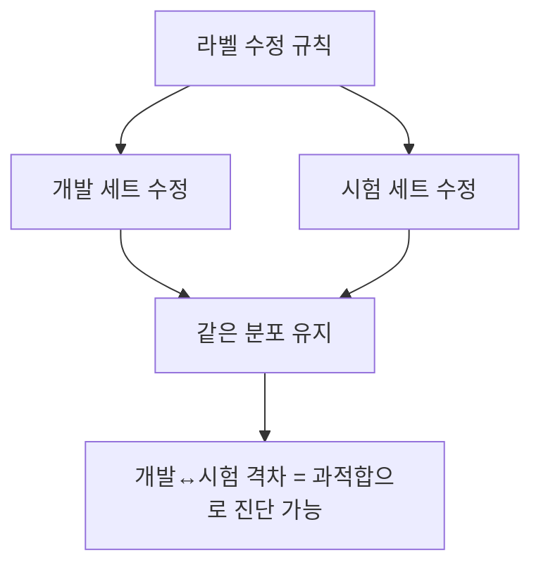
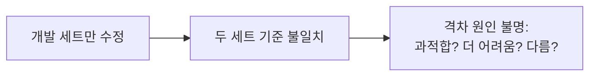

# 개발·시험 라벨 수정 일관성

> 라벨 오류를 고칠 때는 **개발 세트와 시험 세트에 같은 규칙을 같은 방식으로 적용**해야 한다. 한쪽만 고치면 두 세트의 분포가 달라져 "개발 세트에서는 좋은데 시험 세트에서는 나쁜" 원인을 가릴 수 없게 된다.

## 쉽게 말하면
연습 시험지와 본 시험지를 서로 다른 채점 기준으로 만들면, 연습에서 만점이어도 본 시험 결과가 왜 다른지 모른다. 채점표를 고친다면 두 쪽 모두 같은 기준으로 고쳐야 한다.

## 자세히
- **분포가 같아야 하는 이유(Ng, Machine Learning Yearning 6장, 본문 확인)**: 개발 세트에서는 좋은데 시험 세트에서는 나쁘다면, 두 분포가 같을 때는 진단이 명확하다 — **개발 세트에 과적합**했다. 처방은 개발 세트를 더 모으는 것. 분포가 다르면 가능한 원인이 셋이다: ① 개발 세트 과적합 ② 시험 세트가 더 어려움(더 개선할 여지가 없을 수도 있음) ③ 어렵진 않지만 **다름**(개발 세트 개선 노력이 낭비). 불일치는 무엇이 효과 있는지 파악하기 어렵게 한다.
- **라벨 수정에 적용(MLY 16장)**: "개발 세트 라벨을 고치는 과정이 무엇이든 시험 세트 라벨에도 적용해, 개발·시험 세트가 계속 같은 분포에서 나오게 하라." 그렇지 않으면 팀이 개발 세트 성능에 최적화했는데 나중에 **다른 기준의 다른 시험 세트**로 평가받는 문제가 생긴다.
- **맞힌 예시도 점검해야 하는 이유**: 모델이 틀린 예시만 고치면 평가에 편향이 생긴다. 모델과 원래 라벨이 **둘 다 틀린** 예시는 정답처럼 보여 그대로 남기 때문이다. 98% 정확도에서 틀린 20개만 보면 쉽지만 맞힌 980개는 안 본다. 제품 개발엔 허용되지만 논문·무편향 측정엔 부적합하다고 Ng은 설명한다.
- **실무 체크리스트**
  1. 수정 규칙(무엇을 오류로 볼지)을 문서화하고 개발·시험 세트에 동일 적용.
  2. 틀린 예시와 맞힌 예시를 **같은 비율로 표본 점검**(최소 일부라도).
  3. 수정 전후 버전을 기록하고, 모델 비교는 같은 버전 라벨로.
  4. 학습 세트는 고치지 않아도 되지만 개발·시험과 분포가 어긋날 수 있음을 인지(Ng은 학습/개발 분포 차이는 별도 문제로 다룸).
  5. 라벨 수정 후 기존 점수를 새 점수와 직접 비교하지 않는다(기준이 바뀜).
- **한계**: 규칙이 같아도 라벨러가 다르면 일관성이 깨진다 → 라벨러 간 일치도 점검.

## 그림으로 보기

## 예시
- 챗봇 평가에서 개발 세트 "정답 답변" 일부를 새 정책에 맞게 고쳤다면 시험 세트에도 같은 정책을 적용한 새 버전(v2)을 만들고, 이전 점수와 직접 비교하지 않는다.
- 점검 메모: `labels_v2 = {"rule": "고객 인사말 제외", "applied": ["dev", "test"], "date": "2026-11-26"}`

## 헷갈리는 것과 비교
| 상황 | 결과 |
|---|---|
| 개발·시험 둘 다 같은 규칙 | 분포 유지 |
| 개발만 수정 | 분포 불일치 |
| 틀린 예시만 수정 | 평가 편향 |
| 틀린·맞힌 예시 모두 점검 | 편향 감소 |

관련: [오류 중 라벨 오류 비중](#label-error-share-of-errors), [개발 세트 라벨 오류 수정 기준](#mislabeled-dev-set-threshold)

## 더 읽을거리
- [Andrew Ng, Machine Learning Yearning 6·16장](https://home-wordpress.deeplearning.ai/wp-content/uploads/2022/03/andrew-ng-machine-learning-yearning.pdf) — 분포 일치와 라벨 수정 원칙(본문 열어 확인).
