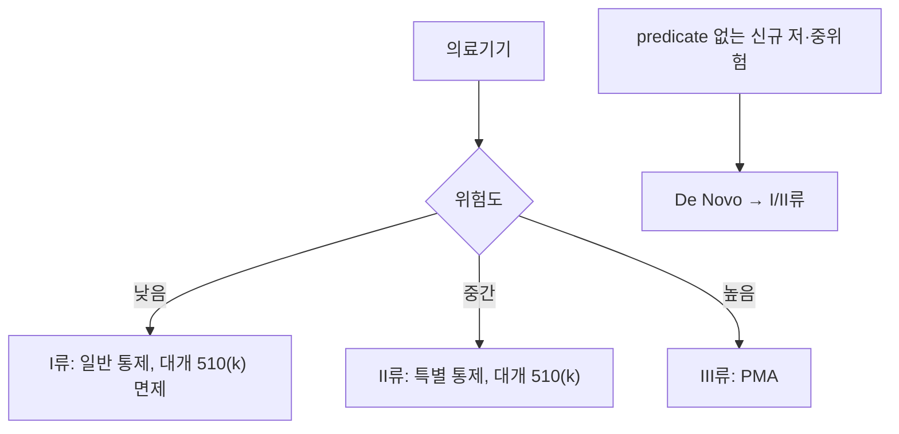

# 의료기기 등급 I·II·III

> FDA는 의료기기를 위험도에 따라 I(낮음)·II(중간)·III(높음)로 나눠 요구 규제를 다르게 한다. 등급이 허가 경로(510(k)·De Novo·PMA)를 정한다.

## 쉽게 말하면
칼의 종류에 따라 면허가 다른 것과 같다. 과일 칼은 신고 없이, 수술 칼은 시험을, 심장을 건드리는 도구는 가장 엄격한 승인을 받는다.

## 자세히
출처: 규제 해설 사이트 요약(FDA 원 페이지는 접근하지 못함, 404). 세부는 FDA 자료 확인 필요.
- **I류(저위험)**: 일반 통제(general controls)만 적용. 대부분 510(k) 면제(일부는 필요).
- **II류(중위험)**: 일반 통제만으로 부족해 **특별 통제(special controls)**(성능 표준, 시판 후 감시, 환자 등록 등) 추가. 대부분 510(k) 필요(일부 면제).
- **III류(고위험)**: 일반 통제+**PMA 승인**, 안전·효과에 대한 임상 근거 필요.
- **De Novo**: predicate 없는 신규 저·중위험 기기를 I 또는 II류로 분류해 달라고 요청하는 경로. 허가되면 이후 510(k)의 predicate가 된다. 자료마다 일부 저·중위험 III류도 가능하다는 서술이 다르니 FDA로 확인.
- **AI**: 소프트웨어도 용도 위험도로 분류된다. 많은 AI 영상 보조 소프트웨어는 II류 510(k) 경로([FDA AI 기기 목록](#fda-ai-enabled-device-list)에서 K번호가 다수).
- 등급은 기술이 아니라 **용도와 위험**에 달려 있다.

## 그림으로 보기

## 예시
- 일반 체온계류: I류. 방사선 영상 AI 보조 진단 소프트웨어: II류 510(k) 사례가 많음. 이식형 AI 제어 기기: III류 PMA 가능성.

## 헷갈리는 것과 비교
| 등급 | 경로 | 근거 수준 |
|---|---|---|
| I | 대개 면제 | 일반 통제 |
| II | 510(k) | 동등성+성능 |
| III | PMA | 임상 근거 |
| [predicate](#predicate-device) | 510(k) 비교 대상 | |

## 더 읽을거리
- [FDA Medical Device Classification 해설](https://www.pureglobal.com/blog-posts/fda-medical-device-classification-class-i-ii-iii-guide) — 등급 요약(검색 결과로만 확인)
