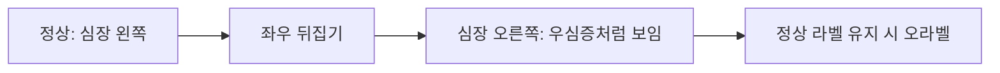
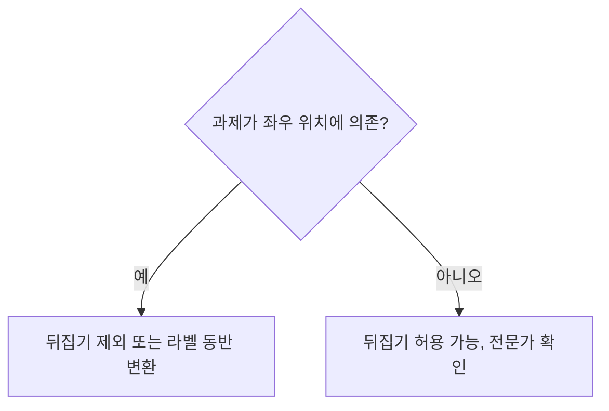

# 우심증과 증강

> 우심증(dextrocardia)은 **심장이 몸의 오른쪽에 있는 드문 상태**다. 흉부 X선을 좌우로 뒤집는 증강은 정상 환자 사진을 "우심증처럼" 보이게 만들어, 좌우 위치가 진단 정보인 과제에서는 틀린 라벨을 학습시킬 수 있다.

## 쉽게 말하면
오른손잡이 설명서 사진을 거울로 뒤집어 "왼손잡이 사진"이라며 학습시키면, 정말 왼손잡이 사진과 구분하지 못한다. 좌우가 곧 정보인 데이터는 거울 뒤집기가 정답을 바꿔 버린다.

## 자세히
- 근거(직접 읽음): 심장 딥러닝 리뷰 *Integrating Deep Learning in Cardiology*(arXiv 2407.09561)의 데이터 증강 절(3.2.1)은 "증강 때 관련 정보가 지워지지 않게 해야 한다"고 말한 뒤 이렇게 예를 든다 — 흉부 X선을 뒤집으면 "심장이 몸의 오른쪽에 있는 이미지가 되어 **우심증으로 오해될 수 있다**".
- 왜 문제인가(추론): 정상 사진을 뒤집은 결과는 해부학적으로 우심증·역위(situs inversus) 사진과 같아 보인다. 이 증강본에 "정상" 라벨을 붙이면 모델은 "심장이 오른쪽이어도 정상"을 배운다. 반대로 실제 우심증 사진을 뒤집으면 정상 모양이 되어 라벨과 어긋난다.
- 실무 현실: 검색 결과 요약에 따르면 한 특허 문서가 임상 영상 7,057장 중 18.65%가 좌우 반전되어 있었다고 적고, 우심증·역위가 있으니 "뒤집혔는지"를 단순히 오류로 단정할 수 없다고 말한다(특허 원문은 열어 확인하지 못함). 한편 흉부 X선 연구에서 무작위 수평 뒤집기(p=0.5)를 쓰는 파이프라인과, 회전+뒤집기 조합이 이진 분류에서 가장 높은 정확도(0.91)를 낸 연구도 있다(검색 요약, 원문 미확인) — 뒤집기가 **항상 해롭지는 않다**.
- 판단 기준(제안): ① 과제가 좌우 위치·심장 크기·장기 위치에 의존하는가 ② 의존하면 수평 뒤집기 제외 또는 라벨·메타데이터(L/R 표시)도 함께 교체([좌우 라벨 동반 반전](#laterality-label-flip)) ③ 의존하지 않는 병변 검출(예: 폐 결절)이면 뒤집기 허용 가능 — 단 도메인 전문가 확인([도메인 전문가 증강 검토](#domain-expert-augmentation-review)).
- 대안: 수직 뒤집기는 해부학적으로 더 비현실적이라 보통 쓰지 않는다. 작은 회전·밝기·대비 조정은 대체로 안전한 선택지로 거론된다(일반 관행, 이 문서에서 검증하지 않음).

## 그림으로 보기

## 예시
- 심비대(심장 크기 비율) 분류는 위치 정보를 쓰므로 뒤집기를 빼고, 폐 결절 유무 분류는 허용을 검토.
- 교육: "증강은 도메인 지식이 필요하다"는 대표 사례.

## 헷갈리는 것과 비교
| 개념 | 차이 |
|---|---|
| 우심증 | 심장이 오른쪽에 있는 실제 해부 변이 |
| 영상 좌우 반전 오류 | 촬영·저장 과정에서 이미지가 뒤집힌 데이터 오류 |
| 증강 뒤집기 | 학습 중 인위적으로 만든 반전본 |
| [박스 형식 변환](#bbox-format-conversion) | 뒤집기 때 좌표를 함께 바꾸는 문제와 닮음 |

## 더 읽을거리
- [Integrating Deep Learning in Cardiology (arXiv 2407.09561)](https://arxiv.org/abs/2407.09561) — 3.2.1절 데이터 증강 문장(PDF 텍스트로 읽음).
