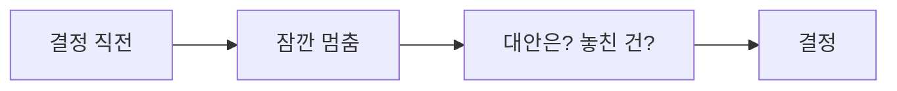

# 진단 타임아웃

> 결정을 내리기 전에 **잠깐 멈추고 다른 가능성은 없는지 점검하는 절차**다. 의료에서 쓰는 인지 강제 장치이며, AI 보조 의사결정에도 응용할 수 있다.

## 쉽게 말하면
비행기 이륙 전 체크리스트나 수술 직전 "타임아웃"과 같다. 숙련자도 습관대로 움직이다 놓치는 것이 있으니, 한 박자 멈춰 "내가 놓친 건 없나?"를 확인한다.

## 자세히
(Buçinca 외 2021 PDF의 서론·배경을 직접 읽었다. 의료 연구 원문은 논문이 인용한 것이며 이 글에서는 열지 못했다.)
- **정의(논문)**: 인지 강제 함수는 **의사결정 시점에 적용**되어 직관적(휴리스틱) 사고를 끊고 분석적 사고를 하게 만드는 개입. 예: **체크리스트, 진단 타임아웃, 대안을 명시적으로 배제하기, 느린 의사결정**.
- **교육 전략과의 차이(논문)**: 교육 전략은 편향 인식을 키우는 사전 교육(교과·시뮬레이션), 인지 강제 함수는 결정 순간의 개입. 임상 연구들에 따르면 결정 시점 개입이 진단 정확도를 높이는 데 교육 전략보다 더 효과적이라고 논문이 소개한다.
- **AI 보조 맥락(논문)**: 이중 과정 이론에 따라 사람은 AI의 개별 추천과 설명을 분석적으로 살피기보다 "언제 따를지"에 대한 어림 규칙을 만든다는 가정에서, 설명을 더 깊이 보게 하는 장치로 3가지를 시험했다(먼저 결정, 요청 시 공개, 30초 대기).
- **30초 대기 조건(논문)**: "AI is processing the image" 메시지로 **30초 대기** 후 AI 제안을 보여 준다. 기다리는 동안 사용자가 자기 가설을 세우게 하는 효과를 노린 것.
- **한계**: 논문의 3종이 진단 타임아웃 그 자체는 아니다. 타임아웃과 닮은 "멈춤" 요소는 wait 조건이다. 효과 크기·대가는 [먼저 결정 후 공개](#decide-before-reveal) 참고.

## 그림으로 보기

## 예시
- 대출 승인 AI 화면에서 승인 버튼 전에 "다른 가능성 한 가지"를 쓰게 하는 한 줄 입력칸(제안).
- 챗봇 답을 복사하기 전 "근거 한 가지 확인했나요?" 체크박스(제안).

## 헷갈리는 것과 비교
| 개념 | 차이 |
|---|---|
| 진단 타임아웃 | 결정 직전 점검 절차 |
| 체크리스트 | 항목별 확인 |
| [먼저 결정 후 공개](#decide-before-reveal) | AI 보기 전에 내 판단 |
| 교육 전략 | 사전 교육으로 편향 인식 |

## 더 읽을거리
- [Buçinca, Malaya, Gajos (2021)](https://arxiv.org/abs/2102.09692) — 직접 읽음.
