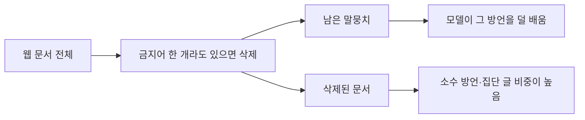
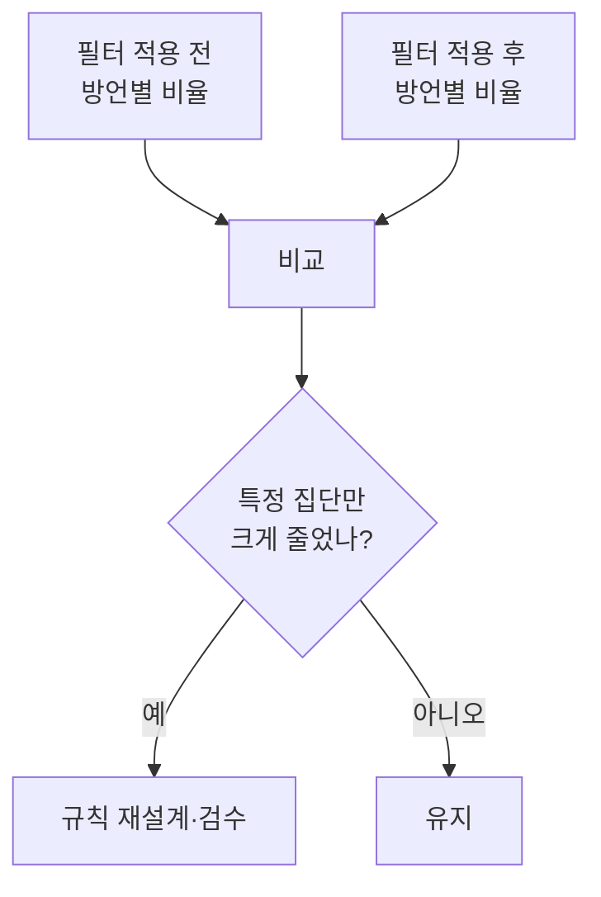

# 방언별 필터링 편향

> 금지어 목록으로 "나쁜 글"을 거르면, 욕설이 아닌데도 **소수 방언·소수 집단에 관한 글이 더 많이 지워지는** 편향이 생긴다.

## 쉽게 말하면
도서관에서 "위험한 단어가 한 번이라도 나온 책은 모두 치운다"는 규칙을 세웠다고 하자. 그 단어가 일상어로 쓰이는 공동체의 책, 혹은 그 정체성을 설명하는 책이 훨씬 많이 사라진다. 규칙은 모두에게 똑같이 적용했지만 결과는 고르지 않다.

## 자세히
- 출처: Dodge 외, "Documenting Large Webtext Corpora: A Case Study on the Colossal Clean Crawled Corpus"(EMNLP 2021, arXiv 2104.08758). C4는 2019년 4월 Common Crawl에서 만든 영어 말뭉치이고, 금지어(blocklist) 단어가 하나라도 있는 문서를 통째로 뺐다.
- 규모: 표 1로 계산하면 문서의 약 7.6%(365M vs 395M), 토큰의 약 21%(156B vs 198B)가 제거됐다(논문이 직접 적은 비율이 아니라 표에서 계산한 값).
- 방언 추정: Blodgett 외(2016)의 방언 인식 토픽 모델(지리 태그 트윗 6천만 개, 미국 인구조사 인종 비율을 토픽으로 사용)로 문서마다 가장 확률 높은 방언을 붙였다. 글쓴이의 정체성을 추정한 것이 아니라 방언 **대리 지표**라고 저자들이 밝힌다.
- 결과: 이 방언으로 분류된 문서 중 아프리카계 미국 영어(AAE)는 약 42%, 히스패닉 정렬 영어는 약 32%가 제거됐고, 백인 정렬 영어는 6.2%, 기타는 7.2%였다. 반면 C4.en에서 AAE는 0.07%, 히스패닉 정렬 영어는 0.09%뿐이고 97.8%가 백인 정렬 영어로 분류돼, 이미 적은 표본이 더 줄어든다.
- 성소수자 관련 글: lesbian·gay 등 성적 지향 단어가 포함된 문서가 가장 잘 걸러졌다. 직접 본 50개씩 중 비공격·비성적 내용이 "lesbian" 22%, "gay" 36%였다.
- 한계: 방언 판정 모델이 불완전하고 분석은 표본 기반이며 영어에만 해당한다. 저자들은 단어 목록이 해로운 글을 못 잡는 경우도 있다고 지적한다.
- 대안: 문서 전체 삭제 대신 문맥을 보는 분류기, 사람이 검수한 표본으로 오탐률 점검, 필터 전후 집단별 비율 비교.

## 그림으로 보기

## 예시
| 방언 분류 | 제거 비율(논문) |
|---|---|
| 백인 정렬 영어 | 6.2% |
| 기타 | 7.2% |
| 히스패닉 정렬 영어 | 약 32% |
| 아프리카계 미국 영어 | 약 42% |
- 업무 장면: 사내 한국어 상담 로그에서 비속어 목록으로 학습 데이터를 거를 때, 사투리·청소년 말투 비율이 필터 후 얼마나 줄었는지 먼저 센다.

## 헷갈리는 것과 비교
| 개념 | 차이 |
|---|---|
| 방언별 필터링 편향 | 필터가 특정 방언·집단 글을 더 지움 |
| [금지어 목록 필터](#bad-words-list-filter) | 편향이 생기는 원인이 되는 방법 |
| 라벨 편향 | 사람이 붙인 라벨의 치우침. 이쪽은 수집·정제 단계의 치우침 |

## 더 읽을거리
- [Documenting Large Webtext Corpora (arXiv 2104.08758)](https://arxiv.org/abs/2104.08758) — C4 필터링 분석, 방언 수치(직접 읽음).
