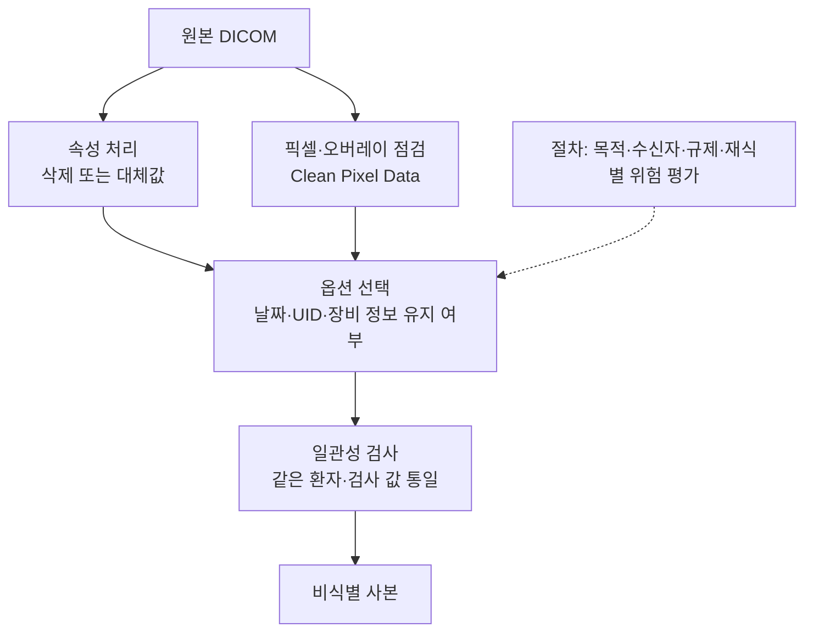
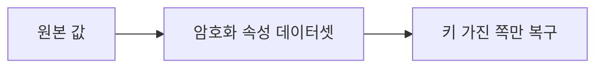

# DICOM 비식별화

> 의료 영상 파일(DICOM)에 들어 있는 환자 이름·ID·생년월일·검사 날짜 같은 속성을 지우거나 가짜 값으로 바꿔 연구용으로 공유 가능한 형태로 만드는 작업. 표준 문서 PS3.15 부록 E가 "무엇을 지우고 무엇을 남길지" 규칙(프로파일과 옵션)을 정해 둔다. 단, 표준은 이 규칙만으로 비식별화가 끝나지 않는다고 명시한다.

## 쉽게 말하면
의료 영상 파일은 사진 한 장이 아니라 "사진 + 수백 개의 꼬리표"다. 꼬리표에는 환자 이름, 병원, 촬영 날짜, 장비 일련번호가 있다. 이 꼬리표를 지워도 사진 속에 글자로 박힌 이름(화면 위에 찍힌 환자 정보)이나 머리 CT에서 얼굴 윤곽이 남을 수 있다. 비식별화는 꼬리표 정리와 사진 자체의 점검을 둘 다 하는 일이다.

## 자세히
출처: DICOM PS3.15(보안·시스템 관리 프로파일) 부록 E "Attribute Confidentiality Profiles" 본문 앞부분(공식 사이트에서 내려받아 직접 읽음, 2026-11-17 열람), 옵션 목록은 검색 결과로 확인한 PS3.15 2026d 목차. 개별 속성 표(Table E.1-1)와 옵션 세부 문구는 이번에 읽지 않았다.
- **표준의 경고**: 이 프로파일을 써도 모든 식별 정보가 제거된다고 보장되지 않는다. 속성 비식별화가 정보 객체 전체의 비식별화를 뜻하지 않는다. 프로파일은 비식별화 **절차**를 대체하지 않고 그 일부가 되어야 한다. 절차에는 최소한 목적·수신자·공유 방식 결정, 해당 규제 해석, 재식별 위험 평가가 들어간다.
- **목적**: 이미 있는 데이터에서 교육·연구·임상시험·등록용 **특수 목적 비식별 사본**을 만드는 프로파일이다. 원본을 대체하거나 영상 보관소의 기본 표현이 되려는 것이 아니다. 필요하면 권한 있는 사람이 신원을 복구할 수단을 둘 수 있다.
- **처리 방식**: 보호할 각 속성은 **삭제**하거나 식별을 허용하지 않는 **대체값**(더미 값)으로 바꾼다. Type 1 속성은 길이 0으로 보낼 수 없어 더미 값이 필요할 수 있다. 같은 환자·검사·시리즈에 속한 여러 인스턴스에서 대체값이 **일관**되어야 한다(예: Study Instance UID, Frame of Reference UID, 환자 ID).
- **암호화 속성 데이터셋(Encrypted Attributes)**: 원본 값을 RSA로 키 전달, AES 등으로 암호화해 (0400,0500) 시퀀스에 넣어 두면 키를 가진 쪽이 복구할 수 있다. 필수가 아니며, 오래 보관할 데이터는 현재 암호가 충분하지 않을 수 있다. 암호화되지 않은 해시는 사전 공격에 취약해 피하라고 한다.
- **화소(픽셀)에 박힌 정보**: 영상 픽셀에 찍힌 식별 정보는 제거해야 하고, 그 위치를 찾아 지우는 방법은 표준 범위 밖이다. 그래서 **Clean Pixel Data** 옵션이 따로 있다. 비픽셀 그래픽·오버레이의 식별 정보는 삭제하거나 Clean Graphics 옵션이 지원되면 정리.
- **옵션(PS3.15 2026d 목록, 검색으로 확인)**: 제거를 요구하는 쪽 — Clean Pixel Data, Clean Recognizable Visual Features, Clean Graphics, Clean Structured Content, Clean Descriptors. 유지하는 쪽 — Retain Longitudinal Temporal Information(전체 날짜 / 수정된 날짜 중 택일), Retain Patient Characteristics, Retain Device Identity, Retain Institution Identity, Retain UIDs, Retain Safe Private. 수정된 날짜 옵션은 영상 간 대략의 시간 관계를 남기되 날짜 대조로 재식별될 가능성을 줄이려는 것이다.
- **TCIA의 사례**: 기관이 현장에서 1차 처리하고 TCIA가 같은 프로파일 기준으로 2차 검토한다([TCIA](#tcia)).
- **얼굴 복원 위험(일반 지식, 이번에 출처 확인 안 함)**: 머리 CT·MRI는 3D 재구성으로 얼굴이 보일 수 있어 별도 처리(얼굴 가리기)가 논의된다.

## 그림으로 보기

## 예시
- 연구용 CT를 외부 대학에 보낼 때: 이름·ID는 가명으로 일관 치환, 촬영 날짜는 수정된 날짜 옵션, 장비 일련번호는 제거, 영상 모서리의 글자는 Clean Pixel Data로 점검.
- 초음파 화면 캡처 DICOM처럼 모서리에 환자 정보가 박힌 파일은 속성 삭제만으로는 부족하다.

## 헷갈리는 것과 비교
| 개념 | 차이 |
|---|---|
| 가명처리(대체값) | 같은 사람의 데이터를 이어 볼 수 있게 값을 바꿈 |
| 삭제 | 속성 자체를 지움 |
| 비식별화 절차 | 목적·위험 평가를 포함한 전체 과정. 프로파일은 일부 |
| [TCIA](#tcia) | 이 규칙으로 2차 검토하는 공개 아카이브 |
| [데이터 사용 계약](#data-use-agreement) | 기술적 비식별화 후 남는 위험을 계약으로 관리 |

## 더 읽을거리
- [DICOM PS3.15 Annex E: Attribute Confidentiality Profiles](https://dicom.nema.org/medical/dicom/current/output/chtml/part15/chapter_E.html) — 이 글의 출처(앞부분 직접 읽음)
- [DICOM PS3.15 현행판 전체](https://dicom.nema.org/medical/dicom/current/output/html/part15.html) — 옵션 세부 문구(이번에 열지 않음)
