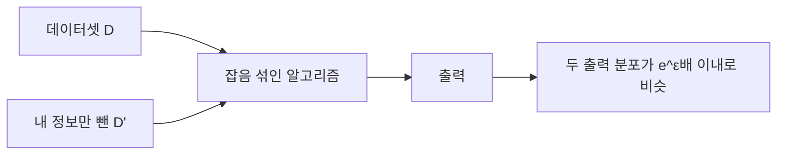
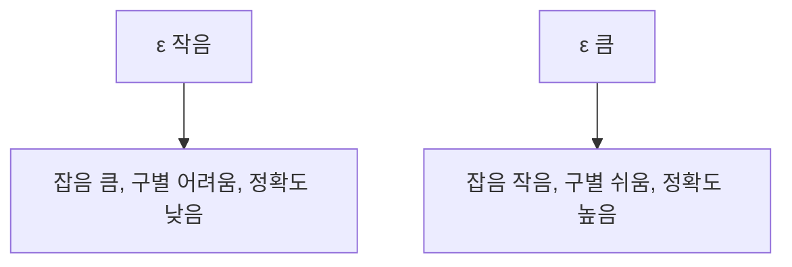

# 차분 프라이버시 학습

> **차분 프라이버시(DP)**는 "데이터에 내 정보가 들어 있든 없든 결과가 거의 똑같다"를 수학으로 보장하는 틀이다. 이를 모델 학습에 적용한 것이 차분 프라이버시 학습이며, 암기·추출 공격을 줄이는 방어 수단으로 쓰인다.

## 쉽게 말하면
투표 결과를 발표할 때 모든 표에 조금씩 "눈속임 숫자"를 섞어 두면, 내 표가 있든 없든 발표 숫자가 거의 같아 내가 어떻게 투표했는지 알아내기 어렵다. 눈속임이 클수록 안전하지만 결과가 덜 정확하다. 이 눈속임의 크기를 ε(엡실론)로 조절한다.

## 자세히
- **정의**(Wikipedia 확인): 한 사람의 데이터만 다른 두 데이터셋에 대해, 알고리즘 출력이 어떤 결과 집합에 들어갈 확률이 한쪽이 다른 쪽의 **e^ε배 이하**여야 ε-차분 프라이버시다. δ를 더한 일반형(ε, δ)도 있다. ε이 작을수록 두 경우의 출력을 구별하기 어렵다.
- **라플라스 메커니즘**: 결과에 라플라스 잡음(규모 λ = 민감도/ε)을 더한다. 개수 세기(한 사람이 바꾸는 최대량 1)는 λ = 1/ε. ε이 작으면 잡음이 크고 정확도가 낮다.
- **직접 실행**(장난감: 특성이 있는 사람 수 100명 vs 한 명 빠진 99명, 개수에 라플라스 잡음, 공격자는 출력으로 "100명 쪽인지" 추측, 20만 번 시뮬레이션):

| ε | 잡음 표준편차 | 공격자 정확도 | 이론 상한 e^ε/(1+e^ε) |
|---|---|---|---|
| 0.1 | 14.1 | 0.524 | 0.525 |
| 1.0 | 1.4 | 0.696 | 0.731 |
| 5.0 | 0.3 | 0.959 | 0.993 |

  ε이 작으면 공격자는 거의 동전 던지기(0.52)와 같고, ε이 커질수록 구별이 쉬워진다. 측정값이 이론 상한을 넘지 않았다.
- **학습에 적용**: 데이터 한 건의 기여를 잘라 내고 잡음을 더해 모델을 학습한다([DP-SGD](#dp-sgd)). 같은 데이터를 여러 번 쓰면 비용이 누적된다(순차 합성: t번이면 약 tε, Wikipedia 확인).
- **주의**: ε에 정답은 없다. 문서도 적정 ε 숫자를 권하지 않고, 잘못 고르면 안전하다는 착각을 줄 수 있다고 경고한다. 부동소수점 구현 결함으로 정보가 새는 사례도 언급된다. 모델 품질과의 교환은 DP-SGD 노드의 표 참고. 이 데모는 단순 개수 질의이며 언어 모델 학습의 실제 효과는 확인하지 않았다.

## 그림으로 보기

## 예시
- 통계청이 지역별 인구 통계를 공개할 때 라플라스 잡음으로 개인 식별을 어렵게 함.
- 교육: 위 시뮬레이션을 돌려 ε에 따라 공격자 정확도가 0.52에서 0.96으로 변하는 모습을 그린다.

## 헷갈리는 것과 비교
| 개념 | 차이 |
|---|---|
| 차분 프라이버시 | 수학적 보장 틀 |
| [DP-SGD](#dp-sgd) | 그 틀을 신경망 학습에 적용하는 알고리즘 |
| 익명화 | 식별자 제거. 보장 없음 |
| [PII 치환](#pii-formatter) | 정규식으로 일부 개인정보만 가림 |

## 더 읽을거리
- [Differential privacy — Wikipedia](https://en.wikipedia.org/wiki/Differential_privacy) — 정의, 라플라스 메커니즘, ε 주의점(열어 확인).
- [Deep Learning with Differential Privacy](https://arxiv.org/abs/1607.00133) — 딥러닝에 DP를 적용한 논문(초록 확인).
