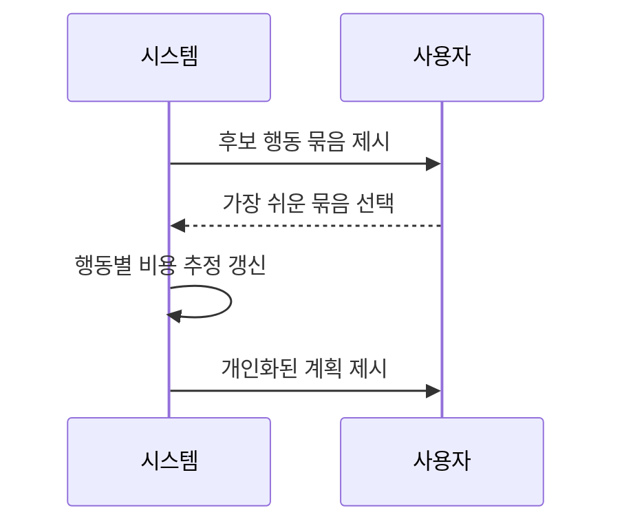

# 도메인 전문가 난이도 가중치

> recourse 비용을 계산할 때 "모든 특징을 같은 난이도로 본다"는 기본 가정을 깨고, **특징별로 바꾸기 어려운 정도(상대 난이도)를 도메인 전문가가 정해 가중치로 넣는 방법**이다. 더 나아가 사용자 본인의 선호를 물어 개인별로 정하는 연구도 있다.

## 쉽게 말하면
"운동량 30분 늘리기"와 "이직하기"를 똑같이 1점 어려운 일로 계산하면 이상하다. 현실을 아는 사람이 "이직은 운동의 10배 어렵다"고 가중치를 붙이면 안내가 현실에 가까워진다. 그래도 사람마다 어려움은 다르니, 본인에게 직접 묻는 방법도 있다.

## 자세히
(Ustun·Spangher·Liu, 「Actionable Recourse in Linear Classification」(arXiv 1809.06514) 3.2절 PDF 직접 확인 + De Toni 외 PEAR 논문(arXiv 2205.13743) 초록 확인.)
- **기본값(논문)**: 백분위 기반 비용 함수는 **1 백분위 이동 = 모든 특징에서 같은 비용**으로 본다. 논문은 이 가정이 "각 특징을 바꾸는 난이도가 같다"는 뜻임을 밝히고, **도메인 전문가가 기준 특징 대비 상대 난이도를 지정하면 완화할 수 있다**고 말한다.
- **구현 방식(제안)**: 특징 j의 비용에 가중치 λ_j를 곱한다. 예: λ(소득 +) = 1, λ(학력 +) = 5, λ(대출 개수 −) = 2. 기준 특징을 하나 정해 상대값으로 적는다. 가중치 표와 근거를 문서화한다.
- **개인화 연구(요약)**: 같은 비용을 모두에게 쓰면 어떤 사람에게는 지나치게 비싼 계획이 나온다. **PEAR**(De Toni 외, TMLR 2024-01)는 사용자에게 후보 행동 묶음 중 고르게 하여(preference elicitation) 그 사람의 행동별 비용을 베이즈 방식으로 추정하고, 강화학습+MCTS로 개인화된 계획을 찾는다. 몇 번의 질의만으로 좋은 계획을 찾는다고 저자들이 보고한다(초록 기준, 수치 미확인).
- **관련 연구(검색 결과 요약, 직접 열어 보지 못함)**: 쌍 비교로 Mahalanobis 비용 행렬을 학습하는 방법(2024), Bradley-Terry로 보편 비용을 추정한 뒤 개인화하는 방법(2020).
- **위험(제안)**: 전문가 가중치는 주관이 들어간다. 전문가 집단과 영향받는 사람의 의견이 다르면 어느 쪽 비용을 쓸지 정하는 절차가 필요하고, 특정 집단에 불리한 가중치가 숨어들 수 있다. → [행동 집합의 이해관계자 합의](#action-set-stakeholder-agreement)

## 그림으로 보기

## 예시
- 채용 모델 감사: HR 전문가가 "자격증 취득=3, 경력 +1년=10, 포트폴리오 보완=1"처럼 상대 난이도를 매겨 비용 함수에 반영.
- 교육 활동: 수강생이 가상 대출 모델의 특징 5개를 어려운 순으로 줄 세우고 팀 간 차이를 토론.

## 헷갈리는 것과 비교
| 개념 | 차이 |
|---|---|
| 전문가 난이도 가중치 | 전문가가 정한 일괄 가중치 |
| 개인화 비용(PEAR 등) | 사용자 본인에게 물어 추정 |
| [백분위 이동 비용](#percentile-shift-cost) | 가중치 이전의 기본 비용 |
| [recourse 비용 함수의 성질](#cost-function-properties) | 비용이 지켜야 할 단조성 등 |

## 더 읽을거리
- [Actionable Recourse in Linear Classification (arXiv 1809.06514)](https://arxiv.org/abs/1809.06514) — 난이도 가정과 전문가 지정 완화 언급(PDF 확인).
- [Personalized Algorithmic Recourse with Preference Elicitation (arXiv 2205.13743)](https://arxiv.org/abs/2205.13743) — PEAR, 사용자 선호 질의로 개인 비용 추정(초록 확인).
