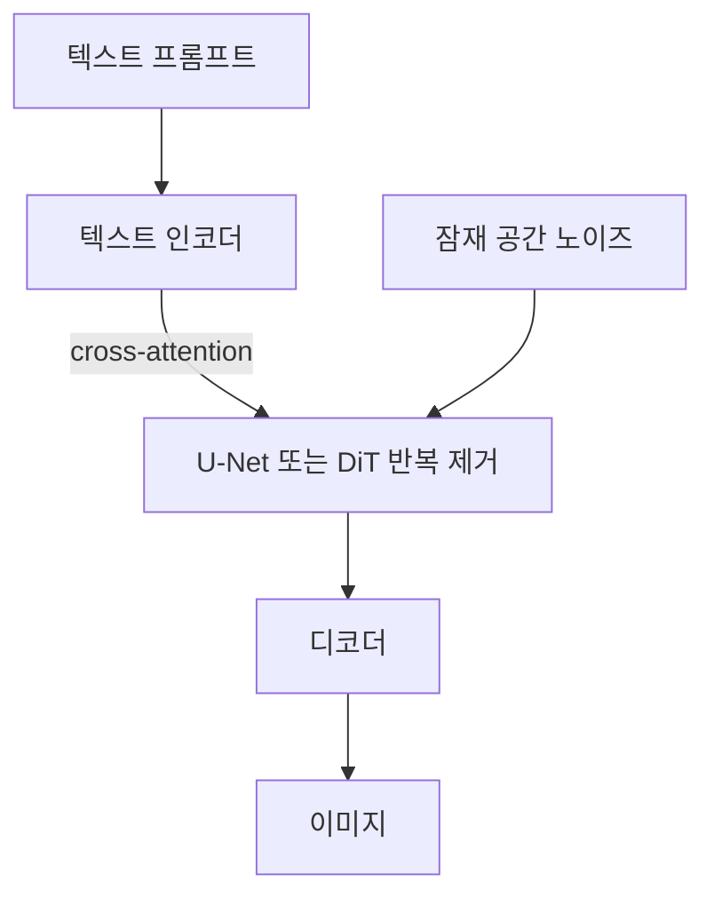

# 확산 모델

> 확산 모델(Diffusion Model)은 데이터에 노이즈를 조금씩 더하는 과정을 거꾸로 되돌리도록 신경망을 학습시켜, 순수 노이즈에서 이미지 같은 데이터를 만들어 내는 생성 모델이다.

## 쉽게 말하면
잉크 한 방울을 물에 떨어뜨리면 서서히 퍼져 맑은 물과 구분이 안 된다. 이 과정을 영상으로 찍어 거꾸로 돌리면 퍼진 잉크가 한 점으로 모인다. 확산 모델은 "퍼지는 과정"은 정해진 규칙으로 만들고, "거꾸로 모으는 법"만 신경망이 배운다. 생성할 때는 완전한 노이즈에서 시작해 한 단계씩 노이즈를 걷어내며 그림을 얻는다.

## 자세히
- **정방향(노이즈 추가)**: 원본 x₀에 T단계에 걸쳐 가우시안 노이즈를 더한다. 단계별 분산 β₁…β_T(스케줄)로 조절하며, T가 커지면 순수 노이즈가 된다. 수식 덕에 임의의 t단계 상태를 한 번에 계산할 수 있다.
- **역방향(노이즈 제거)**: 신경망(보통 U-Net)이 "지금 섞여 있는 노이즈 ε"를 예측하도록 학습한다. DDPM(Ho 외, 2020)의 단순화된 손실은 실제 노이즈와 예측 노이즈의 제곱오차다. 스케줄은 선형(1e-4~0.02)에서 코사인(2021)으로 개선됐다.
- **느림 문제**: 수백~천 단계를 거쳐야 해 GAN보다 샘플링이 느리다. DDIM(2020)의 결정적·건너뛰기 샘플링, 점진적 증류, 일관성 모델(2023, 1단계 생성 가능)이 속도를 개선했다.
- **잠재 확산(LDM, 2022)**: 픽셀 대신 오토인코더가 압축한 잠재 공간에서 확산해 비용을 크게 줄인다. 텍스트 같은 조건은 cross-attention으로 넣는다. 이 구조가 Stable Diffusion 계열의 토대다.
- **Classifier-free guidance(2021)**: 조건을 가끔 비우고 학습해 조건부·무조건 예측을 모두 갖추고, 생성 시 둘을 섞어 프롬프트 충실도를 조절한다(w가 클수록 프롬프트에 강하게 맞춤).
- 이후 U-Net 대신 Transformer를 쓰는 DiT(2023), 구조 조건을 추가하는 ControlNet(2023)이 나왔다.

## 그림으로 보기

## 예시
- 이미지 생성 서비스에 "비 오는 서울 골목, 필름 사진 느낌"을 입력하면 내부에서 노이즈를 수십 단계로 걷어내며 그림을 만든다. 단계 수·guidance 값을 바꾸면 속도와 프롬프트 충실도가 달라진다.
- 직접 학습해 보려면 Hugging Face Diffusers 강의에서 나비 이미지를 생성하는 작은 모델을 만들어 볼 수 있다.

## 헷갈리는 것과 비교
| 개념 | 차이 |
| --- | --- |
| [GAN](#gan) | 생성자·판별자가 경쟁, 샘플링은 빠르지만 학습이 불안정 |
| [VAE](#vae) | 압축·복원 구조. LDM에서는 확산 앞뒤의 압축기로 함께 쓰임 |
| [트랜스포머](#transformer-architecture) | 구조 이름. 확산의 노이즈 제거기로 쓰이면 DiT |
| [이미지 프롬프트 쓰기](#image-prompting) | 확산 모델에 넣는 입력을 잘 쓰는 법 |

## 더 읽을거리
- [Lilian Weng: What are Diffusion Models?](https://lilianweng.github.io/posts/2021-07-11-diffusion-models/) — 수식과 계보(2015~2023) 정리
- [Hugging Face Diffusion Course](https://huggingface.co/learn/diffusion-course/unit1/2) — 코드로 첫 확산 모델 만들기(목차만 확인)
