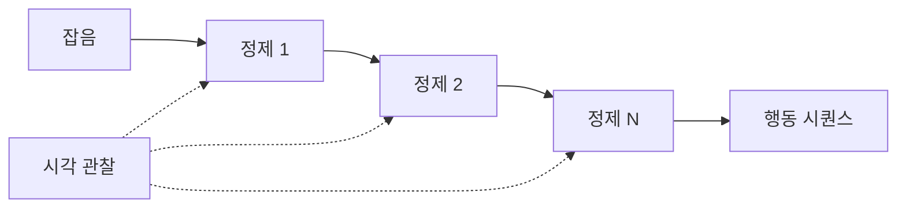
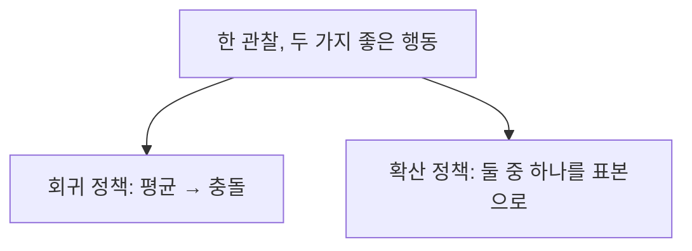

# Diffusion Policy

> 로봇 행동을 **조건부 노이즈 제거(denoising) 확산 과정**으로 생성하는 정책. 잡음에서 시작해 여러 번 다듬으며 행동을 만들고, 한 관찰에 여러 가능한 행동이 있는 경우(다봉 분포)에 강하다. (Chi 외, arXiv 2303.04137, 초록 읽음)

## 쉽게 말하면
조각가가 대리석 덩어리(잡음)에서 시작해 여러 번 깎아 형태(행동)를 만드는 방식이다. 왼쪽으로 돌아도 오른쪽으로 돌아도 장애물을 피할 수 있는 상황에서, 둘 다 가능한 답을 함께 표현할 수 있다.

## 자세히
- 정의: 시각-운동 정책을 "조건부 노이즈 제거 확산 과정"으로 모델링해 **반복적 정제**로 행동을 생성.
- 결과(저자 보고): 4개 로봇 조작 벤치마크의 12개 과제에서 기존 최고 방법보다 **평균 46.9% 더 낫다**고 보고.
- 저자들이 내세우는 강점: **다봉 행동 분포** 처리, **고차원 행동 공간**, **안정적 학습**.
- 핵심 기법: **후퇴 시야 제어(receding horizon control)**, **시각 조건화**, **시계열 확산 트랜스포머**. 코드·데이터·학습 세부는 공개.
- 연결: [UMI 그리퍼](#umi-gripper)는 diffusion policy를 학습 정책으로 쓴다(UMI 프로젝트 페이지). 행동을 구간 단위로 내는 점은 [행동 묶음 예측](#action-chunking)과 비슷한 정신이다(내 해석, 논문이 직접 비교한 것은 아님).
- 한계: "평균 46.9%"가 무엇에 대한 상대 개선인지(성공률의 상대 증가인지)는 초록만으로 확인할 수 없다. 추론 때 반복 정제로 계산이 늘 수 있다(일반 설명).

## 그림으로 보기

## 예시
- 장애물 좌우 모두 가능한 상황에서 한쪽으로 일관되게 피하는 궤적을 생성.
- 교육: 평균을 내면 부적절해지는 답(왼쪽과 오른쪽의 평균 = 정면 충돌)을 그림으로 설명.

## 헷갈리는 것과 비교
| 개념 | 차이 |
|---|---|
| Diffusion Policy | 반복 정제로 행동 생성 |
| [행동 복제](#behavior-cloning) | 한 번에 회귀·분류 |
| [ACT](#aloha-act) | CVAE+트랜스포머로 묶음 예측 |

## 더 읽을거리
- [Diffusion Policy 논문](https://arxiv.org/abs/2303.04137) — 개요와 결과(초록 읽음).
- [UMI 프로젝트 페이지](https://umi-gripper.github.io/) — 사용 사례(읽음).
