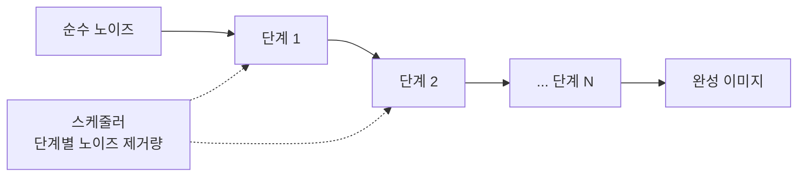
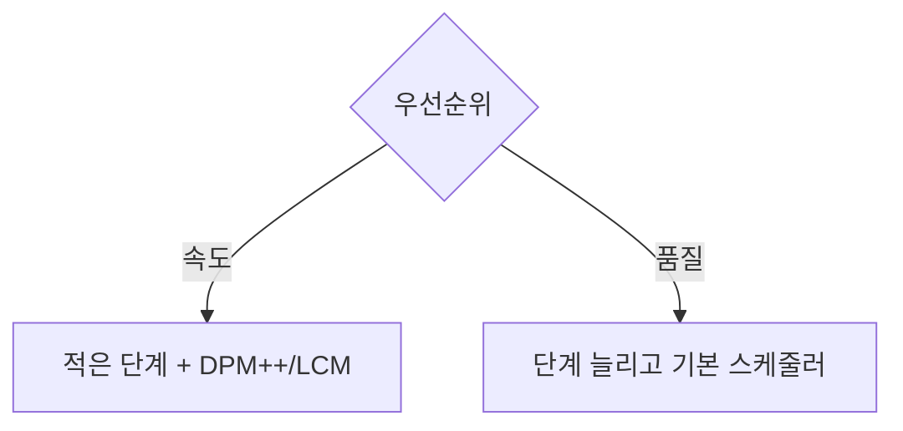

# 확산 스케줄러 (Diffusion Scheduler)

> 스케줄러는 확산 모델의 노이즈 제거 루프에서 "각 단계에서 노이즈를 얼마나 걷어낼지"를 정하는 규칙으로, 속도와 품질의 균형을 좌우한다.

## 쉽게 말하면
눈 쌓인 그림에서 눈을 치워 그림을 드러내는 작업이다. 한 번에 몇 번에 나눠 치울지, 처음엔 많이 나중엔 조금씩 치울지가 스케줄러가 정하는 요령이다.

## 자세히
Hugging Face diffusers 문서(Schedulers, v0.42) 기준:
- 스케줄러는 **가중치가 없는 설정 전용 객체**다. 체크포인트 기본값에서 시작하고 속도·품질을 바꾸고 싶을 때만 교체한다.
- 교체: `pipeline.scheduler = DPMSolverMultistepScheduler.from_config(pipeline.scheduler.config)`.
- 선택 가이드(문서): DPM++ 2M SDE Karras는 범용으로 강력, TCD는 증류 모델, FlowMatchEuler는 Qwen-Image·Flux 같은 FlowMatch 모델의 기본(유지 권장), Euler 계열은 애니 스타일에 좋음, LCM은 few-step 생성.
- **타임스텝 스케줄**: 노이즈를 단계에 어떻게 분배할지(선형 vs 중요한 곳에 촘촘). Align Your Steps(AYS)는 SDXL에서 10단계로 고품질 이미지를 만들 수 있다고 소개. **간격(spacing)**: `leading`·`linspace`·`trailing` — trailing이 적은 단계에서 디테일이 좋은 편. **Karras sigmas**: 구조가 정해지는 중간 구간에 sigma를 촘촘히 배치(`use_karras_sigmas=True`, Karras로 학습된 모델에만).
- 기본 `num_inference_steps`는 Stable Diffusion에서 50(HF 블로그), 적을수록 빠르지만 디테일이 깨질 수 있다. 

## 그림으로 보기



## 예시
```python
from diffusers import DiffusionPipeline, DPMSolverMultistepScheduler
pipe = DiffusionPipeline.from_pretrained("stabilityai/stable-diffusion-xl-base-1.0")
pipe.scheduler = DPMSolverMultistepScheduler.from_config(pipe.scheduler.config, use_karras_sigmas=True)
image = pipe(prompt="a cat on a pumpkin", num_inference_steps=20).images[0]
```

## 헷갈리는 것과 비교
| 개념 | 차이 |
|---|---|
| 스케줄러 | 노이즈 제거 순서·양을 정함(가중치 없음) |
| [U-Net](#unet-denoiser) | 노이즈를 예측하는 신경망 |
| 가이던스 스케일 | 프롬프트를 얼마나 따를지 |
| 샘플러 | 흔히 스케줄러와 같은 뜻으로 쓰는 용어 |

## 더 읽을거리
- [diffusers Schedulers](https://huggingface.co/docs/diffusers/using-diffusers/schedulers) — 스케줄러 선택, 간격, Karras sigmas.
- [Stable Diffusion with Diffusers](https://huggingface.co/blog/stable_diffusion) — 파이프라인에서 스케줄러의 역할.
