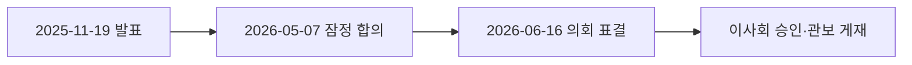
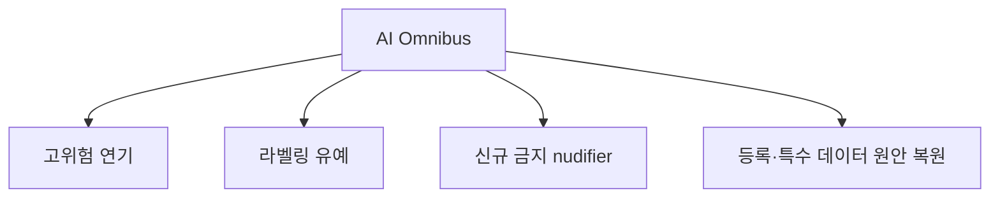

# 디지털 옴니버스

> EU가 2025-11-19에 내놓은 규제 간소화 패키지 중 AI Act를 손보는 "AI Omnibus". 고위험 AI 의무의 적용 시점을 늦추고 일부 부담을 덜어 주며, 새 금지 조항도 추가하는 방향으로 2026-05-07에 이사회·의회가 잠정 합의했다.

## 쉽게 말하면
법을 시행하기 직전에 "교재(표준)가 안 나왔고 비용 부담이 크다"는 민원이 많아, 시행일을 조정하고 일부 조항을 다듬는 개정이다. 단, 합의 내용 전부가 기업에 유리한 것은 아니고 일부는 원안보다 엄격해졌다.

## 자세히
출처: CMS 법률 글(열람), Sidley 글(열람, 앞 노드), artificialintelligenceact.eu 113조(열람). 최종 채택·관보 게재 여부는 이번 자료로 확인하지 못했다. 법률 자문이 아니다.
- **배경**: 집행위가 2025-11-19에 발표. 표준 공개 지연과 준수 비용에 대한 우려(Sidley).
- **잠정 합의(2026-05-07, CMS 기준) 주요 변경**
  - 독립형 고위험 AI 의무: 2026-08-02 → 2027-12-02
  - 규제 제품 내장 고위험 AI: 2027-08-02 → 2028-08-02
  - 생성형 AI 투명성 라벨링: 2026-08-02까지 이미 시장에 있던 시스템은 2026-12-02까지 유예(집행위 원안은 2027-02-02였음)
  - 신규 금지: 동의 없는 성적·친밀 콘텐츠나 아동 성착취물을 생성하는 AI("nudifier" 앱), 2026-12-02부터
  - 등록: 예외를 주장하는 독립형 고위험 시스템 제공자도 EU 고위험 AI 데이터베이스에 등록해야 한다(원안은 이 의무를 없애려 했으나 복원)
  - 특수 범주 데이터: 편향 탐지·시정을 위한 처리의 "엄격히 필요" 기준이 복원(원안의 완화안은 삭제)
  - 부문 법과의 중복: 집행위가 2027-08-01까지 중복 회피·부담 완화 지침을 낸다
- **절차(Sidley)**: 2026-06-16 의회 표결 후 이사회 승인과 관보 게재(게재 3일 뒤 발효)가 남았고 2026-08-02 전 완료가 목표였다고 쓴다. 이후 진행은 확인하지 못했다.
- **SME·SMC**: 앞의 [소형 중견기업](#small-mid-cap) 노드의 99조 6a항 설명과 연결되나, CMS 글은 이 부분을 다루지 않았다.
- **한계**: 위 날짜는 법률 사무소 해설 기준이다. 시행 중인 조문 문구와 날짜는 관보의 최종 텍스트로 확인해야 한다. 집행위의 옴니버스 정책 페이지는 열었으나 찾을 수 없었다(404).

## 그림으로 보기

## 예시
- 생성형 AI 서비스를 2026-08-02 이전에 출시한 회사는 합의대로면 식별 표시 준비 기한이 2026-12-02로 늘어난다(합의 확정 시).
- 교육 실습: 원안과 합의 결과의 차이(등록, 특수 데이터, 라벨링 유예)를 표로 정리.

## 헷갈리는 것과 비교
| 개념 | 차이 |
|---|---|
| 디지털 옴니버스 | 규제 간소화 패키지 전체 |
| AI Omnibus | 그중 AI Act 개정 부분 |
| [부속서 III 적용 연기](#annex-iii-delay) | 연기의 핵심 내용 |
| [50조 투명성 의무](#article-50-transparency) | 라벨링 유예의 대상 |

## 더 읽을거리
- [CMS: The EU's Digital Omnibus on AI](https://www.cms.law/en/gbr/publication/The-EU-s-Digital-Omnibus-on-AI-What-the-Provisional-Agreement-Really-Changes) — 합의 내용(열람)
- [Sidley: Provisional agreement to delay key AI Act obligations](https://datamatters.sidley.com/2026/06/22/eu-lawmakers-reach-provisional-agreement-to-delay-key-eu-ai-act-obligations/) — 일정·절차(열람)
