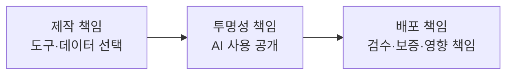
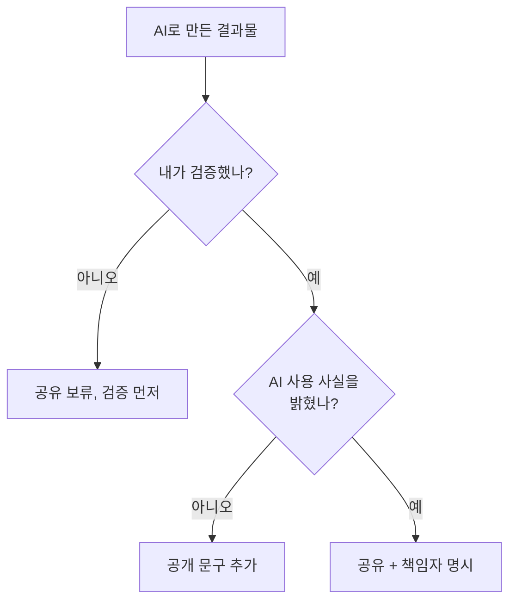

# 책임(Diligence) 역량

> AI 협업 4D 중 네 번째. AI를 어떻게 쓰고 그 결과를 무엇으로 내보내는지에 대한 책임을 지는 능력. 도구·데이터 선택, AI 사용 사실의 공개, 결과물 검수와 책임 인수로 나뉜다.

## 쉽게 말하면
조수가 쓴 보고서에 내 이름으로 서명해 내보낸다면, 어떤 조수를 쓸지(믿을 만한가), 조수가 도왔다는 사실을 밝힐지, 서명 전에 내용을 검수했는지에 대해 내가 책임진다. "AI가 그렇게 썼어요"는 변명이 되지 않는다.

## 자세히
Anthropic의 AI Fluency 프레임워크(Dakan·Feller와 공동, CC BY-NC-SA 4.0)의 네 번째 D로, 윤리·안전 차원을 다룬다. 해설 글(The Neuron)은 이 단계가 프레임워크를 "생산성 요령"에서 "책임 있는 혁신의 모델"로 끌어올린다고 설명한다. 세 갈래:

1. **제작 단계의 책임(Creation Diligence)**: 쓰는 **도구와 넣는 데이터**를 신중히 고른다. AI 시스템의 개인정보 보호·보안·윤리 이력을 따진다. → [데이터 마스킹](#data-masking), [모델 호스팅 선택지](#model-hosting-options)와 연결.
2. **투명성의 책임(Transparency Diligence)**: 작업에서 AI가 한 역할을 **밝힌다**. 개인·학술·업무 어디서든 관련 이해관계자에게 AI 도움을 공개한다.
3. **배포 단계의 책임(Deployment Diligence)**: AI의 도움을 받은 결과물을 공유할 때 **내가 책임진다**. 정확성을 확인하고, 품질을 보증하고, 영향에 대한 전적인 책임을 받아들인다. → [인용·링크 검증](#citation-verification).

**구체적 실천(해설 글 기준)**
- 데이터를 넣기 전에 도구의 프라이버시·보안·윤리 점검
- AI 도움 사실 공개
- 공유 전 결과 검증
- 내 기여와 AI 기여를 구분한 기록 남기기(앞으로 더 중요해질 수 있음)
- 프로젝트별 "Diligence Statement"(AI의 역할과 최종 결과에 대한 내 책임을 적은 공식 문구) 작성(과정에서 쓰는 방식)

**주의**: 위 세 갈래 이름과 설명은 해설 글(2차 자료)에서 확인한 것이다. 이 세션에서 원 PDF의 정의는 열어 보지 못했으므로 공식 문구는 Anthropic AI Fluency 자료에서 확인해야 한다. 한 대학 페이지는 다른 한 줄 정의를 쓰기도 해 표현은 자료마다 다를 수 있다.

**기업 교육에서**: 사내 AI 사용 정책의 뼈대로 쓰기 좋다 — 허용 도구 목록(제작), AI 사용 표기 규칙(투명성), 결과물 검수 책임자(배포).

## 그림으로 보기

## 예시
- 영업 제안서 초안을 AI로 쓸 때: 고객 이름·가격을 마스킹한 데이터만 입력(제작) → 문서 하단에 "초안 작성에 AI 보조"(투명성) → 수치와 인용을 원문과 대조하고 담당자가 서명(배포).
- Diligence Statement 예: "이 보고서의 초안 작성과 표 정리에 AI를 사용했고, 모든 수치는 원자료와 대조했으며 최종 내용은 본인이 책임진다."

## 헷갈리는 것과 비교
| 개념 | 차이 |
|---|---|
| 책임(Diligence) | 도구 선택·공개·배포 책임 |
| 평가(Discernment) | 결과물이 쓸 만한지 판단(품질 쪽) |
| 위임(Delegation) | 무엇을 AI에 맡길지 결정 |
| [AI Fluency 4D](#ai-fluency-4d) | 위 네 역량 전체 프레임워크 |

## 더 읽을거리
- [Inside Anthropic's AI Fluency Masterclass (The Neuron)](https://www.theneuron.ai/explainer-articles/inside-anthropics-ai-fluency-masterclass-on-human-ai-collaboration) — 세 갈래와 실천 항목
