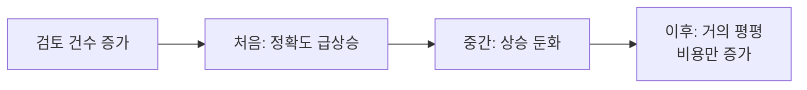
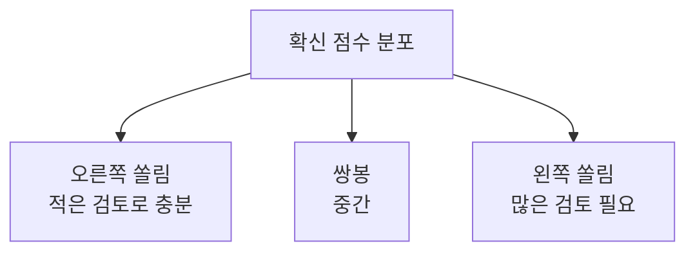

# 검토의 수확 체감

> 사람이 AI 판정을 검토하는 건수를 늘릴수록 정확도는 오르지만, 어느 지점부터는 검토를 더 해도 오르는 폭이 급격히 작아진다. 이 구간을 알아야 검토 인력을 어디까지 투입할지 정할 수 있다.

## 쉽게 말하면
시험지 채점을 검수할 때, 점수가 애매한 답안부터 다시 보면 오류가 많이 잡힌다. 하지만 확실히 맞거나 틀린 답안까지 다시 보기 시작하면 시간만 들고 고쳐지는 건 거의 없다. 처음 20%의 노력이 이득의 대부분을 가져간다는 감각이다.

## 자세히
- **시뮬레이션 연구(Muric·Minton, arXiv 2601.05974, 본문 열람)**: [이중 임계값 정책](#double-threshold-policy)에서 검토 예산을 늘리며 F1을 쟀다. 베타 혼합 분포에서 검토 예산이 결정의 20%일 때 달성 가능한 최대 F1이 약 0.93이고, "검토가 늘수록 F1은 오르되 수확이 체감한다"고 쓴다. 정밀도는 소량 검토로 급상승 뒤 포화하고, 재현율은 임계값 근처 경계 사례까지 검토가 넓어지며 완만히 오른다.
- **분포 모양의 영향**: 점수가 1 근처에 몰린 분포는 적은 검토로도 높은 성능, 0 근처에 몰린 분포는 비슷한 정확도에 훨씬 많은 검토가 필요, 쌍봉 혼합은 그 중간이었다.
- **가정의 한계**: 시뮬레이션은 N=10,000, 검토자는 완벽하고 건당 비용이 1이라고 가정한다. 실제 검토자는 틀리므로 곡선이 달라진다. 정확한 "꺾이는 지점" 비율은 논문이 제시하지 않는다(20%는 한 예).
- **검토 방식의 부작용(Selective prediction 임상 실험, arXiv 2508.07617, 열람)**: 임상의 259명·사례 45건 실험에서, AI가 불확실할 때 예측을 숨기면 틀린 AI가 일으킨 정확도 하락(66%→56%)이 64%로 회복됐다. 그러나 AI가 숨긴 사례에서 거짓 음성이 39%→46%로 늘어 놓친 진단이 약 18% 상대 증가했다. 즉 "AI가 기권한 건은 사람이 보면 된다"는 가정은 사람이 AI 없이 볼 때와 같게 행동한다는 전제인데 그렇지 않을 수 있다.
- **실무 해석**: 곡선이 평평해지는 구간에서는 검토를 늘리기보다 라벨 품질·보정·모델 개선에 투자하는 편이 효율적일 수 있다(해석). 기준 설정은 자기 데이터에서 시뮬레이션해 확인한다.

## 그림으로 보기

## 예시
- 사기 탐지: 의심 점수가 애매한 거래부터 하루 500건씩 검토하며 오탐·미탐 감소 폭을 기록하고, 감소가 미미한 지점을 검토 인력 상한 후보로 삼는다.
- 교육 활용: "검토를 100% 하면 안전하다"는 직관에 반례로 쓰고, 어디에 사람 시간을 써야 하는지 토론한다.

## 헷갈리는 것과 비교
| 개념 | 차이 |
| --- | --- |
| [이중 임계값 정책](#double-threshold-policy) | 3구간 라우팅 설계. 수확 체감은 그 설계의 효율 곡선 |
| [확신 분포 모양](#confidence-distribution-shape) | 곡선 모양을 좌우하는 요인 |
| 선택적 예측(selective prediction) | 모델이 기권. 기권 건을 사람이 어떻게 볼지는 별개 문제 |

## 더 읽을거리
- [A Framework for Optimizing Human-Machine Interaction in Classification Systems (arXiv 2601.05974)](https://arxiv.org/html/2601.05974v2) — 검토 예산 대비 F1 시뮬레이션
- [On the Limits of Selective AI Prediction (arXiv 2508.07617)](https://arxiv.org/html/2508.07617v1) — 임상의 259명 실험
