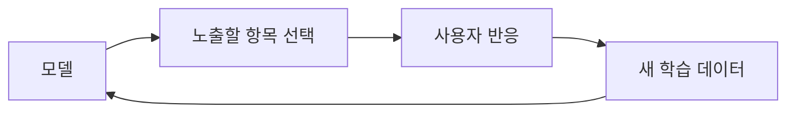
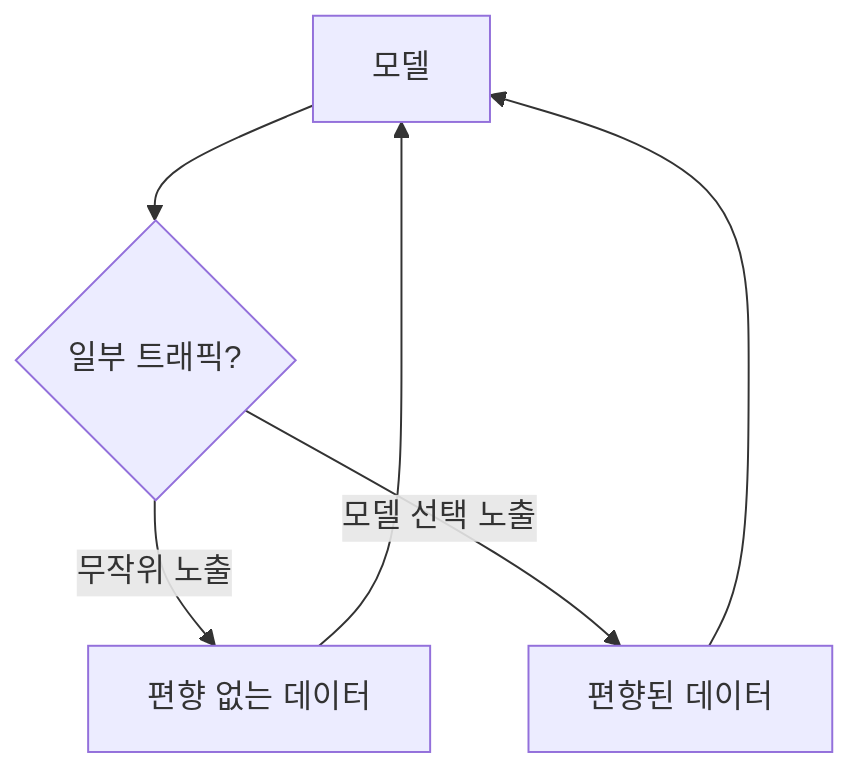

# 직접 피드백 고리

> 모델이 **자기 자신의 미래 학습 데이터를 고르는 데 직접 영향**을 주는 구조다. 모델이 보여 준 것만 사용자가 반응하고, 그 반응이 다시 학습 데이터가 되어 모델의 편향이 스스로 강화된다.

## 쉽게 말하면
식당 추천 앱이 "라멘집"만 보여 주면 사람들은 라멘집만 누른다. 앱은 "역시 라멘이 인기네" 하고 더 라멘만 보여 준다. 사실은 다른 가게를 보여 준 적이 없어서 비교가 불가능했을 뿐이다. 스스로 만든 데이터를 정답처럼 믿고 돌고 도는 것이다.

## 자세히
(Sculley 외, "Hidden Technical Debt in Machine Learning Systems", NIPS 2015 4절을 PDF에서 직접 읽었다.)
- **정의(논문)**: "A model may directly influence the selection of its own future training data." 실제 서비스의 모델은 시간이 지나 갱신되면 자기 행동에 영향을 주며, 이는 **분석 부채**(출시 전 모델 행동을 예측하기 어려운 부채)로 이어진다고 설명한다. 모델 갱신이 드물어 변화가 서서히 쌓일수록 발견·처리가 더 어렵다.
- **이론적 정답 vs 현실**: 이론적으로 맞는 해법은 밴딧(bandit) 알고리즘이지만, 컨텍스추얼 밴딧은 실제 서비스에서 필요한 큰 행동 공간에서 잘 확장되지 않는다. 그래서 흔히 표준 지도학습을 쓴다.
- **완화책(논문)**: ① **약간의 무작위화**(일부 노출을 모델과 무관하게 정함) ② 데이터 일부를 해당 모델의 영향에서 **격리**.
- **전형적 증상(일반 해설)**: 추천 다양성 감소, 인기 편향, 신규 항목 외면, 오프라인 지표는 좋은데 장기 지표는 정체. 이 증상 목록은 논문 문장이 아니라 일반적 해석이다.
- **발견하는 법(일반 원칙)**: 무작위 노출 트래픽의 결과와 모델 노출 결과를 비교, 모델 버전별 학습 데이터 분포 변화 추적, 홀드아웃(모델 영향 없는) 그룹 유지.
- 다른 시스템을 경유하는 간접 경로는 [숨은 피드백 고리](#hidden-feedback-loop)다.

## 그림으로 보기

## 예시
- 추천 시스템: 상위에 노출된 상품만 클릭 데이터가 쌓여 그 상품이 더 상위로 간다. 해결: 트래픽 일부를 [탐색용 무작위화](#exploration-randomization)로 돌린다.
- 교육 소재: "AI가 한 말을 사람이 믿고, 그 믿음이 다시 AI의 학습 재료가 되면?"을 토론 주제로.

## 헷갈리는 것과 비교
| 개념 | 차이 |
|---|---|
| 직접 피드백 고리 | 모델이 자기 데이터 선택에 직접 영향 |
| [숨은 피드백 고리](#hidden-feedback-loop) | 서로 다른 시스템이 세상을 통해 간접 영향 |
| [ML 분석 부채](#ml-analysis-debt) | 이런 고리 때문에 출시 전 행동 예측이 어려운 부채 |
| [탐색용 무작위화](#exploration-randomization) | 이 고리를 끊는 대표 완화책 |

## 더 읽을거리
- [Hidden Technical Debt in Machine Learning Systems (NIPS 2015)](https://proceedings.neurips.cc/paper/2015/file/86df7dcfd896fcaf2674f757a2463eba-Paper.pdf) — 4절 Feedback Loops 원문(직접 읽음).
