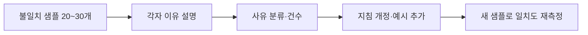
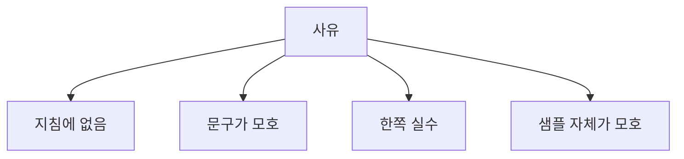

# 불일치 샘플 토론

> 불일치 샘플 토론은 일치도가 낮을 때 두 주석자가 서로 다르게 라벨한 샘플 20~30개를 모아 놓고, 왜 갈렸는지 사유를 분류해 라벨 가이드에 반영하는 회의다.

## 쉽게 말하면
두 채점자의 점수가 갈린 답안 몇 장을 책상에 펼쳐 놓고 "왜 다르게 줬나"를 이야기해 보면, 채점 기준이 모호했던 곳이 금방 드러난다. 사람 탓보다 기준 탓인 경우가 많다.

## 자세히
- **근거(Finlayson & Erjavec, arXiv 1602.05753)**: 주석 단계에는 지침 작성, 주석자 훈련, IAA 추적, 흔한 오류·불일치 점검과 수정, 주석자·판정자 회의 일정이 포함된다. 평가에서는 혼동 행렬과 오류 유형으로 데이터를 범주화하라고 한다. 모델은 맞는데 지침이 모자라면 주석 단계 안의 작은 순환에서 지침을 더 명확하게 고친다(MAMA 설명).
- **모호 예시를 지침에 넣는 효과(Pradhan 외, arXiv 2112.02255 초록)**: 작업자가 모호한 예시를 찾아 태그를 달고, 요청자가 라벨을 정해 지침에 예시로 넣은 뒤 다시 라벨링하면 정확도가 개선됐다고 보고한다(수치는 초록에 없음). 토론에서 나온 결론을 예시로 지침에 넣는 것과 같은 방식이다.
- **진행 방법(해석)**: ① 불일치 샘플에서 20~30개를 무작위로(또는 혼동 쌍마다 몇 개씩) 뽑는다([라벨러 간 혼동 행렬](#annotator-confusion-matrix)) ② 각 샘플마다 두 사람이 자신의 이유를 말하고 사유를 분류한다 — 지침에 없는 경우 / 지침 문구가 모호 / 한쪽의 실수 / 샘플 자체가 모호(판단 불가) ③ 사유별 건수를 센다 ④ 지침을 고치고 예시를 추가한다 ⑤ 새 샘플로 일치도를 다시 잰다([라벨러 훈련 라운드](#annotator-training-rounds)).
- **원칙(해석)**: 토론의 목적은 "누가 맞나"가 아니라 "기준을 어떻게 하나"다. 결론은 반드시 문서(지침 버전)에 남긴다([판정 사유 기록](#adjudication-rationale-log)). 모호한 샘플은 오류가 아니므로 [판단 불가 선택지](#cannot-decide-option)나 규칙으로 처리한다.

## 그림으로 보기

## 예시
- 불일치 25개를 보니 지침에 없음 9, 문구 모호 8, 실수 4, 샘플 모호 4(가정한 예)라면 지침 개정이 우선이고 교육은 그다음이다.
- 교육 활용: 학습자들이 라벨링한 문장 중 갈린 것을 모아 사유 분류 회의를 직접 해 본다.

## 헷갈리는 것과 비교
| 개념 | 차이 |
| --- | --- |
| 불일치 샘플 토론 | 원인을 찾아 지침을 고침 |
| 판정(adjudication) | 개별 샘플의 정답을 확정 |
| [라벨러 훈련 라운드](#annotator-training-rounds) | 사람을 교육·측정 |
| [MATTER·MAMA 순환](#matter-mama-cycle) | 지침 개선 순환 전체 |

## 더 읽을거리
- [Overview of Annotation Creation: Processes & Tools (arXiv 1602.05753)](https://arxiv.org/abs/1602.05753) — 주석자·판정자 회의, 지침 개선 순환
- [In Search of Ambiguity (arXiv 2112.02255)](https://arxiv.org/abs/2112.02255) — 모호 예시를 지침에 추가
