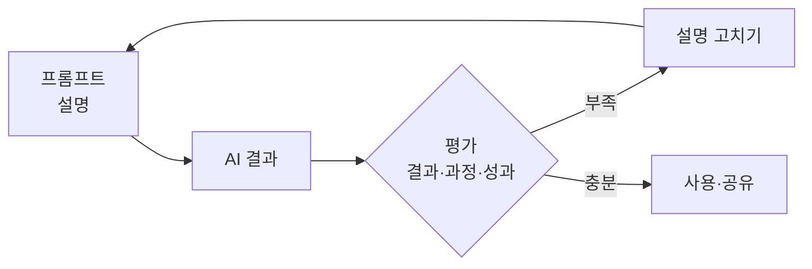

# 결과 평가 습관

> AI 유창성 4D의 Discernment. AI가 낸 결과·추론·태도가 쓸 만한지 비판적으로 가려내는 습관.

## 쉽게 말하면
후배가 가져온 보고서를 읽는 선배의 눈이다. 숫자 출처를 묻고, 결론이 근거와 이어지는지 보고, 말투가 자신만만하다고 믿지 않는다. AI는 그럴듯하게 틀리므로 이 눈이 필수다.

## 자세히
Anthropic 자료는 Discernment를 세 갈래로 나눈다.
- **결과(Product) 평가**: 내용이 정확한가, 빠진 것은 없는가, 목적에 맞는가, 형식은 맞는가.
- **과정(Process) 평가**: 추론 단계에 논리 비약이 없는가, 근거 없이 단정하지 않는가, 모른다고 해야 할 때 지어내지 않았는가([환각](#hallucination)).
- **성과(Performance) 평가**: 대화 방식이 내게 맞는가, 아첨하듯 동의만 하지 않는가.
습관으로 만드는 체크리스트:
1. 수치·인용·고유명사는 출처를 직접 확인한다.
2. "반대 근거를 대 보라"고 시켜 본다.
3. 같은 질문을 다시 해 답이 흔들리는지 본다.
4. 틀린 점을 찾았으면 [설명](#description-skill)을 고쳐 다시 요청한다(순환).
시스템 차원에서는 이 판단을 자동화한 것이 [평가 세트](#eval-set)와 [LLM 심사위원](#judge-bias)이다. 다만 심사위원도 편향이 있다.

## 그림으로 보기

## 예시
- 시장 규모 문단: "이 수치의 원문 링크를 줘" → 링크가 없거나 내용이 다르면 폐기.
- 코드 제안: 실행해 보고 테스트로 검증한 뒤 채택.

## 헷갈리는 것과 비교
| 개념 | 차이 |
|---|---|
| 결과 평가 습관 | 사람이 개별 결과를 읽는 습관 |
| [AI 평가](#ai-evaluation) | 모델·시스템 전체를 체계적으로 재는 일 |
| [위임 판단](#delegation-skill) | 맡기기 전 판단 |

## 더 읽을거리
- [Description–Discernment loop(Anthropic)](https://www.anthropic.com/ai-fluency/description-discernment-loop) — 설명과 평가의 순환.
- [4D 프레임워크로 조직 교육하기(Disco)](https://www.disco.co/blog/anthropics-ai-fluency-course-how-to-upskill-your-org-with-the-4d-framework) — 4D 정리(2차 자료).
