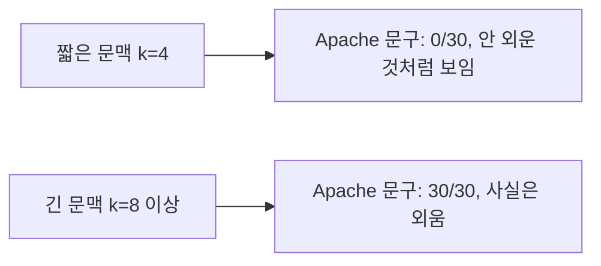
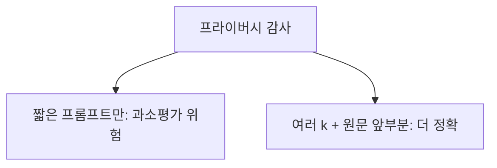

# 발견 가능성 현상

> 모델이 외운 내용이 **짧은 프롬프트로는 안 나오다가, 문맥을 충분히 길게 줘야 비로소 드러나는** 현상이다. 그래서 짧은 프롬프트로 한 암기 점검은 실제 암기량을 과소평가할 수 있다.

## 쉽게 말하면
어떤 노래는 첫 두 음만으로는 생각이 안 나다가 첫 소절을 들으면 줄줄 나온다. 기억이 없는 게 아니라 **꺼내는 단서가 부족했던 것**이다. 모델의 암기도 단서(앞 문맥)가 충분해야 드러난다.

## 자세히
- **논문 설명**(Carlini 외 2022, arXiv 2202.07646, ar5iv 확인): 일부 암기는 특정 조건에서만 드러난다. 6B GPT-J에서 학습 시퀀스의 약 **33%가 50토큰 문맥**으로 추출 가능했고 **450토큰 문맥에서는 약 65%**로 늘었다. 추출 가능성은 문맥 토큰 수에 로그-선형으로 늘며, 긴 프롬프트가 더 구체적이라 학습 데이터에 더 높은 확률을 준다고 설명한다.
- **함의(논문)**: 프롬프트 길이를 제한하면 위험을 줄일 수 있지만, 짧은 프롬프트로 하는 프라이버시 감사는 암기를 **과소평가**할 수 있다. 감사에는 학습 데이터의 긴 문맥으로 프롬프트하는 방식이 필요하다.
- **직접 실행**(Hugging Face `gpt2` 124M, 그리디, 앞 k토큰을 주고 뒤 30토큰을 원문과 토큰 단위로 대조, 문서 1회씩):

| 텍스트(토큰 수) | k=2 | k=4 | k=8 | k=16 | k=32 | k=48 |
|---|---|---|---|---|---|---|
| Apache 라이선스 문구(100) | 0/30 | 0/30 | **30/30** | 30/30 | 30/30 | 30/30 |
| GPL 문구(91) | 30/30 | 30/30 | 30/30 | 30/30 | 18/30 | 2/30 |
| 미국 헌법 전문(65) | 5/30 | 3/30 | 0/30 | 1/30 | 5/30 | - |
| Lorem ipsum(79) | 4/30 | 2/30 | 15/30 | 7/30 | 0/30 | 0/30 |

- 해석: **Apache 문구는 k=2·4에서 0/30인데 k=8부터 전부 일치**한다. 짧은 프롬프트로만 점검했다면 "외우지 않았다"고 잘못 결론 내렸을 것이다. 반면 GPL은 문맥을 더 줘도 일치가 오히려 줄었는데(32→18, 48→2), 내가 넣은 버전 문장과 모델이 많이 본 변형(예: "either version 2" 이후 문구)이 달라 이어쓰기가 갈린 것으로 추정한다(추정이며 확인하지 않았다). 따라서 **긴 문맥이 항상 유리한 것은 아니고**, 문맥이 학습 데이터의 어떤 변형과 맞는지가 중요하다. 4개 문서·1회라 통계가 아니라 현상 예시다.
- **감사 실무(제안)**: 짧은 프롬프트 한 가지만 쓰지 말고 k를 여러 값(예: 8·32·128)으로 바꿔 최대 일치를 보고, 학습 데이터 원문 앞부분을 그대로 프롬프트로 쓴다.

## 그림으로 보기

## 예시
- 사내 모델 점검 때 약관 문서의 앞 8·32·128토큰을 각각 프롬프트로 주어 가장 많이 일치하는 길이를 기록.
- 교육: 위 표를 재현하며 "단서가 부족하면 외운 것도 안 나온다"를 체험.

## 헷갈리는 것과 비교
| 개념 | 차이 |
|---|---|
| 발견 가능성 | 문맥이 길어야 드러나는 암기 |
| [추출 가능 암기 정의](#extractable-memorization-definition) | 앞 k토큰으로 재현되는지의 정의 |
| [암기의 세 요인](#memorization-three-factors) | 문맥 길이는 그중 하나 |
| 망각 | 학습 중 잊음. 발견 가능성은 안 잊었지만 안 나오는 것 |

## 더 읽을거리
- [Quantifying Memorization Across Neural Language Models — ar5iv](https://ar5iv.labs.arxiv.org/html/2202.07646) — 발견 가능성, 33%→65%(열어 확인).
- [Hugging Face gpt2](https://huggingface.co/gpt2) — 위 실험에 쓴 모델(직접 실행).
