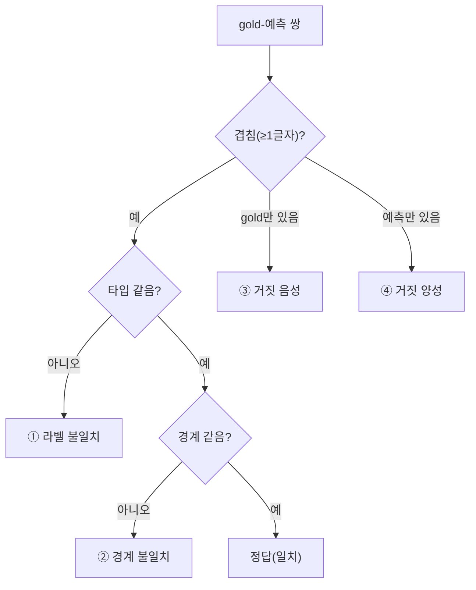

# NER 불일치 4유형

> 개체명 인식(NER)에서 사람 정답(gold)과 모델 예측이 어긋나는 경우를 **라벨 불일치·경계 불일치·거짓 음성·거짓 양성** 네 가지로 나눠, 가장 흔한 유형부터 규칙서를 고치는 분류 틀.

## 쉽게 말하면
형광펜으로 문서에서 질병 이름을 표시하는 시험이다. 정답지와 비교하면 ① 같은 자리인데 "다른 종류"로 표시(라벨), ② 종류는 같은데 **범위가 다르게** 칠함(경계), ③ 정답인데 아예 안 칠함(놓침), ④ 정답이 아닌데 칠함(헛칠함)으로 나뉜다.

## 자세히
(arXiv 2605.20809 3.4.1절 HTML을 직접 열어 확인. 저자 정의)
- 네 범주는 **서로 배타적**이고 아래 **우선순위 순서**로 판정한다.
  | 순위 | 유형 | 조건 |
  |---|---|---|
  | 1 | 라벨 불일치 | gold와 예측이 **한 글자 이상 겹치지만 타입이 다름** |
  | 2 | 경계 불일치 | 겹치고 타입은 같지만 **시작·끝 오프셋이 다름** |
  | 3 | 거짓 음성(FN) | gold가 어떤 예측과도 **겹치지 않음**(놓침) |
  | 4 | 거짓 양성(FP) | 예측이 어떤 gold와도 **겹치지 않음**(헛 예측) |
- **논문의 예(NCBI Disease 개발 세트, GPT)**: 반복 0에서 gold `DiseaseClass`를 예측 없이 놓친 FN이 7건, 첫 정제 후 1건으로 감소(그림 3). gold `SpecificDisease`를 `Modifier`로 예측한 라벨 불일치 5건이 첫 반복에서 해결. FP 예: "copper accumulation"을 `DiseaseClass`로 예측했지만 gold에는 없음. FN 예: "microcephaly, mental retardation, and short stature"를 gold는 `DiseaseClass`로 표시했으나 놓침. 이 수치는 10문서 정제 세트의 단일 사례라 대표성은 없다고 저자도 밝힌다(경계 불일치 건수는 보고된 그림에서 0).
- **왜 구분하나**: 유형마다 규칙서 처방이 다르다.
  | 유형 | 흔한 원인 | 규칙서 처방 |
  |---|---|---|
  | 라벨 | 타입 정의 모호 | 타입 경계·판별 기준 추가 |
  | 경계 | 어디까지 포함할지 불명 | 수식어·관사 포함 규칙 |
  | FN | 범주 정의가 좁음 | 포함해야 할 표현 예 추가 |
  | FP | 범주 정의가 넓음 | 제외 규칙 예 추가 |
- **사람 라벨링에도 그대로 적용**: 라벨러 간 불일치를 같은 4유형으로 분류하면 지침의 어느 부분이 모호한지 보인다.
- **한계**: 한 글자라도 겹치면 같은 개체로 보는 느슨한 기준이라 긴 개체와 짧은 개체가 부분 겹침일 때 처리 규칙이 필요하다. 중첩 개체·불연속 개체는 별도 정의가 필요(일반 지식).

## 그림으로 보기

## 예시
- gold: `[급성 신부전]` DiseaseClass. 예측 `[신부전]` DiseaseClass → 경계 불일치(수식어 "급성" 처리 규칙 필요). 예측 `[급성 신부전]` Modifier → 라벨 불일치. 예측 없음 → FN.
- 교육: 사내 정보 추출(계약서의 금액·날짜) 평가에서 오류를 이 4유형으로 분류해 보고.

## 헷갈리는 것과 비교
| 개념 | 설명 |
|---|---|
| 라벨 불일치 | 위치는 맞고 타입이 다름 |
| 경계 불일치 | 타입은 맞고 범위가 다름 |
| FN/FP | 겹침 자체가 없음 |
| [엄격 구간·유형 F1](#strict-span-type-f1) | 경계·타입이 모두 맞아야 정답 |

## 더 읽을거리
- [arXiv 2605.20809 (HTML)](https://arxiv.org/html/2605.20809) — 3.4.1절 정의와 그림 3의 건수(열어 확인).
