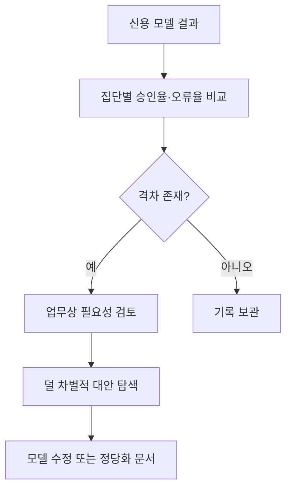

# 신용 차별 영향 분석

> 차별 의도가 없어도 겉보기에 중립적인 신용 정책·모델이 특정 보호 집단에 불리한 결과를 낳는지 따지는 분석 틀(disparate impact). 미국에서는 이 법리의 적용 범위가 최근 바뀌는 중이라 현행 상태 확인이 필요하다. (법률 자문 아님)

## 쉽게 말하면
모든 지원자에게 똑같이 "우편번호 점수"를 적용했는데 특정 인종이 많은 지역이 계속 탈락한다면, 규칙은 중립이어도 결과는 불평등하다. 이를 따져 보는 것이 영향 분석이다.

## 자세히
- **개념**: 차별 의도(disparate treatment)가 아닌 **결과의 차이**를 문제 삼는 법리. 모델에서는 집단별 승인율 비교(예: 4/5 규칙은 고용 분야의 관행이며 신용에 그대로 쓰이는지는 별개), 대체 모델 탐색(덜 차별적인 대안이 있는지)로 점검한다.
- **현행 상태(검색 요약, 법률 해설 기반, 원문 미확인)**: 2025-11 CFPB가 ECOA·Reg B에서 disparate impact 이론을 없애는 규칙을 제안했고(90 Fed. Reg. 50901, 2025-11-13), 2026-04-22에 Reg B를 개정한 최종 규칙이 나왔다는 결과가 있으나 그 규칙이 disparate impact 변경인지는 이번에 확인하지 못했다. 한 해설은 CFPB가 "effects test"를 규정에서 제거하고 ECOA가 disparate impact 책임을 인정하지 않는다고 명시했다고 적었다. 정확한 현재 상태는 연방관보와 CFPB 사이트로 확인해야 한다.
- **기관 지침 철회**: 2025-05-12에 CFPB가 다수의 지침(복잡한 알고리즘 회람 포함)을 철회했다([불리한 조치 통지](#adverse-action-notice)).
- **실무적 이유**: 법적 책임 범위가 바뀌어도 주(州) 법·소송·평판·공정성 원칙 때문에 모델의 집단별 성능·승인율 점검은 계속 필요하다는 것이 업계의 일반적 시각이다(의견).
- **방법**: 집단별 승인율·오류율, 대리 변수(우편번호 등) 점검, 대체 모델 비교, 결과 문서화.

## 그림으로 보기

## 예시
- 소액대출 모델에서 우편번호 변수 제거 시 성능이 거의 같다면 제거. 성능 손실이 크면 업무상 필요성을 문서화하고 다른 대체 변수 검토.

## 헷갈리는 것과 비교
| 개념 | 차이 |
|---|---|
| 차별 의도(disparate treatment) | 의도적으로 다르게 대우 |
| 차별 영향(disparate impact) | 중립적 규칙의 불평등 결과 |
| [ECOA·Reg B](#ecoa-reg-b) | 신용 차별 금지 법 틀 |

## 더 읽을거리
- [CFPB 지침 철회 관련 해설(Krieg DeVault)](https://kriegdevault.com/insights/cfpb-withdraws-67-guidance-documents) — 2025-05 철회 요약(검색 결과로만 확인)
- [Federal Register 2025-08286](https://www.govinfo.gov/content/pkg/FR-2025-05-12/html/2025-08286.htm) — 철회 목록
