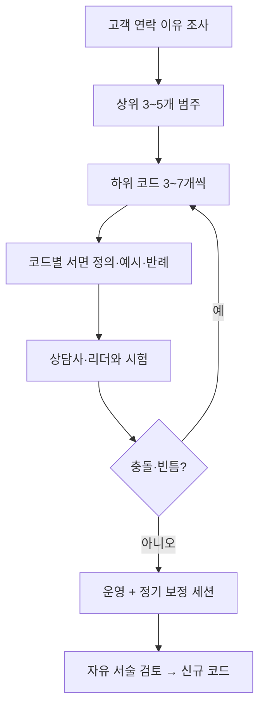

# 처리 결과 코드 설계

> 상담이 끝날 때 붙이는 **처리 결과(wrap-up·disposition) 코드 체계**를 설계하는 일. 좋은 코드는 서로 겹치지 않고, 고객이 왜 연락했는지를 중심으로 짜이며, 정의가 글로 적혀 있어 사람과 AI가 같은 기준으로 분류한다.

## 쉽게 말하면
서랍장에 칸 이름을 붙이는 일이다. 칸이 너무 많으면 아무 데나 넣고, 너무 적으면 "기타"에 다 쌓인다. 칸의 정의가 겹치면 같은 물건이 날마다 다른 칸에 들어간다.

## 자세히
출처: NICE 용어집(wrap-up code)과 Call Centre Helper의 디스포지션 코드 가이드(둘 다 본문 확인, 2026-11-18). 둘은 코드 개수 권장이 서로 다르며, 둘 다 업계 글이다.
- **정의**: 상호작용 끝에 상담사가 고르는, 연락의 성격과 결과를 설명하는 범주. 원자료 위에 얹는 구조화 메타데이터의 핵심 층이다(NICE).
- **고객 의도 기준(NICE)**: 부서·내부 프로세스가 아니라 **고객이 왜 연락했는가**로 코드를 짠다. 조직 구조를 그대로 본뜬 "어긋난 코드"를 실패 유형으로 든다.
- **개수 권장이 갈린다**: NICE는 최상위 3~5개 × 하위 3~7개, 총 15~30개 정도를 권하며 50개를 넘으면 정확도가 떨어지고 10개 미만이면 분석이 제한된다고 한다. Call Centre Helper는 코드를 최대 약 10개로 제한하라고 하고, 긴 목록은 상담사가 맨 위나 자주 쓰는 코드를 고르게 만든다고 한다. 두 글의 수치는 조사 근거가 제시된 연구가 아니라 실무 권고다.
- **주 코드 + 보조 코드**: Call Centre Helper는 주 코드(예: 판매)와 보조 코드(예: 제품)를 쓰는 센터가 많다고 한다.
- **서면 정의와 보정(NICE)**: 코드마다 글로 쓴 정의를 두고, 애매한 건을 감독자와 상담사가 함께 검토하는 정기 보정 세션을 연다.
- **협업 설계(Call Centre Helper)**: 상담사·리더와 함께 만들고 빈틈·충돌·명료성을 시험한다. 새 이유는 자유 서술을 받아 정기 검토 후 목록에 추가. 통화 길이와 코드를 대조(2분짜리 통화에 "무응답"은 이상).
- **자주 하는 실수**: 너무 넓은 코드, 너무 많은 코드(무작위 선택), 자유 서술에만 의존, 갱신 부재. 겹치는 코드는 별도 항목이 아니라 "불명확한 정의"의 하나로 읽힌다.
- **AI 자동 분류(벤더 주장)**: NICE는 자동 디스포지션이 후처리 시간을 없애고 주관성을 줄이며 일관된 분류를 만든다고 주장한다. 자사 데이터로 검증해야 한다.
- **상호 배타성(해석)**: 두 글은 "상호 배타적이어야 한다"를 명시하지 않았다. 다만 정의 충돌을 시험하라는 권고는 같은 취지이며, 한 건에 여러 코드를 허용할지는 의식적으로 정해야 한다.

## 그림으로 보기

## 예시
| 상위 | 하위(설명용) |
|---|---|
| 배송 | 지연, 오배송, 분실, 주소 변경 |
| 결제·환불 | 환불 요청, 중복 결제, 청구서 문의 |
| 계정 | 로그인, 해지, 정보 변경 |
교육 활용: 자사 코드 목록을 "고객 의도 vs 부서 기준" 어느 쪽으로 짜였는지 점검하는 실습.

## 헷갈리는 것과 비교
| 개념 | 차이 |
|---|---|
| 처리 결과 코드 | 연락의 성격·결과를 요약한 범주 |
| 주 코드·보조 코드 | 큰 범주와 세부 속성의 2층 구조 |
| [코드 분포 감시](#code-distribution-monitoring) | 코드 운영 후 분포 변화 점검 |
| [에스컬레이션 재현율](#escalation-recall) | 중요 코드를 놓치지 않는 정도 |

## 더 읽을거리
- [NICE: Wrap-up code](https://www.nice.com/glossary/wrap-up-code) — 고객 의도 기준, 계층, 보정(벤더)
- [Call Centre Helper: 디스포지션 코드 가이드](https://www.callcentrehelper.com/the-ultimate-guide-to-call-disposition-codes-175401.htm) — 코드 수 제한과 실수 목록
