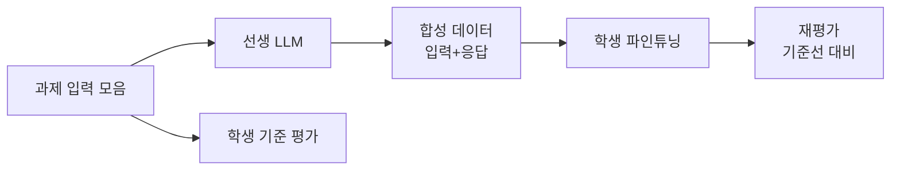

# LLM 증류 실무

> 큰 LLM(선생)이 만든 출력을 학습 데이터로 삼아 작은 LLM(학생)을 파인튜닝해, 좁은 작업에서 선생에 가까운 품질을 더 싸고 빠르게 얻는 방법이다. 데이터 생성 → 기준 평가 → 파인튜닝 → 재평가 순으로 한다.

## 쉽게 말하면
유명 요리사(큰 모델)가 레시피 노트를 수백 장 써 주고, 동네 식당 주방장(작은 모델)이 그 노트로 연습해 "우리 가게 메뉴"만큼은 비슷한 맛을 내는 것이다. 모든 요리를 다 잘하게 되는 건 아니고, 연습한 메뉴에 한해서다.

## 자세히
Meta의 Llama 증류 가이드 기준(확인: 2026-11-13).
1. **입력 수집**: 파인튜닝처럼 과제용 예시 입력을 모은다. 정답(완성문)은 필요 없다.
2. **선생 출력 생성**: 큰 모델이 입력마다 고품질 응답을 만든다. 규모가 크면 배치 요청과 데이터 분포 관리가 필요하다(Meta의 Synthetic Data Kit이 이 단계를 돕는다).
3. **학생 기준 평가**: 학습 전 성능을 먼저 잰다.
4. **학생 파인튜닝**: 입력+선생 응답으로 학습.
5. **재평가**: 같은 평가에서 기준선보다 올랐는지 확인.
- **증류 신호**: 하드 타깃(선생 최종 출력, LLM에서 가장 흔함) / 로짓 타깃(다음 토큰 확률 분포 — 불확실성과 여러 정답을 담음) / 피처 타깃(내부 표현 정렬, 구조 설계 필요) / 다중 선생→한 학생(과제별로 가장 강한 선생을 쓰고 합침).
- **평가**: 출력 유사도(BLEU·ROUGE·[LLM-as-judge](#llm-as-judge)), 분포 일치, 과제 성능("원래 지표의 5% 이내" 목표 예), 추론 속도(보통 2~4배), 메모리.
- 팁: 업무 기준으로 과제 전용 지표를 만든다. 학생 크기를 여러 개 시험해 품질-효율 절충을 본다. 증류는 "관심 있는 좁은 과제"에서만 큰 모델을 따라잡는다.
- **약관·라이선스 주의**: 상용 API 약관은 출력을 경쟁 모델 학습에 쓰는 것을 금지하는 경우가 많다(OpenAI 약관 인용 사례가 검색에 나옴, 2차 출처). 선생은 라이선스가 허용하는 오픈 웨이트를 쓰거나 약관을 먼저 확인한다. 법적 상황은 유동적이라는 서술이 많다(원문 약관 미확인).
- 연결: 같은 구조에서 성능을 올리는 [자기 증류](#self-distillation), 합성 데이터로 개선하는 [합성 데이터 자기 개선](#synthetic-data-self-improvement).

## 그림으로 보기

## 예시
고객 문의 분류 챗봇: 상담 문의 5천 건을 큰 모델로 분류+이유 생성 → 8B급 모델을 그 데이터로 파인튜닝 → 기존 평가셋에서 큰 모델 대비 정확도 격차와 응답 속도를 비교한다.

## 헷갈리는 것과 비교
| 개념 | 차이 |
| --- | --- |
| LLM 증류 | 선생 출력으로 학생 학습, 압축·비용 절감 |
| 일반 파인튜닝 | 사람이 만든 정답으로 학습 |
| [자기 증류](#self-distillation) | 같은 구조·크기에서 성능 향상 |
| [합성 데이터](#synthetic-data) | 증류에 쓰이는 데이터의 총칭 |

## 더 읽을거리
- [Distillation guide (Meta Llama 문서)](https://dev.meta.ai/llama/docs/how-to-guides/distillation/) — 5단계 흐름·증류 신호·평가
