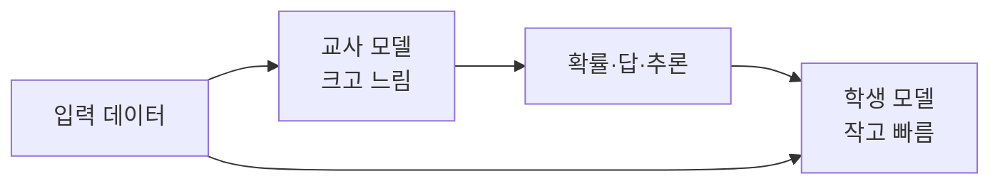

# 증류

> 크고 똑똑한 교사 모델의 출력을 따라 작은 학생 모델을 학습시켜, 작은 모델로 비슷한 성능을 얻는 기법.

## 쉽게 말하면
베테랑 요리사가 풀이 과정을 곁들여 가르치면, 신입이 수년 걸릴 감각을 빨리 익히는 것이다. 정답만이 아니라 "이 답이 얼마나 확신인지"까지 전달한다.

## 자세히
- Hinton·Vinyals·Dean의 "Distilling the Knowledge in a Neural Network"(arXiv 1503.02531, 2015-03, NIPS 2014 워크숍). 앙상블 지식을 단일 모델로 압축해 배포를 쉽게 한다는 아이디어(Caruana 외 선행 연구를 확장).
- 일반 설명(이 문서 초록엔 없음, 일반 지식): 교사의 확률 분포(soft target)를 온도 조절해 학생이 따라 배운다.
- LLM에서는 교사 모델이 만든 답·추론 과정으로 학생을 미세조정하는 방식도 흔히 증류라 부른다. 약관 제한이 있을 수 있으니 확인한다.
- 양자화가 같은 모델의 숫자를 줄이는 것이라면, 증류는 더 작은 구조의 새 모델을 학습시킨다.

## 그림으로 보기

## 예시
대형 모델로 고객 문의 분류 라벨 1만 건을 만들고, 소형 모델을 그 데이터로 미세조정해 비용을 낮춘다.

## 헷갈리는 것과 비교
| 개념 | 차이 |
| --- | --- |
| 증류 | 큰 모델의 행동을 작은 새 모델에 학습 |
| 양자화 | 같은 모델의 정밀도를 낮춤 |
| 미세조정 | 모델을 특정 데이터로 추가 학습. 증류는 교사 출력이 데이터 |

## 더 읽을거리
- [Distilling the Knowledge in a Neural Network](https://arxiv.org/abs/1503.02531) — 원 논문 초록
