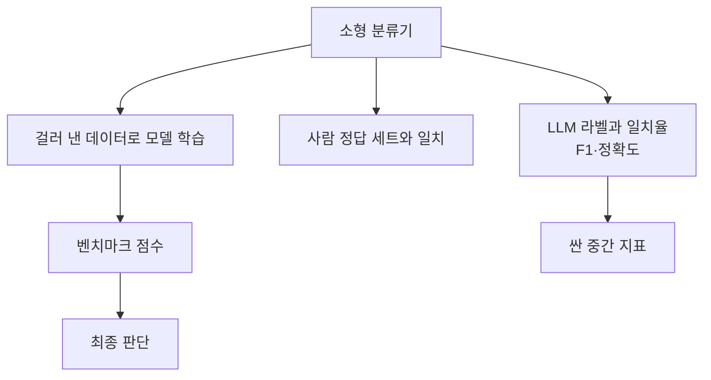
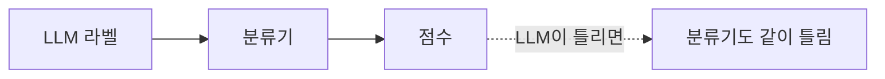

# 증류 분류기 평가

> LLM 라벨로 학습한 작은 분류기가 **얼마나 믿을 만한지** 재는 일. LLM과의 일치율(F1)은 싸게 볼 수 있는 중간 지표이고, 최종 판단은 걸러 낸 데이터로 학습한 모델의 성능으로 한다.

## 쉽게 말하면
조교(작은 분류기)가 심사위원(LLM)의 채점을 얼마나 따라 하는지는 비교하기 쉽다. 하지만 심사위원이 틀렸다면 조교가 아무리 똑같이 따라 해도 소용이 없다. 그래서 "조교가 심사위원과 같은가"와 "그 채점으로 뽑은 학생이 정말 잘하는가"를 따로 본다.

## 자세히
- **1층, 교사 대비 일치율**: 홀드아웃에서 분류기 점수를 LLM 라벨과 비교. FineWeb-Edu 분류기의 모델 카드는 46,867개 홀드아웃에서 임계값 3 이진 F1 82%, 전체 정확도 0.71, 매크로 F1 0.50을 보고한다. 이 기준 라벨은 사람이 아닌 Llama3 주석이다. 같은 모델 카드에 5점 클래스 F1이 0.02라는 점이 보여 주듯, 평균 지표 뒤에 클래스별 약점이 숨는다.
- **2층, 사람 정답 세트 대비**: 사람 라벨 소량으로 LLM 주석 자체([사람 정답 세트 점검](#gold-set-check))와 분류기를 함께 점검한다.
- **3층, 다운스트림 검증**: Kong 외(arXiv 2406.04638, Apple, 2024-06)는 프롬프트된 LLM이 매긴 품질 라벨을 분류기로 증류해 이미 걸러진 웹 말뭉치의 75%를 버리고 나머지로 LLM을 학습했다. 초록 기준으로 전체 말뭉치 모델과 같은 품질을 FLOPs의 최대 70%로 얻었고, 더 유능한 라벨러·분류기일수록 결과가 좋고 프롬프트에 덜 민감했으며, in-context learning이 약한 라벨러를 도왔다고 한다(본문 표는 확인하지 못함).
- 일치율과 최종 성능이 항상 같이 움직이지는 않으므로(검색에서 확인한 보고들: 일치도가 높아도 실제 품질 개선은 별개일 수 있고, 합성 데이터를 늘려도 일치도가 자동으로 오르지 않음) 두 층을 모두 본다.
- 점검 목록: 클래스별 정밀도·재현율, 임계값별 F1, 분포 밖 데이터 성능, 오분류 표본 눈검사.

## 그림으로 보기

## 예시
| 지표 | 값(FineWeb-Edu 모델 카드) |
|---|---|
| 이진 F1(임계값 3) | 82% |
| 전체 정확도 | 0.71 |
| 매크로 F1 | 0.50 |
| 5점 클래스 F1 | 0.02 |
- 업무 장면: 사내 보안 문서 분류기를 만들었다면 F1만 보고하지 말고 "기밀" 클래스 재현율, 사람 라벨 100건 대비 일치를 같이 낸다.

## 헷갈리는 것과 비교
| 개념 | 차이 |
|---|---|
| 증류 분류기 평가 | 학생(분류기)의 신뢰도 점검 |
| [사람 정답 세트 점검](#gold-set-check) | 교사(LLM 주석)의 신뢰도 점검 |
| [주석 후 증류 패턴](#annotate-then-distill) | 두 점검이 들어가는 전체 절차 |
| [임계값](#classifier-threshold-tradeoff) | 점수를 이진 판정으로 바꾸는 기준 |

## 더 읽을거리
- [Large Language Model-guided Document Selection (arXiv 2406.04638)](https://arxiv.org/abs/2406.04638) — LLM 라벨 증류 분류기와 75% 제거 실험(초록 직접 읽음).
- [fineweb-edu-classifier 모델 카드](https://huggingface.co/HuggingFaceFW/fineweb-edu-classifier) — 홀드아웃 지표와 한계(직접 읽음).
