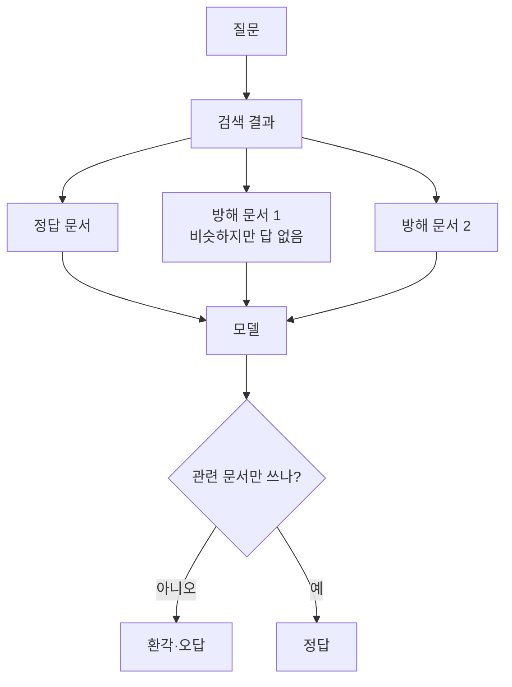
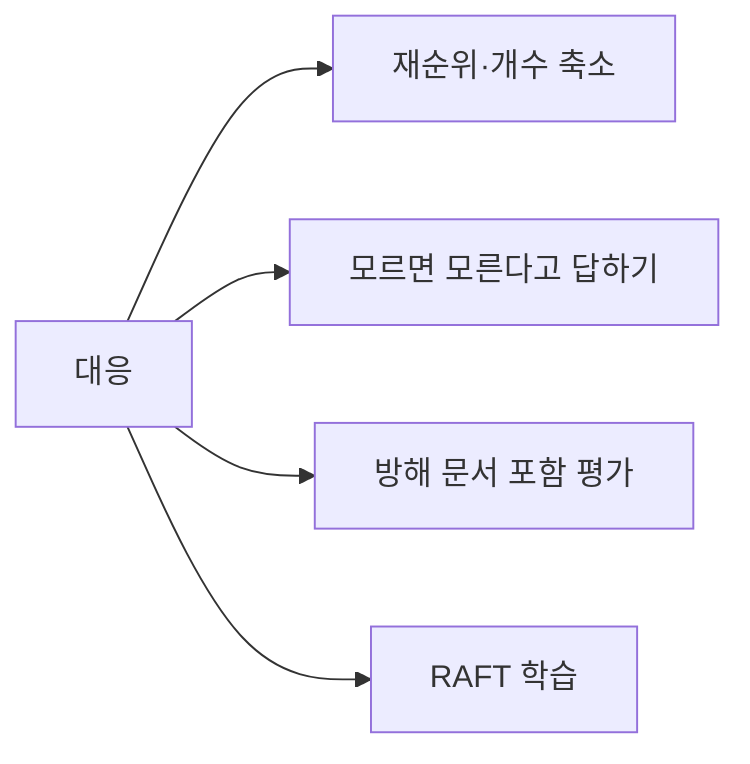

# 방해 문서(distractor)

> 정답은 담고 있지 않지만 질문과 비슷해 보여 모델을 헷갈리게 하는 검색 문서. RAG에서 정확도를 깎는 대표 원인이자, RAFT 같은 학습에서는 일부러 섞는 훈련 재료다.

## 쉽게 말하면
도서관에서 "휴가 규정"을 찾는데 "복지 규정"과 "휴직 규정" 책도 같은 선반에서 같이 나온 상황이다. 제목이 비슷할수록 엉뚱한 책의 내용을 가져다 쓰기 쉽다.

## 자세히
- **Chroma Context Rot 보고(열람)**: 방해 문장 하나만 있어도 바늘만 있을 때보다 정확도가 떨어졌고 넷이면 더 떨어졌다. 방해 2, 3번째가 환각을 가장 많이 유발했고, Claude 계열은 환각이 가장 적고 답을 거부하는 경우가 많았으며 GPT 계열은 환각이 가장 많았다고 보고. 바늘과 질문의 유사도가 낮을수록 입력 길이에 따라 더 빨리 성능이 떨어졌다.
- **관련 있지만 답은 없는 문서의 해악(arXiv 2401.14887, 초록 열람)**: 검색기의 상위 점수 문서 중 답이 없는 것들이 LLM의 효과를 낮춘다. 반대로 무작위로 관련 없는 문서를 프롬프트에 더하면 정확도가 최대 35% 오르는 의외의 결과도 보고했다(저자 보고, 조건 한정, 해석은 열린 문제).
- **RAFT의 이용(Gorilla 블로그, 열람)**: 학습 예시마다 정답 문서와 방해 문서를 섞거나 방해 문서만 주고, 모델이 관련 문서만 인용하며 답하도록 가르친다. 방해 문서 속 정답을 가려내는 능력을 학습으로 키우는 접근이다.
- **운영 대응(해석)**: 검색 결과 수를 줄이거나 재순위를 하고, 근거가 없으면 "모르겠다"고 답하도록 지시하며, 방해 문서가 섞인 평가 질문을 일부러 세트에 넣어 시험한다.
- 주의: 방해 문서 효과의 크기는 모델·과제·검색기에 따라 다르며 위 수치는 각 보고의 실험 조건에서만 확인된 것이다.

## 그림으로 보기

## 예시
- 휴가 질문에 "휴직 규정" 문서가 같이 검색돼 휴직 일수를 답함 → 방해 문서 영향.
- 교육 실습: 질문 하나에 정답 문서 1개와 비슷한 방해 문서 3개를 섞어 모델에 주고 오답률을 정답 문서만 줬을 때와 비교.

## 헷갈리는 것과 비교
| 개념 | 차이 |
|---|---|
| 방해 문서 | 비슷해 보이지만 답이 없음 |
| 정답(oracle) 문서 | 답이 들어 있음 |
| 무관한 무작위 문서 | 한 연구에선 오히려 도움이 됐다는 보고 |
| [RAFT](#raft) | 방해 문서를 학습 재료로 사용 |

## 더 읽을거리
- [The Power of Noise (arXiv 2401.14887)](https://arxiv.org/abs/2401.14887) — 관련·무관 문서의 효과(초록 열람)
- [Chroma: Context Rot](https://www.trychroma.com/research/context-rot) — 방해 문장 시험(열람)
- [Berkeley Gorilla: RAFT](https://gorilla.cs.berkeley.edu/blogs/9_raft.html) — 방해 문서 학습(열람)
