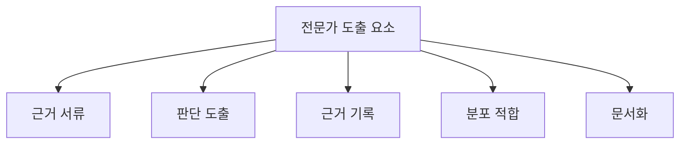

# 분포 근거 기록

> 분포 근거 기록은 시뮬레이션의 각 입력에 어떤 분포·범위를 왜 썼는지(출처, 전문가 의견, 가정 여부)를 표로 남기는 문서화 습관이다. 결과 숫자가 어디서 나왔는지 추적하고 나중에 틀린 가정을 고칠 수 있게 한다.

## 쉽게 말하면
요리 레시피에 "설탕 두 큰술"이라고만 쓰지 않고 "시어머니 레시피 기준, 단 것을 싫어하는 가족이라 한 술 줄임"처럼 이유를 적어 두는 것이다. 맛이 이상할 때 어디를 고칠지 알 수 있다.

## 자세히
- **보건경제 분야의 상황(ISPOR 2024 좋은 실무 보고서, Soares 등, 본문 열람)**: 구조화된 전문가 도출(SEE)은 정보가 부족할 때 전문가의 지식을 확률분포로 만드는 방법이다. 이 보고서는 SEE의 구성 요소로 근거 서류 준비, 전문가 선정·훈련, 판단 도출, 근거(rationale)의 수집·기록, 분포 적합, 편향 관리, 검증, 판단 조정, 그리고 "도출의 방법·과정·수행·결과를 요약하는 문서화"를 든다. 특정 방법을 권하는 것이 아니라 입문 보고서이므로 구체적 실무 권고는 하지 않는다고 밝힌다.
- **보고의 현실**: 이 보고서가 인용한 검토 연구에서 모델링 연구의 SEE 보고 수준은 열악해 연구 간 비교가 어려웠다(Cadham 등: 2021-06까지 SEE 연구 40건·비공식 방법 112건). 영국 NICE 평가 25건 중 23건이 전문가 도출을 썼으나 방법의 상세(설문지·녹취)를 낸 평가는 4건뿐이었고, 전문가 의견 사용에 대한 정당화와 대안 시나리오 탐색도 부족했다(van Hest 등).
- **SHELF(Sheffield 도출 프레임워크 사이트, 열람)**: 자료가 드문 경우 전문가 그룹에서 불확실한 양의 확률분포를 끌어내는 문서·양식·소프트웨어 모음으로, 문서를 따라 하면 비전문 진행자도 도출을 할 수 있게 한다는 취지다. 프로토콜 단계는 해당 페이지에서 확인하지 못했다.
- **[삼각분포](#triangular-distribution) 같은 단순 입력에도 적용(해석)**: 최소·최빈·최대 세 값을 누구에게 어떻게 물었는지, 몇 명의 평균인지 적는다.
- **기록 항목 예(해석, 위 보고서의 문서화 정신을 개인 ROI 분석에 옮김)**

| 입력 | 분포 | 범위·모수 | 근거 | 근거 수준 | 담당·날짜 |
| --- | --- | --- | --- | --- | --- |
| 사용률 | 삼각 | 0.3·0.6·0.9 | 파일럿 3개 팀 | 소표본 | 2026-11-24 |
| 월 절감 시간 | 삼각 | 1·2.5·5 | 팀장 3명 의견 | 전문가 의견 | 2026-11-24 |
| 라이선스 | 고정 | 3만 원/월 | 견적서 | 문서 | 2026-11-24 |

- **효과(해석)**: 분석이 틀렸을 때 근거 수준이 낮은 입력부터 재검토하고, [민감도 분석](#sensitivity-range-selection)에서 "가정"으로 표시한 항목과 맞출 수 있다.

## 그림으로 보기

## 예시
- AI 도입 ROI 보고서 부록에 위 표를 붙여, 결재권자가 "이 숫자는 누구 의견인가"를 바로 확인하게 한다.
- 교육 활용: 학습자가 자기 시뮬레이션의 입력마다 근거 표를 채우게 하고 근거 수준이 낮은 입력이 무엇인지 찾게 한다.

## 헷갈리는 것과 비교
| 개념 | 차이 |
| --- | --- |
| [몬테카를로 ROI](#monte-carlo-roi) | 방법. 근거 기록은 그 입력 문서화 |
| 전문가 도출(SEE) | 의견을 분포로 만드는 절차. 기록은 그 결과를 남기는 일 |
| 모델 검증 | 모델이 맞는지 확인. 기록은 확인할 수 있게 하는 재료 |

## 더 읽을거리
- [ISPOR Task Force: Recommendations on the Use of Structured Expert Elicitation Protocols](https://eprints.whiterose.ac.uk/id/eprint/220470/1/PIIS1098301524028432.pdf) — SEE 요소와 보고 현실(PDF 본문 열람)
- [SHELF: Sheffield Elicitation Framework](https://shelf.sites.sheffield.ac.uk/) — 전문가 도출 문서·양식 모음
