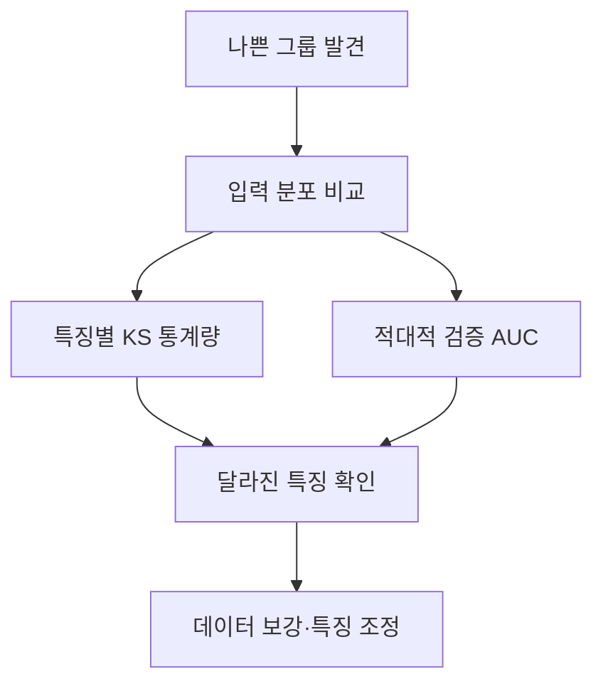
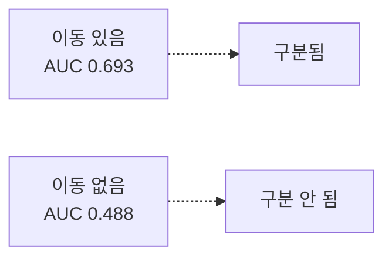

# 그룹 간 분포 이동

> 점수가 나쁜 그룹의 입력 데이터가 학습 데이터와 다르게 생겼는지 확인하는 일이다. 특징별 분포 비교(KS 검정)나 "어느 쪽 데이터인지 맞히는 분류기(적대적 검증)"로 어떤 특징이 달라졌는지 찾는다.

## 쉽게 말하면
한국 학생 사진으로만 배운 얼굴 인식이 다른 환경의 사진에서 틀리면, 모델이 나빠서가 아니라 입력 사진의 조명·각도가 달라서일 수 있다. 틀린 그룹의 입력이 학습 입력과 어떻게 다른지 먼저 비교하면 원인이 보인다.

## 자세히
- **특징별 비교(scipy `ks_2samp` 문서, 열람)**: 두 표본이 같은 분포에서 나왔다는 가설을 검정한다. 통계량은 두 경험적 분포함수의 최대 차이이고, 클수록 서로 다르다. p-값이 작으면(예: 0.05 미만) 같은 분포라는 가설에 불리한 증거다.
- **직접 해 본 실험(합성 데이터)**: 기준 그룹 1,000개와 비교 그룹 300개, 특징 5개 중 2번째만 평균을 1.0 이동시켰다. KS 통계량은 특징 2가 0.362(p=2e-27)로 압도적이었고, 나머지는 0.046~0.105였다. 특징 0은 p=0.012로 5개 검정 중 우연히 작게 나온 거짓 경보였다(다중 비교 주의). 단순 임계값 대신 통계량의 크기를 같이 본다.
- **적대적 검증(해석, 흔한 실무 기법)**: 기준 그룹과 비교 그룹을 구분하는 분류기를 5겹으로 학습해 AUC를 본다. 이 실험에서 이동이 있을 때 랜덤 포레스트의 AUC는 0.693, 이동이 없는 대조군은 0.488로 0.5 근처였다. AUC가 0.5보다 크게 높으면 두 그룹의 입력이 구분된다는 뜻이고, 변수 중요도로 어떤 특징이 달랐는지 찾는다.
- **이동이 있다고 모델이 틀리는 건 아니다**: 점수가 나쁜 이유가 입력 분포 이동인지, 라벨 기준 차이인지, 표본 부족인지 구분해야 한다([작은 그룹의 점수 노이즈](#small-group-noise)).
- **대처**: 해당 그룹 데이터를 더 모아 학습에 넣거나, 이동한 특징을 정규화·제거하거나, 별도 모델을 둔다.

## 그림으로 보기

## 예시
- 코드: `ks_2samp(train[col], bad_group[col])`를 특징마다 돌려 통계량 순으로 정렬한다.
- 실무: 특정 지점에서만 불량 검출 정확도가 낮을 때 그 지점 이미지의 밝기·해상도 분포가 학습 이미지와 다른지부터 본다. 교육 활용: 평균 하나를 이동시킨 합성 데이터로 AUC가 오르는 것을 보는 실습.

## 헷갈리는 것과 비교
| 개념 | 차이 |
| --- | --- |
| 입력 분포 이동(공변량 이동) | 입력이 달라짐 |
| 라벨 기준 차이 | 같은 입력에 다른 정답 |
| [최악 그룹 성능](#worst-group-performance) | 나쁜 그룹을 찾는 지표 |
| [시간을 그룹으로 쓰기](#time-as-group) | 시간에 따른 분포 이동 |

## 더 읽을거리
- [SciPy: ks_2samp](https://docs.scipy.org/doc/scipy/reference/generated/scipy.stats.ks_2samp.html) — 두 표본 KS 검정의 가설과 통계량
