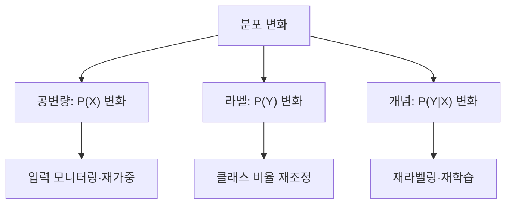

# 분포 변화의 종류

> 배포 후 데이터가 학습 때와 달라지는 방식은 크게 **입력 분포가 바뀌는 공변량 변화**, **정답 클래스 비율이 바뀌는 라벨 변화**, **입력과 정답의 관계가 바뀌는 개념 변화**로 나뉜다. 어떤 변화인지에 따라 대응이 다르다.

## 쉽게 말하면
스팸 필터를 만들었다고 하자. ① 사용자들이 쓰는 단어·길이가 달라졌다(입력 변화). ② 스팸 비율이 전체 메일의 10%에서 60%로 늘었다(비율 변화). ③ 스패머가 수법을 바꿔 같은 문장이 이제는 스팸이 아니라거나 그 반대가 되었다(관계 변화). 원인이 다르면 처방도 다르다.

## 자세히
(DataEval 문서 직접 확인 + 검색 요약. 용어는 자료마다 다르게 쓰인다.)
- **공변량 변화(covariate shift, 가상 드리프트)**: P(X)가 바뀌고 P(Y|X)는 그대로. 원인 예: 환경 변화, 센서 열화, 편향된 표본. 모델에 "사각지대"를 만들 수 있다.
- **라벨 변화(label shift, prior-probability shift)**: P(Y)가 바뀌고 클래스별 입력 패턴 P(X|Y)는 그대로. 희귀 타깃의 편향 표본이 보정을 해칠 수 있다.
- **개념 변화(concept drift, 사후확률 변화·real drift)**: P(X)는 안정적인데 P(Y|X)가 달라져 "같은 입력이 시간이 지나면 다른 출력에 대응"한다. 문서는 P(X|Y)나 P(Y), 또는 둘의 변화에서 올 수 있다고 한다.
- **용어 혼란**: 검색에서 확인한 다른 자료는 "concept shift"를 서로 다르게 정의했다(일부는 P(X) 또는 P(Y) 불변인 특수 경우, 일부는 P(X|Y)와 P(Y|X) 모두 변화). 세 변화가 동시에 나타나는 일도 흔하다.
- **WILDS의 분류(논문 ar5iv 확인)**: 평가 설계 쪽 분류로 도메인 일반화(새 도메인)와 소집단 변화(비율 변화), 둘의 혼합. 논문은 의료의 일부 변화를 concept drift로 언급하지만 공변량·라벨 변화를 본문에서 정의하지는 않는다. 즉 이 글의 세 분류와 WILDS 분류는 서로 다른 축이다.
- **탐지(DataEval 문서)**: 피처별 KS·CVM 검정, 다변량 MMD, 모델 예측 불확실성 분포 비교(DriftUncertainty). 다변량 p값은 Bonferroni 또는 FDR로 보정.

## 그림으로 보기

## 예시
- 새 카메라로 바꿔 사진 톤이 달라짐 → 공변량 변화.
- 독감 철에 환자 중 독감 비율이 증가 → 라벨 변화.
- 사기 수법이 진화해 같은 거래 패턴이 더 이상 사기가 아님 → 개념 변화.
- 교육 소재: 세 사례 카드를 주고 변화 유형 맞히기.

## 헷갈리는 것과 비교
| 개념 | 변하는 것 |
|---|---|
| 공변량 변화 | 입력 분포 P(X) |
| 라벨 변화 | 클래스 비율 P(Y) |
| 개념 변화 | 관계 P(Y|X) |
| [도메인 통째로 떼기](#held-out-domain-split) | 이런 변화를 평가에 재현하는 분할 |
| [분포 밖 탐지(최대 소프트맥스)](#ood-detection-softmax) | 낯선 입력 알아채기 |

## 더 읽을거리
- [DataEval: Detecting drift in Datasets](https://dataeval.readthedocs.io/en/v0.86.8/concepts/Drift.html) — 세 드리프트 정의·탐지기(직접 확인, 버전 0.86.8 문서).
- [WILDS 논문 (ar5iv)](https://ar5iv.labs.arxiv.org/html/2012.07421) — 도메인 일반화·소집단 변화 구분(앞 100,000자 확인).
