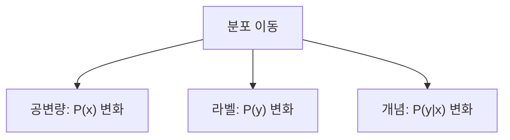

# 분포 이동

> 모델을 **배포한 뒤 만나는 데이터의 분포가 학습 때와 달라지는** 현상. 입력이 바뀌는지, 라벨 비율이 바뀌는지, 입력-출력 관계 자체가 바뀌는지에 따라 종류를 나눈다.

## 쉽게 말하면
여름 옷만 팔던 가게 데이터로 예측 모델을 만들었는데 겨울이 오면 손님도 상품도 달라져 예측이 틀리는 것과 같다. 세상이 모델이 배운 것과 달라졌다.

## 자세히
(검색 요약 기준. 용어와 정의가 논문마다 조금씩 다르다는 점이 중요하다.)
- **공변량 이동(covariate shift)**: 입력 분포 P(x)가 바뀌지만 조건부 관계 P(y|x)는 같다.
- **라벨 이동(label shift)**: 라벨 분포 P(y)가 바뀌지만 클래스별 입력 분포 P(x|y)는 같다(공변량 이동의 반대 관계로 설명되기도 한다).
- **개념 이동(concept shift)**: 입력-출력 관계가 바뀐다. 출처마다 어느 조건부 분포가 움직이는지 정의가 엇갈리니, 읽는 논문이 어떤 관례를 쓰는지 확인해야 한다. 이미지 데이터에서는 P(X) 변화 없이 개념 이동만 일어나는 일이 드물다는 관찰도 있다.
- **탐지 방법**: 두 표본이 같은 분포인지 보는 통계 검정(Kolmogorov-Smirnov 등), 온라인 오류율을 감시하는 DDM·EDDM 같은 순차 탐지기, 마팅게일 기반 탐지기, KL 발산 추정으로 이동 유형별로 검정하는 최근 방식.
- **제약**: 배포 라벨이 없으면 일반적으로 공변량 이동 탐지에 한정되고, 추가 가정이 있으면 더 가능하다. 대부분의 탐지기는 특정 이동 유형에 맞춰져 있고 일반적인 형식 검정이 어렵다.
- 모방 학습과의 연결: [오차 누적](#compounding-error)은 정책이 자신의 행동으로 입력 분포를 스스로 바꾸는 특수한 분포 이동이다(내 해석).
- 한계: 이 글은 검색 요약으로 확인한 일반 정의이며 1차 논문을 직접 열람하지 않았다.

## 그림으로 보기

## 예시
- 코로나 전후로 고객 문의 주제가 바뀌어 챗봇 분류 성능이 떨어짐(공변량·개념 이동 혼재 가능).
- 교육: 날씨 앱 사례로 세 가지 이동을 구분해 보는 활동.

## 헷갈리는 것과 비교
| 개념 | 차이 |
|---|---|
| 분포 이동 | 배포 분포가 학습 분포와 다름(일반) |
| [오차 누적](#compounding-error) | 정책 자신이 분포를 바꾸는 경우 |
| 드리프트 모니터링 | 이동을 운영 중 감시하는 활동 |

## 더 읽을거리
- [Testing for concept shift online](https://arxiv.org/pdf/2012.14246) — 개념 이동 탐지(검색 결과 확인).
- [Towards Practicable Sequential Shift Detectors](https://arxiv.org/pdf/2307.14758) — 순차 탐지(검색 결과 확인).
