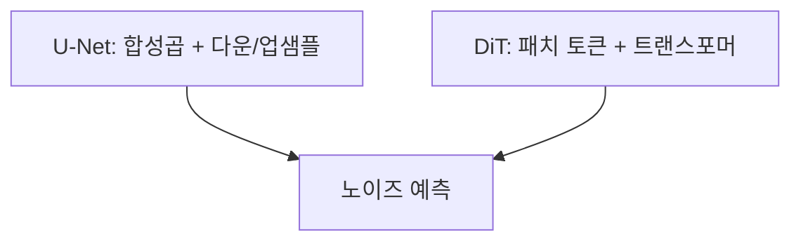

# DiT (확산 트랜스포머)

> DiT(Diffusion Transformer)는 확산 모델의 노이즈 예측망을 U-Net 대신 트랜스포머로 만든 구조로, 잠재 이미지를 작은 패치로 잘라 토큰처럼 처리한다.

## 쉽게 말하면
사진을 퍼즐 조각(패치) 여러 개로 나눠 글자처럼 한 줄로 늘어놓고, 글을 읽는 AI(트랜스포머)가 조각들의 관계를 보며 노이즈를 걷어내는 방식이다. 기존 U-Net이 합성곱 기반의 "그림 전용 구조"였다면 DiT는 "글자와 같은 구조"로 그림을 다룬다.

## 자세히
HF diffusers의 `DiTTransformer2DModel` 문서(v0.42.1) 기준:
- 논문: DiT(arXiv 2212.09748). 입력은 잠재 이미지(기본 4채널, `sample_size` 32)이고 `patch_size`(기본 2)로 패치화한다.
- 기본 설정: 헤드 16개, 헤드 차원 72, 레이어 28개. 정규화는 시간 단계·클래스 라벨을 주입하는 `ada_norm_zero`(AdaLN-Zero)를 쓰며, 시간 단계(timestep)와 클래스 라벨이 정규화 층의 임베딩으로 들어간다.
- 효과(일반적 설명, 이번 문서엔 서술 없음): 트랜스포머는 모델 크기를 키울수록 성능이 올라가는 스케일링이 잘 맞아, SD3·Flux 같은 최신 이미지 모델이 DiT 계열 뼈대를 쓴다고 알려져 있다(MMDiT 등 변형 포함).
- [U-Net](#unet-denoiser)과 달리 컨볼루션 다운·업샘플 구조가 없고, 이미지는 [VAE](#vae-latent)로 압축된 잠재 공간에서 다뤄진다. 학습 방식도 Flux 등은 [Flow Matching](#flow-matching)을 쓴다.

## 그림으로 보기



## 예시
```python
from diffusers import DiTPipeline
pipe = DiTPipeline.from_pretrained("facebook/DiT-XL-2-256")   # 클래스 조건 이미지 생성
image = pipe(class_labels=[207], num_inference_steps=25).images[0]
```
(위 코드는 일반적 사용 예이며 이번에 실행·확인하지 않았다.) 최신 이미지 모델이 왜 U-Net 대신 트랜스포머로 가는지 이해하는 출발점이다.

## 헷갈리는 것과 비교
| 개념 | 차이 |
|---|---|
| [U-Net](#unet-denoiser) | 합성곱 중심의 전통 구조 |
| DiT | 패치 + 트랜스포머, 스케일링에 유리 |
| [VAE](#vae-latent) | 픽셀↔잠재 압축기(별도 모듈) |
| [LLM 트랜스포머](#llm-basics) | 같은 계열이지만 입력이 텍스트 토큰 |

## 더 읽을거리
- [HF DiTTransformer2DModel](https://huggingface.co/docs/diffusers/api/models/dit_transformer2d) — 구조 매개변수와 AdaLN-Zero.
