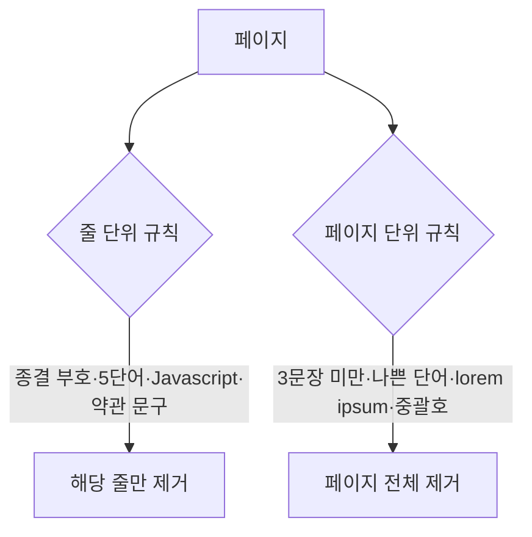
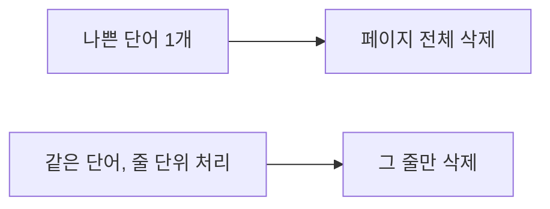

# 문서 단위 vs 줄 단위 제거

> 웹 텍스트 정제에서 "문서 전체를 버릴지, 문제 되는 줄만 버릴지"의 선택이다. C4는 둘을 섞어 썼다: 일부 규칙은 줄 단위, 다른 규칙은 페이지 단위로 제거했다.

## 쉽게 말하면
식당 접시에서 상한 반찬 하나가 나왔을 때 그 반찬만 걷어낼지(줄 단위) 접시 전체를 버릴지(문서 단위)의 차이다. 전체를 버리면 안전하지만 멀쩡한 음식까지 잃는다.

## 자세히
(Raffel 외 T5 논문 arXiv 1910.10683의 C4 정제 규칙 절을 직접 읽고 확인.)
- **줄 단위 규칙**: 종결 부호(마침표·느낌표·물음표·닫는 따옴표)로 끝나는 줄만 유지, 단어 5개 이상인 줄만 유지, "Javascript"가 들어간 줄 제거, "terms of use"·"privacy policy"·"cookie policy" 등이 들어간 줄 제거, 위키 인용 표시([1] 등) 제거.
- **페이지 단위 규칙**: 문장이 3개 미만인 페이지 제거, 나쁜 단어 목록(List of Dirty, Naughty, Obscene or Otherwise Bad Words)의 단어가 있으면 **페이지 전체 제거**, "lorem ipsum" 포함 페이지 제거, 중괄호 `{`가 있는 페이지 제거(코드로 간주).
- **중복 제거**: 3문장 구간이 두 번 이상 나오면 하나만 남긴다. 영어 확률 0.99 미만 페이지 제거(langdetect).
- **비교 포인트**: 나쁜 단어 규칙은 **페이지 단위**여서 한 단어 때문에 문서 전체가 지워지고 이것이 편향을 낳았다([블록리스트 필터 편향](#blocklist-filter-bias)). Gopher는 단어 목록 대신 SafeSearch를 쓴다고 밝힌다. 줄 단위로 처리하면 피해는 줄지만 문맥이 끊긴 문서가 남을 수 있다(제안).
- **절충(제안)**: 위험이 줄에 국한된 규칙(메뉴·쿠키 문구)은 줄 단위, 문서 전체의 성격을 보는 규칙(스팸·코드·독성)은 문서 단위.

## 그림으로 보기

## 예시
- 사내 문서 정제에서 "쿠키 안내 줄"은 줄 단위로 지우고 "스팸 점수 높은 문서"는 통째로 제외.
- 교육 활용: 같은 규칙을 줄/문서 단위로 적용해 남는 데이터 양과 품질을 비교.

## 헷갈리는 것과 비교
| 개념 | 차이 |
|---|---|
| 줄 단위 제거 | 문서 일부만 삭제, 문맥 단절 가능 |
| 문서 단위 제거 | 전체 삭제, 무고한 내용 손실 |
| [줄 길이 필터](#line-length-filter) | mC4가 종결 부호 규칙을 대체한 페이지 단위 기준 |

## 더 읽을거리
- [T5 논문 (arXiv 1910.10683)](https://arxiv.org/abs/1910.10683) — C4 정제 규칙.
- [Documenting Large Webtext Corpora (arXiv 2104.08758)](https://arxiv.org/abs/2104.08758) — 페이지 단위 블록리스트의 영향.
