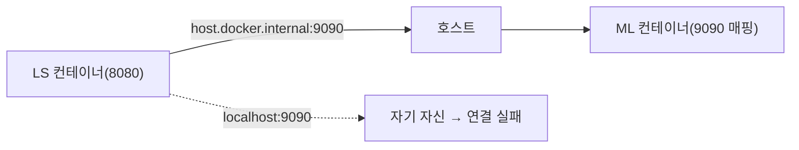
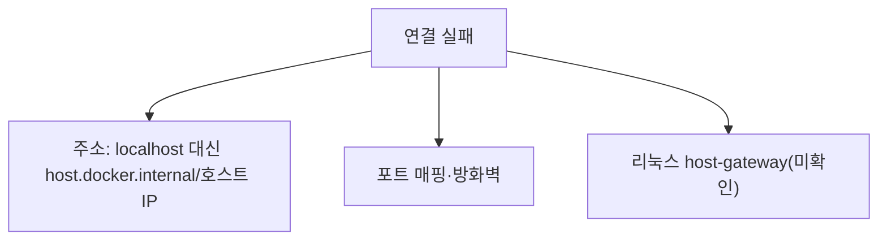

# Docker 네트워킹과 host.docker.internal

> Docker 컨테이너 안에서 `localhost`는 그 컨테이너 자신이다. Label Studio와 ML 백엔드를 각각 컨테이너로 띄웠다면 서로 연결할 주소를 `host.docker.internal`이나 호스트 IP로 지정해야 한다.

## 쉽게 말하면
각 컨테이너는 따로 있는 방이다. 방 안에서 "여기"라고 하면 그 방을 가리킨다. 옆방에 가려면 건물 주소(호스트 IP)를 써야 한다.

## 자세히
(Label Studio 문서 ml_create·install과 SAM 예제 README, `settings/base.py`를 직접 읽고 확인. 2026-11-21 기준.)
- **ML 백엔드 주소**: ml_create 문서는 docker-compose로 띄우면 `localhost:9090`에서 서비스되지만 LS 컨테이너 안에서는 `http://host.docker.internal:9090`을 쓰라고 안내한다.
- **다른 안내**: SAM 예제 README는 컨테이너 간에 localhost가 해석되지 않으므로 호스트의 IP(`ip a`/`ifconfig`)를 `LABEL_STUDIO_HOST`와 모델 URL에 쓰라고 한다. 리눅스에서 `host.docker.internal`은 `extra_hosts: host-gateway` 설정이 필요할 수 있으나 이번에 **확인하지 못했다**.
- **Label Studio Docker Compose**: `http://localhost:8080`, `docker-compose up -d`, Postgres 백엔드, Compose ≥ 1.25.0, 볼륨 `./mydata:/label-studio/data`, 비루트 컨테이너(UID 1001)라 권한 주의.
- **로컬 파일**: `LOCAL_FILES_SERVING_ENABLED` 기본 False, `LOCAL_FILES_DOCUMENT_ROOT` 기본은 파일시스템 루트. Community 에디션은 두 변수가 없으면 루트를 자동 감지해 켤 수도 있다. 경로 매핑 세부는 확인하지 않았다.
- **체크리스트(제안)**: ① LS 컨테이너에서 `curl 모델URL/health` ② 포트 매핑 확인(9090·8080) ③ 방화벽 ④ 이미지 URL이 모델 컨테이너에서 열리는지.

## 그림으로 보기

## 예시
- LS 화면에서 모델 URL을 `http://host.docker.internal:9090`으로 등록, 안 되면 `http://192.168.x.x:9090`으로.
- 교육 활용: 컨테이너 네트워크 개념을 "방과 건물 주소" 비유로.

## 헷갈리는 것과 비교
| 주소 | 의미 |
|---|---|
| localhost | 현재 컨테이너 자신 |
| host.docker.internal | 호스트 머신(Docker Desktop 등) |
| 호스트 IP | LAN에서의 호스트 주소 |

## 더 읽을거리
- [Label Studio: ML 백엔드 만들기](https://labelstud.io/guide/ml_create) — host.docker.internal 안내.
- [segment_anything_model 예제](https://github.com/HumanSignal/label-studio-ml-backend/tree/master/label_studio_ml/examples/segment_anything_model) — 호스트 IP 안내.
