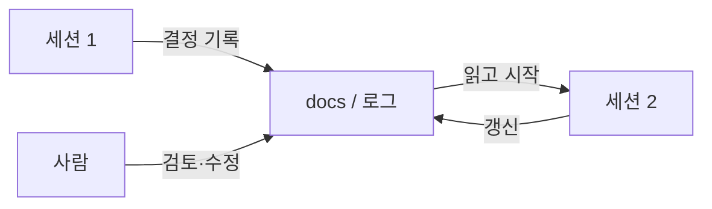
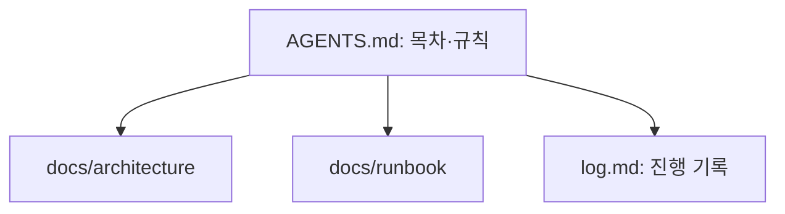

# 문서를 기록 시스템으로

> 프로젝트의 규칙·결정·진행 상태를 채팅이나 사람 머릿속이 아니라 저장소 안 문서에 남겨, 에이전트와 사람이 같은 "단일 진실 원천(system of record)"을 읽게 하는 방식.

## 쉽게 말하면
교대 근무 병원의 인수인계 차트와 같다. 간호사가 바뀔 때마다 구두로만 전하면 빠뜨리지만, 차트에 적혀 있으면 누가 와도 이어간다. 에이전트는 세션이 끝나면 기억을 잃으므로 차트가 곧 기억이다.

## 자세히
- **왜 필요한가**: 에이전트는 세션마다 백지에서 시작한다. 알아야 할 것이 문서에 있어야 매번 재발견하는 비용이 없다. Claude Code 모범 사례도 "저장소에 없는 결정"을 적어 두라고 한다([CLAUDE.md 쓰는 법](#claude-md)).
- **구조 예**: 짧은 지침 파일([AGENTS.md](#agents-md))은 목차 역할, 상세는 `docs/`(아키텍처 결정 기록 ADR, 실행 절차, 평가 기준), 진행 상태는 로그·체크리스트 파일.
- **원칙**: ① 한 사실은 한 곳에(중복하면 어긋남) ② 날짜·버전 기록 ③ 요약보다 링크로 상세를 가리킴 ④ 에이전트가 직접 갱신하는 문서(로그, 변경 이력)는 append 방식으로 충돌 줄이기 ⑤ 오래된 문서는 지우거나 폐기 표시.
- **압축과 짝**: 대화가 압축되거나 새 세션으로 넘어가도 문서에 적힌 결정은 남는다([압축](#compaction)).
- **예**: 이 지식 기반은 `raw → wiki → 규칙 문서` 구조로 작업 기록(log.md)과 목록(index.md)을 문서로 남기고, 매 실행이 그 문서를 읽고 시작한다.
- **한계**: 문서는 낡는다. 낡은 문서는 잘못된 확신을 만들므로 린트(깨진 링크·오래된 날짜 점검)가 필요하다.

## 그림으로 보기

## 예시
프롬프트: "작업을 끝낼 때마다 `docs/decisions/`에 날짜와 함께 결정 1건(맥락·선택·이유)을 추가하고, `log.md`에 한 줄 요약을 append해. 다음 세션은 log.md의 마지막 20줄부터 읽는다."

## 헷갈리는 것과 비교
| 개념 | 차이 |
| --- | --- |
| 기록 시스템(문서) | 영속적이고 공유되는 진실 원천 |
| 대화 기록 | 세션에 갇히고 압축으로 손실 가능 |
| [AGENTS.md](#agents-md) | 기록 시스템의 입구(목차) |
| 위키/Notion | 사람 중심 문서. 에이전트가 쓰려면 저장소 안 파일이 접근이 쉬움 |

## 더 읽을거리
- [Claude Code: Best practices](https://code.claude.com/docs/en/best-practices) — 코드 밖 지식을 문서로
