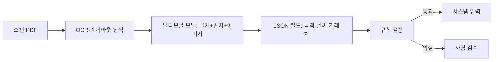
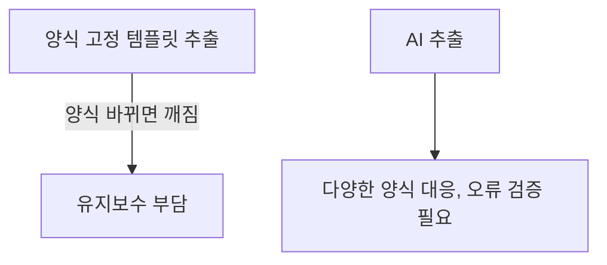

# AI 문서 추출

> **AI 문서 추출**은 송장·영수증·계약서 같은 **비정형 문서에서 금액·날짜·거래처 등 항목을 뽑아 구조화 데이터로 만드는** 기술이다. 글자와 **레이아웃(위치)·이미지**를 함께 이해하는 모델이 쓰인다.

## 쉽게 말하면
사람이 영수증을 보며 엑셀에 합계·날짜를 옮겨 적는 일을 AI가 대신한다. 영수증마다 양식이 달라도 "여기가 합계 칸"임을 글자와 위치로 알아본다.

## 자세히
(LayoutLMv3, arXiv 2204.08387 초록 확인)
- **LayoutLMv3**: 문서 AI용 사전학습 멀티모달 트랜스포머. 텍스트와 이미지에 **같은 마스킹 방식**을 적용해 결합 표현 학습의 난이도를 낮추고, **단어-패치 정렬** 목표로 텍스트 단어와 이미지 패치의 대응을 배운다.
- 양식 이해, 영수증 이해, 문서 시각 질의응답, 문서 이미지 분류, 문서 레이아웃 분석에서 최고 성능을 보고했다. 코드·모델 공개.
- 현재 추세(일반 지식): 범용 멀티모달 LLM이 스키마(JSON)를 지정해 곧바로 추출하는 방식이 늘고 있다. 정확도·비용·지연은 문서마다 달라 샘플로 측정해야 한다.
- 도입 시 점검(권고): 필드별 정확도, 신뢰도 낮은 건의 **사람 검수 경로**, 개인정보 처리, 숫자·날짜 형식 검증 규칙.

## 그림으로 보기

## 예시
- 매입 송장 수백 장에서 공급자·금액·세액을 추출해 회계 시스템에 입력, 합계가 맞지 않으면 사람에게 넘김.
- 계약서에서 계약 기간·갱신 조건 조항 찾기.

## 헷갈리는 것과 비교
| 개념 | 차이 |
|---|---|
| OCR | 이미지를 글자로 변환 |
| 문서 추출 AI | 글자+구조를 이해해 항목화 |
| [멀티모달 RAG](#multimodal-rag) | 문서 검색·질의응답 |
| RPA | 정해진 절차 자동화 |

## 더 읽을거리
- [LayoutLMv3](https://arxiv.org/abs/2204.08387) — 문서 AI 사전학습 모델.
- [ColPali](https://arxiv.org/abs/2407.01449) — 페이지 이미지 검색.
