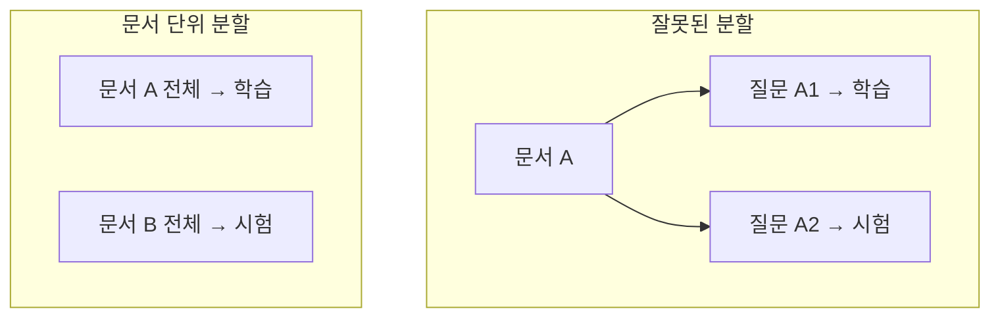
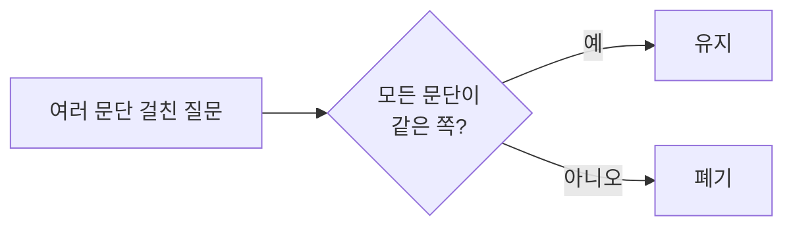

# 문서 단위 분할

> 데이터를 학습·검증·시험으로 나눌 때 "문서" 하나를 나누는 최소 단위로 삼아, 같은 문서에서 나온 문단·질문·답이 여러 쪽에 흩어지지 않게 하는 분할 방식이다. [그룹 단위 분할](#group-wise-split)의 문서 버전이다.

## 쉽게 말하면
교과서 한 단원에서 문제 10개를 만들었다고 하자. 5개는 연습 문제, 5개는 시험 문제로 나누면, 연습하며 그 단원 내용을 이미 본 셈이라 시험이 쉬워진다. 단원 단위로 "이 단원은 연습용, 저 단원은 시험용"으로 갈라야 진짜 실력이 나온다.

## 자세히
- **문제**: 한 문서에서 질문-답 쌍을 여러 개 만들거나 문서를 여러 문단(chunk)으로 쪼개면, 문단·질문 단위로 무작위 분할할 때 같은 문서가 학습과 시험에 모두 들어간다. 모델(특히 검색 인코더)이 시험에 나올 내용을 학습 중에 본 셈이 된다([데이터 누수](#data-leakage)).
- **사례(직접 열어 확인한 논문)**: Deußer 등의 금융 규제 QA 논문(arXiv 2609.30009)은 공개된 ObliQA의 분할이 학습·검증·시험에 원본 문서를 공유한다고 지적하고, 문서 단위로 다시 나눴다.
  - 문서 40개를 고정 시드로 섞어 80%·15%·5%로 배정.
  - 단일 문단 질문은 그 문서를 따라가고, **여러 문단을 걸치는 질문은 문단이 모두 같은 쪽에 있을 때만** 남기고 나머지는 폐기. 그 결과 질문-문단 쌍 989개가 사라졌고, 저자들은 누수 없는 평가를 위한 감수할 만한 비용으로 봤다.
  - 사후 점검: 정확 일치·유사도 85% 퍼지 매칭에서는 겹침이 없었고, 임베딩 코사인 0.85에서 139쌍이 걸렸으나 확인해 보니 비슷하게 표현된 서로 다른 의무였다.
  - 주의: 새 분할 기준 점수는 기존 공개 분할 점수와 직접 비교할 수 없다고 논문이 밝힌다.
- **트레이드오프**: 문서 수가 적으면 시험에 들어갈 문서가 너무 적어 점수 변동이 크다. 다문서 추론 질문이 줄어 데이터가 단순한 쪽으로 기울 수 있다(논문 한계 절).
- **구현 요령(제안)**: 문서 ID를 그룹으로 삼아 `GroupShuffleSplit`·`GroupKFold`([GroupKFold](#group-kfold))를 쓴다. 다른 문서 사이의 거의 같은 문단(복사본, 개정판)은 별도 중복 제거가 필요하다.

## 그림으로 보기

## 예시
- 사내 매뉴얼 100건으로 RAG 챗봇 평가셋을 만들 때: 매뉴얼 단위로 평가 문서 20건을 따로 정해, 그 문서에서 나온 질문은 전부 평가 전용으로 쓴다.
- 검색 인코더를 사내 문서로 파인튜닝할 때도 같은 규칙으로 문서를 분리한다.

## 헷갈리는 것과 비교
| 개념 | 차이 |
|---|---|
| 문서 단위 분할 | 문서가 분할의 최소 단위 |
| 문단·질문 단위 분할 | 같은 문서가 양쪽에 걸쳐 누수 위험 |
| [그룹 단위 분할](#group-wise-split) | 환자·사용자 등 임의 그룹으로 확장한 상위 개념 |
| 중복 제거 | 서로 다른 문서의 사실상 같은 내용을 제거 |

## 더 읽을거리
- [Automated Regulatory Compliance QA… (arXiv 2609.30009)](https://arxiv.org/abs/2609.30009) — 문서 단위 재분할과 989쌍 폐기(PDF 본문 확인).
- [Group K-fold 설명(Neural Base)](https://theneuralbase.com/evaluation-framework/learn/intermediate/group-k-fold/) — 검색 결과로만 확인.
