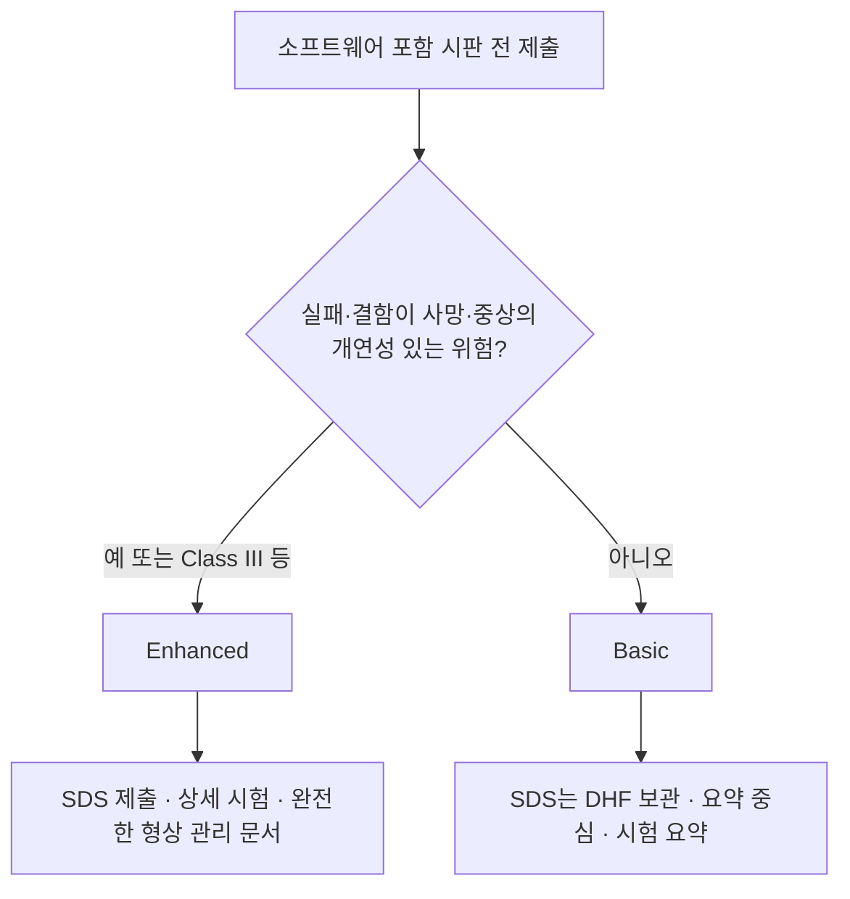

# Documentation Level

> FDA가 소프트웨어 기능이 든 의료기기의 시판 전 제출에서 **어느 정도로 상세한 소프트웨어 문서**를 내야 하는지 정하는 위험 기반 등급. Basic과 Enhanced 둘 중 하나이며, 제출에 필요한 최소 정보량을 가늠하게 해 준다.

## 쉽게 말하면
자전거 정비 기록과 비행기 정비 기록의 상세함이 다르듯이, 소프트웨어가 틀렸을 때의 최악의 결과가 클수록 설계·시험 문서를 더 두껍게 내야 한다. 그 두께를 두 단계로 정한 것이 Documentation Level이다.

## 자세히
출처: FDA 지침 "Content of Premarket Submissions for Device Software Functions"(2023-06-14 발행, PDF 내려받아 V·VI절과 Table 1 읽음). 비구속 권고.
- **기준**: 기기가 환자·사용자·주변인에게 갖는 위험. 위험 통제 조치 **적용 전** 소프트웨어 실패·결함이 사망·중상의 개연성 있는 위험 상황을 만들 수 있으면 Enhanced, 아니면 Basic. 문서 수준은 기기 전체를 기준으로 한다.
- **Enhanced 권고 범주**: 수혈 감염 검사 기기, 혈액 적합성 판정 기기, 자동 혈구 분리기, 혈액원 컴퓨터 소프트웨어(BECS), 복합 제품의 구성 기기, **Class III 기기**. 이들 중 Enhanced가 해당하지 않는다고 판단하면 Basic이 적절한 이유를 구체적으로 적어야 한다.
- **사전 협의**: Pre-Submission으로 Documentation Level과 권고 문서에 대해 미리 피드백을 받을 수 있다([FDA 사전 상담](#pre-sub)).
- **권고 문서 요소(Table 1, VI절)**:
  - Documentation Level 평가(등급과 근거 진술)
  - 소프트웨어 설명(주요 기능·분석·입출력·하드웨어 플랫폼)
  - 위험 관리 파일(계획, 위험이 적절히 완화됐다는 평가, 보고서)
  - 소프트웨어 요구사항 명세(SRS)와 추적성
  - 시스템·소프트웨어 아키텍처 다이어그램(모듈·계층·인터페이스, 데이터 흐름, 사용자·외부 제품과의 상호작용)
  - **소프트웨어 설계 명세(SDS)**: Basic은 시판 전 제출에 요구하지 않고 설계 이력 파일(DHF)에 문서화, Enhanced는 제출
  - 개발·형상 관리·유지 보수 방식: Basic은 요약 또는 IEC 62304 적합성 선언(일부 조항), Enhanced는 완전한 계획 문서 또는 더 넓은 IEC 62304 선언
  - 소프트웨어 시험(V&V): 단위·통합·시스템 수준 시험 요약(Basic)과 Enhanced의 상세 시험 프로토콜·결과
  - 소프트웨어 버전 이력, 해결되지 않은 소프트웨어 이상
- **취지**: 계획, 요구사항, 위험 평가, 설계 검토, 추적성, 변경 관리, 시험 등 좋은 소프트웨어 공학이 적용됐음을 보여 설계·검증·확인이 적절했다고 결론내리게 하는 것.

## 그림으로 보기

## 예시
- 비접촉 체온계, 팽창식 커프 혈압계: 지침 부록 A 예시에서 Basic.
- Class III 기기의 소프트웨어: 기본적으로 Enhanced 권고, 아니라면 근거 설명.
- 점검: 제출 전에 "통제 조치 적용 전" 위험으로 등급을 정했는지, 사이버 보안 위험까지 고려했는지 확인.

## 헷갈리는 것과 비교
| 개념 | 차이 |
|---|---|
| Documentation Level | 제출 문서의 두께를 정하는 FDA 등급 |
| [기기 펌웨어](#firmware-medical) | 이 지침의 적용 대상 예 |
| [의료기기 등급](#device-risk-classes) | 기기 자체의 위험 등급(I~III), 서로 다른 체계 |
| [SaMD 위험 분류](#samd-risk-categorization) | IMDRF의 별도 범주 I~IV |

## 더 읽을거리
- [Content of Premarket Submissions for Device Software Functions (FDA, 2023-06-14)](https://www.fda.gov/media/153781/download) — V·VI절 Table 1(내려받아 확인)
