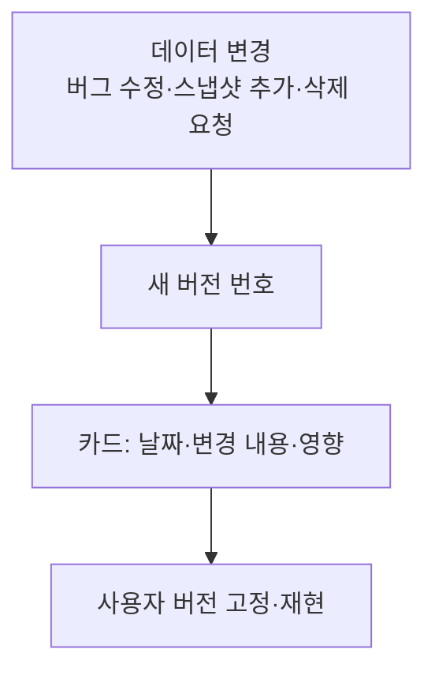
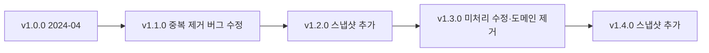

# 문서화 갱신

> 데이터셋을 고치거나 늘릴 때마다 **데이터 카드·변경 이력·인용 정보도 함께 갱신**하는 관행. 데이터는 바뀌는데 설명서가 옛것이면 사용자는 잘못된 전제로 데이터를 쓰게 된다.

## 쉽게 말하면
식품 성분이 바뀌었는데 포장지의 성분표를 그대로 두면 알레르기 있는 사람이 위험하다. 데이터가 바뀌면 "무엇이 언제 바뀌었는지"를 설명서에 적어야 한다.

## 자세히
(Hugging Face FineWeb 데이터셋 카드 README의 변경 이력을 직접 읽음)
- **FineWeb의 변경 이력(카드에 날짜순 기록)**:
  - **v1.0.0(2024-04-21)** 최초 공개.
  - **v1.1.0(2024-05-31)** 중복 제거 버그를 고치려고 2021-49~2023-40 덤프 11개를 재처리·재업로드하고, 2024년 4월 크롤(CC-MAIN-2024-18)을 추가. 작은 성능 개선을 기대한다고 적음.
  - **v1.2.0(2025-01-03)** 2024년 5~12월 스냅샷 8개 추가.
  - **v1.3.0(2025-01-31)** 처리되지 않은 문서가 있던 9개 덤프를 고쳐 약 4,000억 토큰이 추가됨. **삭제 통지(C&D)에 따라 특정 도메인 제거**.
  - **v1.4.0(2025-07-11)** 2025년 1~6월 스냅샷 6개 추가.
- **이 기록에서 읽는 것**: 데이터 버그(중복 제거 오류, 미처리 문서)가 공개 뒤에 발견돼 고쳐질 수 있고, 법적 요청으로 데이터가 빠질 수도 있다. 같은 이름의 데이터셋이라도 시점에 따라 내용이 다르다.
- **인용 정보와 한계 설명도 카드에 유지**: 카드는 NeurIPS 2024 Datasets and Benchmarks 논문 인용 BibTeX를 제시하고, 편향 논의(URL 수준 필터링 후에도 유해 문서가 상당수 남음, 금지어·독성 분류기 대신 다른 방식을 쓴 이유), 알려진 한계(코드 콘텐츠 부족, 위키 같은 큐레이션 자료 보완 필요)를 적는다.
- **갱신 체크리스트(제안)**: ① 데이터 변경 시 카드의 버전·날짜·변경 내용·영향(예상 성능 변화) 기록 ② 삭제·옵트아웃 처리 내역 ③ 처리 단계·필터 파라미터 변경 ④ 사용자가 버전을 고정할 수 있게 태그/리비전 안내([데이터셋 버전 고정](#dataset-version-pinning)) ⑤ 카드 자체의 최종 수정일.
- **사용자 쪽**: 쓰는 데이터의 버전을 기록하고 변경 이력을 주기적으로 확인한다([데이터 카드 읽기](#data-card-reading)).
- 한계: 변경 이력이 모든 수정을 포함하는지는 확인할 수 없다.

## 그림으로 보기

## 예시
| 버전 | 변경 |
|---|---|
| v1.1.0 | 중복 제거 버그로 11개 덤프 재처리 |
| v1.3.0 | 9개 덤프 수정(약 4,000억 토큰 추가)·삭제 통지로 도메인 제거 |
- 업무 장면: 사내 학습 데이터를 월 1회 갱신할 때 카드 맨 아래에 변경 이력 표를 두고 "무엇을 왜 바꿨는지"를 한 줄씩 남긴다.

## 헷갈리는 것과 비교
| 개념 | 차이 |
|---|---|
| 문서화 갱신 | 데이터 변경에 맞춰 설명서를 고침 |
| [데이터 카드 읽기](#data-card-reading) | 사용자가 설명서를 읽는 쪽 |
| [삭제 요청 처리](#takedown-requests) | 변경 이력의 한 원인 |
| [데이터셋 버전 고정](#dataset-version-pinning) | 사용자가 특정 버전을 고정 |

## 더 읽을거리
- [FineWeb 데이터셋 카드](https://huggingface.co/datasets/HuggingFaceFW/fineweb) — 변경 이력·한계·인용(README 직접 읽음).
