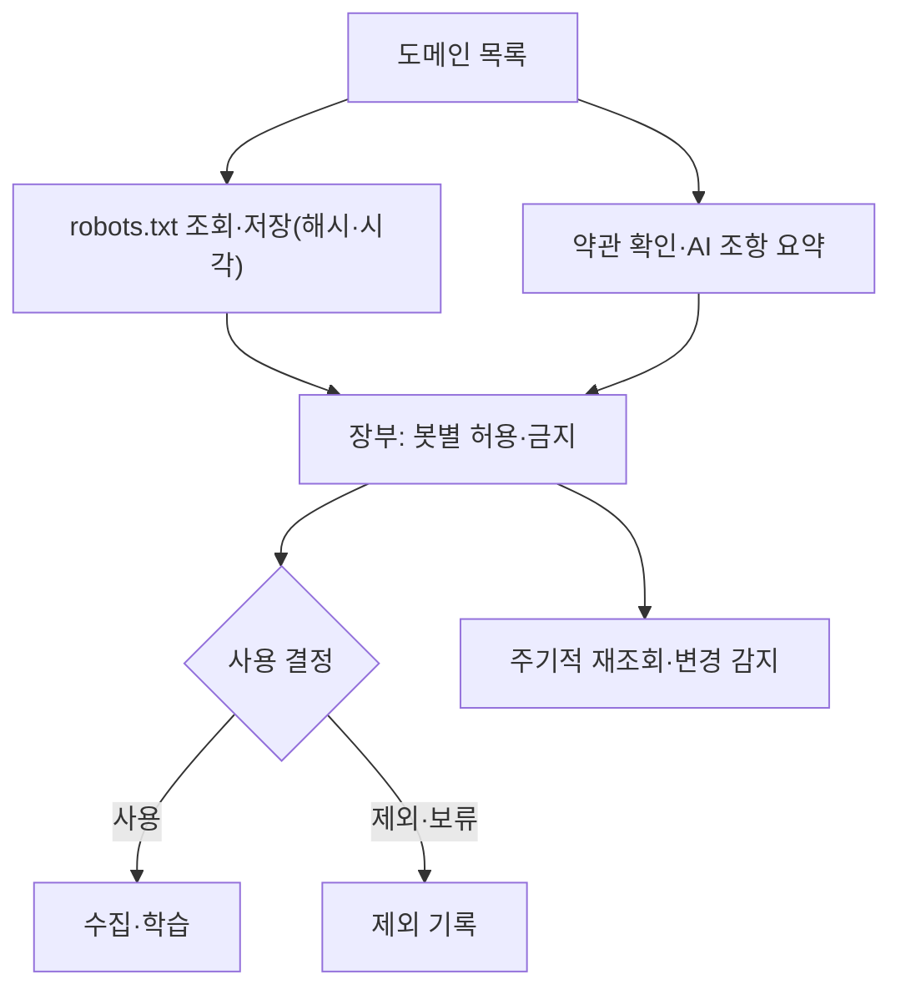
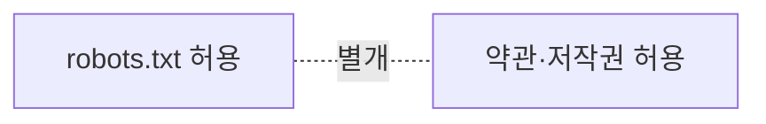

# 도메인별 허용 의사 기록

> 학습 데이터로 쓰는 웹 도메인마다 **그 사이트가 크롤링을 허용했는지(robots.txt)와 이용약관(ToS)의 AI 관련 조항을 날짜와 함께 표로 기록해 두는 것**이다. 허용 의사는 시간이 지나며 바뀌므로 "그때 어땠는지"를 증거로 남기는 장부다.

## 쉽게 말하면
이웃집 마당의 사과를 따도 되는지 팻말을 확인했다면, 언제 어떤 팻말이 있었는지 사진을 찍어 두는 것과 같다. 나중에 팻말이 바뀌어도 "내가 딸 때는 허용이었다"를 보일 수 있다. 사진이 없으면 증명할 방법이 없다.

## 자세히
(RFC 9309 본문 요약을 직접 열어 확인하고, robots.txt 읽기는 직접 실행. 법률 자문이 아니다.)
- **왜 기록하나**: [Consent in Crisis](#consent-in-crisis) 연구는 사이트들의 AI 수집 허용 의사가 빠르게 바뀌고 robots.txt와 이용약관이 서로 다른 경우가 흔하다고 보고한다. 따라서 수집 시점의 상태 기록이 필요하다.
- **robots.txt의 성격(RFC 9309)**: 2022년 9월에 인터넷 표준 트랙으로 확정된 규격. 파일은 `/robots.txt`에 UTF-8·`text/plain`으로 둔다. 크롤러는 제품 토큰(대소문자 무관)으로 그룹을 고르고, 맞는 그룹이 없으면 `*` 그룹, 그것도 없으면 규칙이 없다. 캐시는 24시간을 넘기지 않는 것이 권고(파일에 접근할 수 없을 때 제외). **4xx는 "파일 없음"으로 보아 모든 자원 접근 가능, 5xx·네트워크 오류는 전체 금지로 가정**한다. 규격은 이 규칙이 **접근 권한 부여가 아니며** 콘텐츠 보안의 대체물이 아니라고 명시한다.
- **직접 조회(2026-11-22, 이 실행 환경에서 홈 경로 `/` 접근 여부만 확인, 파이썬 `urllib.robotparser`)**
  | 도메인 | GPTBot | CCBot | ClaudeBot | Google-Extended | `*` |
  |---|---|---|---|---|---|
  | www.wikipedia.org | 허용 | 허용 | 허용 | 허용 | 허용 |
  | arxiv.org | 허용 | 허용 | 허용 | 허용 | 허용 |
  | www.nytimes.com | 금지 | 금지 | 금지 | 금지 | 허용 |
  | www.bbc.com | 금지 | 금지 | 금지 | 금지 | 허용 |
  | www.reddit.com | 금지 | 금지 | 금지 | 금지 | **금지** |
  | github.com | (HTTP 403으로 조회 실패) | | | | |
  `/` 한 경로만 본 결과라 하위 경로별 규칙은 반영하지 못했다. 같은 도메인에서도 AI 크롤러만 막고 일반 크롤러는 허용하는 구성이 보인다. github.com은 이 환경에서 403이라 조회하지 못했고, 사이트가 크롤링에 어떤 입장인지는 알 수 없다.
- **장부 항목(제안)**
  | 열 | 내용 |
  |---|---|
  | domain | 도메인 |
  | robots_snapshot | 원문 보관 경로 + 해시 + 조회 시각 + HTTP 상태 |
  | bot_rules | 봇별 허용/금지 요약(자사 크롤러 이름 포함) |
  | tos_url / tos_ai_clause | 약관 URL과 AI 학습 관련 조항 요약(사람이 읽고 기록) |
  | decision | 사용 / 제외 / 보류 + 결정자·날짜 |
  | license | 별도 라이선스·계약 여부 |
  | recheck_at | 다시 확인할 날짜 |
- **운영(제안)**: ① 수집 전에 도메인별 robots.txt를 저장하고 해시·시각 기록 ② 주기적으로(예: 분기별) 재조회해 변경 감지 ③ 약관의 AI 관련 조항은 자동화가 어렵고 사람이 판단 ④ robots.txt가 **허용이어도 약관·저작권은 별개**이므로 결정 열을 분리 ⑤ 변경이 있으면 이후 수집만 영향을 받는지, 이미 가진 데이터는 어떻게 할지 정책 확인([소급 불가 옵트아웃](#retroactive-opt-out-gap)).

## 그림으로 보기

## 예시
- 사내 학습 말뭉치에 쓰려는 50개 도메인을 장부에 올리고, 분기마다 재조회해 허용→금지로 바뀐 도메인을 표시. 변경 후 수집분은 제외하고 이미 보유한 데이터는 법무 검토.
- 교육 소재: "AI 데이터 출처 장부 만들기" 실습 — 위 파이썬으로 5개 사이트를 조회하고 표를 채우기(데이터 거버넌스 교육).

## 헷갈리는 것과 비교
| 개념 | 차이 |
|---|---|
| 도메인별 허용 의사 기록 | 도메인 단위 허용 의사를 시점과 함께 장부화 |
| [Consent in Crisis](#consent-in-crisis) | 허용 의사 철회 추세를 측정한 연구 |
| [소급 불가 옵트아웃](#retroactive-opt-out-gap) | 이미 수집한 데이터에는 철회가 닿지 않는 문제 |
| [데이터 출처·라이선스](#data-licensing-provenance) | 데이터 출처와 라이선스 기록 일반 |

## 더 읽을거리
- [RFC 9309: Robots Exclusion Protocol](https://www.rfc-editor.org/rfc/rfc9309.html) — robots.txt 표준, 캐시·4xx·5xx 처리, 접근 권한이 아님(직접 확인).
- [Consent in Crisis (arXiv 2407.14933)](https://arxiv.org/abs/2407.14933) — 도메인 약 1만 4천 개의 허용 의사 감사(상위 노드에서 초록 확인).
