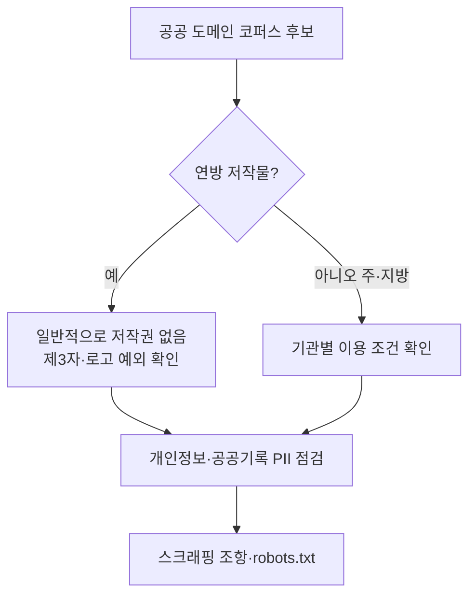
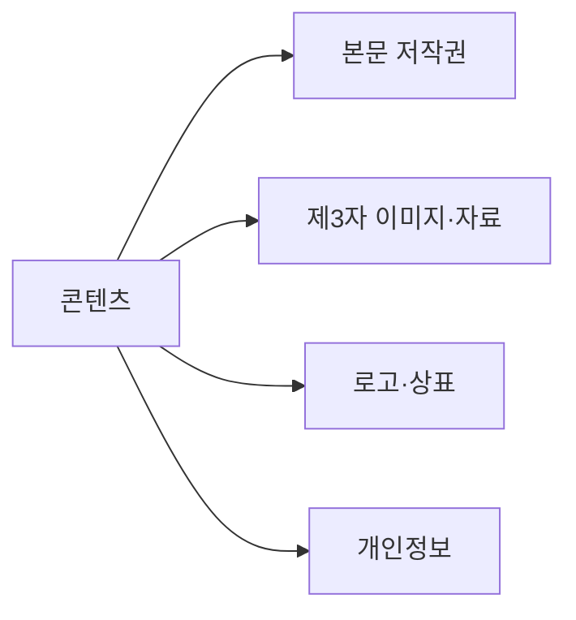

# 도메인 코퍼스 이용 조건

> 정부·공공 사이트처럼 **"공개된 글"이라도 코퍼스로 쓸 때는 사이트별 이용 조건·저작권·개인정보를 따로 확인**해야 한다. 공개됐다는 것이 자유롭게 재사용해도 된다는 뜻은 아니다. (법률 자문이 아니다.)

## 쉽게 말하면
시청 게시판에 붙은 공고문은 누구나 읽을 수 있지만, 그 글과 사진을 모아 책으로 내도 되는지는 별개다. 또 공고문에 이름과 주소가 있다면 개인정보 문제도 따로 따져야 한다.

## 자세히
- **미국 연방 정부 저작물(USA.gov 안내, 직접 읽음)**: 연방 공무원이 직무로 만든 저작물은 일반적으로 저작권이 없는 것으로 다뤄진다. 하지만 연방 사이트에는 **제3자 콘텐츠**(허락받아 게시)가 있을 수 있어 확인해야 하고, 등장하는 사람은 주(州)법상 권리를 가질 수 있다. 연방 상표·기관 로고는 허락 없이 못 쓰며, 기관이 보증하는 것처럼 보이게 쓰면 안 된다. 어떤 기관은 특정 출처 표기를 요구하고 일부는 CC-BY 같은 라이선스를 쓴다. 해외에서는 미국법이 보호하지 않아도 다른 나라 법이 적용될 수 있다.
- **주·지방 정부는 다르다(같은 안내)**: 연방 규정은 주·지방 정부 저작물에 적용되지 않으며 그 저작물은 **저작권 보호를 받을 수 있다**. 해당 정부에 문의하라고 안내한다.
- **워싱턴주 기관 사례(검색으로 확인한 페이지 요약, 각 페이지 본문 미확인)**: 주 정부 전체의 단일 정책이 없고 기관마다 다르다. 일부 기관은 "별도 표시가 없으면 콘텐츠는 기관의 저작권 자산"이라고 하며 비상업적 사용에 한해 출처 표시를 조건으로 허용하고, 의사당 사이트는 사용 전 웹마스터 허락을 요구한다. 어떤 기관은 제3자 자료의 저작권 주장을 하지 않고 제공자를 표기하며, 스톡 이미지는 해당 스톡 라이선스를 따른다고 한다.
- **개인정보와 공공기록**: 주 기관 개인정보 안내문은 공공기록법(RCW 42.56)이 우선한다고 밝히고 이용자가 보낸 정보가 공공기록이 되어 타인이 열람·복사할 수 있다고 알리는 경우가 있다(검색 요약). 즉 공개된 기록에 개인정보가 들어 있을 수 있어 코퍼스화 시 [추가 PII 단계](#extra-pii-pass)가 필요하다.
- **이 노드의 앞선 시연과 연결**: 색인으로 `wa.gov` 같은 도메인의 문서를 뽑는 파이프라인은 기술적으로 가능하지만([도메인 목록 정하기](#domain-list-selection)), 사이트별 조건 확인이 별도 단계다.
- **점검표(제안)**: ① 도메인별 저작권·이용 조건 페이지 ② 제3자 콘텐츠·이미지 제외 ③ 상표·로고 ④ 출처 표시 의무 ⑤ 개인정보·공공기록 내 PII ⑥ robots.txt·이용약관의 스크래핑 조항([웹 스크래핑과 DB권](#scraping-database-right)) ⑦ 국가별 법(EU DB권 등)이 적용되는지.
- 한계: 이번에 직접 읽은 것은 USA.gov 안내이고, 주 정부 사례는 검색 요약이다.

## 그림으로 보기

## 예시
| 도메인 유형 | 확인할 것 |
|---|---|
| 연방 사이트(.gov) | 제3자 콘텐츠, 로고, 출처 표기 |
| 주 정부 사이트 | 기관별 저작권 페이지·허락 절차 |
| 지방정부·공공기록 | 개인정보, 공공기록법 |
- 업무 장면: 공공정책 교육용 코퍼스를 만들기 전에 도메인 20개의 이용 조건 링크와 허용 범위를 표로 정리한다.

## 헷갈리는 것과 비교
| 개념 | 차이 |
|---|---|
| 연방 저작물 | 일반적으로 저작권 없음 |
| 주·지방 저작물 | 저작권 보호 가능 |
| [도메인 특화 코퍼스 만들기](#domain-specific-corpus-cc) | 이 점검을 포함해야 할 파이프라인 |
| [FineWeb 이용 조건](#fineweb-license-terms) | 데이터셋 차원의 조건 읽기 |

## 더 읽을거리
- [USA.gov: Government Works and Copyright](https://www.usa.gov/government-copyright) — 연방 저작물과 예외, 주·지방 정부 안내(직접 읽음).
- [Washington Dept. of Ecology 저작권 안내](https://ecology.wa.gov/copyright.html) — 기관별 이용 조건 예(검색 결과로만 확인).
