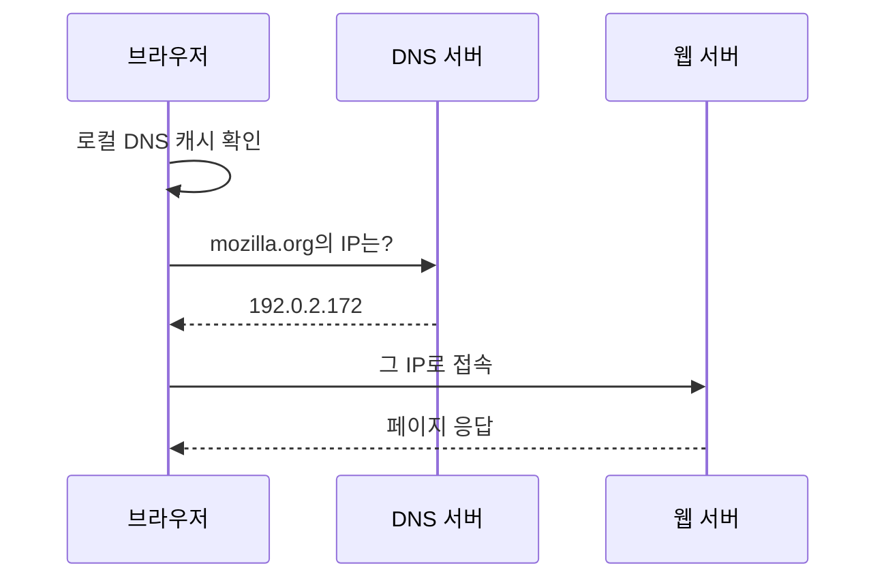
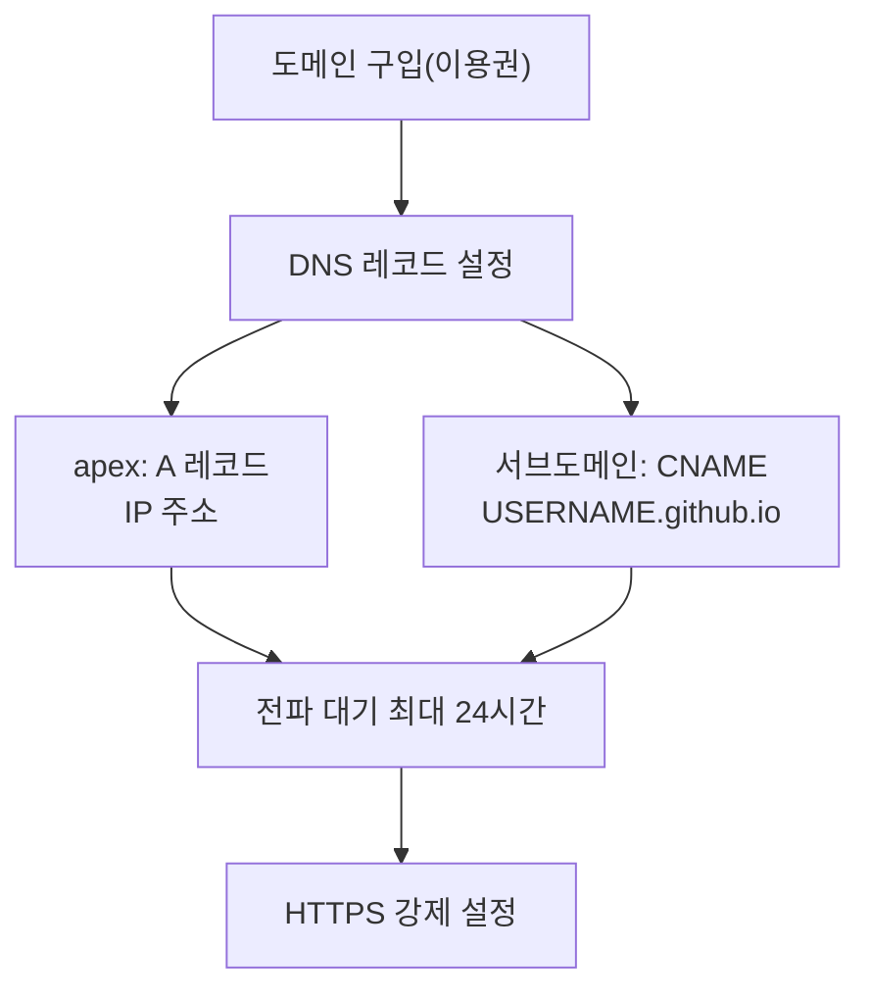

# 도메인과 DNS

> **도메인**은 사람이 기억하기 쉬운 서버 주소(`mozilla.org`)이고, **DNS**는 그 이름을 서버의 IP 주소(`192.0.2.172` 같은 숫자)로 바꿔 주는 인터넷의 전화번호부다. 바이브코딩으로 만든 앱을 내 도메인에 연결할 때 **DNS 레코드(A·CNAME)** 를 설정하게 된다.

## 쉽게 말하면
연락처 앱에 "엄마"라고 저장해 두면 번호를 몰라도 전화를 걸 수 있듯, 도메인은 서버의 "이름"이고 DNS가 그 이름에 맞는 "번호(IP)"를 찾아 준다. 번호가 바뀌어도 이름은 그대로 쓸 수 있다.

## 자세히
(MDN "What is a domain name" 및 GitHub Pages 문서 요약)
- **구조**: 도메인은 **오른쪽에서 왼쪽으로** 읽는다. 가장 오른쪽이 **TLD**(`.com`·`.org`·`.kr` 등), 그 앞의 이름 조각이 **레이블**이다. 내가 가진 도메인 앞에 붙이는 `developer.mozilla.org` 같은 것이 **서브도메인**.
- **소유가 아니라 이용권**: 도메인은 "사는" 것이 아니라 **1년 단위 등으로 사용 권리를 돈 내고 갱신**하는 것이다. 판매 업체가 **등록 대행자(registrar)**. 등록 후 DNS 변경이 퍼지는 데 **몇 시간** 걸릴 수 있다(DNS 서버가 정보를 캐시하기 때문).
- **조회 과정**: 브라우저가 로컬 DNS 캐시 확인 → 없으면 DNS 서버에 질문 → IP 주소를 받아 서버에 접속.
- **자주 보는 DNS 레코드**(일반 설명): **A**(도메인 → IPv4), **AAAA**(→ IPv6), **CNAME**(다른 이름의 별칭), **MX**(메일 서버), **TXT**(검증·메일 정책 등 자유 텍스트).
- **GitHub Pages 연결 예**(GitHub 문서): 최상위(apex) 도메인 `example.com`은 **A 레코드** 4개(185.199.108.153, 185.199.109.153, 185.199.110.153, 185.199.111.153)를 설정하고, `www` 같은 서브도메인은 `USERNAME.github.io`를 가리키는 **CNAME**을 쓴다(저장소 이름은 뺀다). **GitHub에 먼저 도메인을 추가한 뒤 DNS를 바꿔야** 남이 내 서브도메인을 선점하는 위험이 줄고, 변경 반영에 **최대 24시간**, HTTPS 강제 옵션이 나타나는 데도 최대 24시간 걸릴 수 있다. 와일드카드(`*.example.com`) 레코드는 탈취 위험이 있어 피하라고 안내한다. IP 주소는 서비스가 바꿀 수 있으니 항상 현재 문서를 확인한다.
- **직접 확인**: 파이썬 `socket.getaddrinfo`로 `example.com`은 `104.20.23.154`, `172.66.147.243` 등으로, `github.com`은 `140.82.112.4`로 해석됐다(2026-11-25 측정, 서비스·시점에 따라 바뀜).
- **문제 해결 감각**: "도메인을 연결했는데 안 열린다" → ① 레코드 종류·값 오타, ② 전파 대기, ③ 서비스 쪽 도메인 등록 누락, ④ HTTPS 인증서 발급 대기.
- 한계: DNS 설정 화면과 용어는 등록 대행자마다 다르다.

## 그림으로 보기



## 예시
```python
import socket
print(sorted({a[4][0] for a in socket.getaddrinfo("example.com", 443, type=socket.SOCK_STREAM)}))
```
- 프롬프트: "내 GitHub Pages 사이트를 `www.내도메인.com`에 연결하려고 해. DNS에 어떤 레코드를 추가하고, GitHub에서 무엇을 먼저 해야 해?"

## 헷갈리는 것과 비교
| 개념 | 차이 |
|---|---|
| 도메인 | 사람이 읽는 이름 |
| IP 주소 | 서버의 숫자 주소 |
| A 레코드 | 이름 → IPv4 |
| CNAME | 이름 → 다른 이름(별칭), apex에는 보통 못 씀 |
| [HTTP 요청과 상태 코드](#http-basics) | 주소를 찾은 뒤 서버와 나누는 대화 |

## 더 읽을거리
- [MDN: What is a domain name?](https://developer.mozilla.org/en-US/docs/Learn_web_development/Howto/Web_mechanics/What_is_a_domain_name) — 도메인·DNS 입문.
- [GitHub Docs: Managing a custom domain for your GitHub Pages site](https://docs.github.com/en/pages/configuring-a-custom-domain-for-your-github-pages-site/managing-a-custom-domain-for-your-github-pages-site) — A/CNAME 설정 방법.
