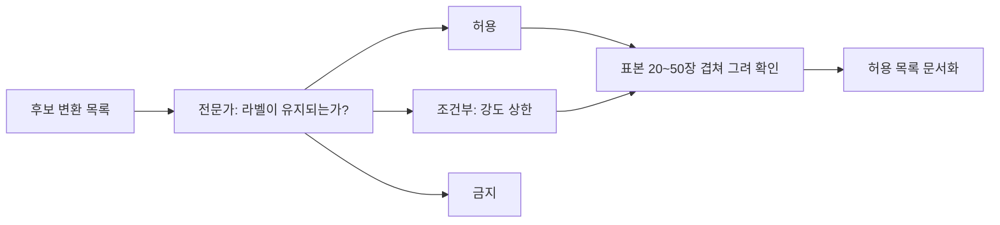
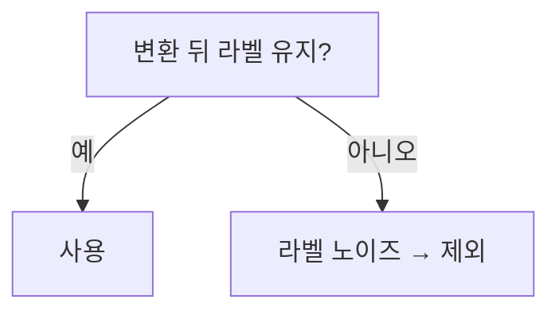

# 도메인 전문가 증강 검토

> 증강 목록은 코드를 짜는 사람이 정하지 않고, **"이 변환 뒤에도 정답이 그대로인가?"를 도메인 전문가와 함께 점검해 만든 허용 목록**으로 정한다. 라이브러리는 변환을 실행할 뿐 무엇이 유효한지는 알지 못한다.

## 쉽게 말하면
요리사가 조리법을 바꾸기 전에 영양사에게 "이 재료를 빼도 알레르기 표시는 그대로 맞나요?"라고 묻는 것과 같다. 변환(재료)을 마음대로 바꾸면 라벨(표시)이 틀려진다.

## 자세히
- 판단 기준(Albumentations 공식 소개 문서, 2026-11-27 열람): 핵심 질문은 **"사람 어노테이터가 이 변환 뒤에도 같은 라벨을 달까?"**다. 문서는 "라벨 보존이 실패하면 증강은 라벨 노이즈가 된다"고 쓴다. 이미지가 사실적인지가 아니라 라벨이 분명히 맞는지가 기준이고, 비현실적이어도 라벨이 분명하면 정규화 효과가 있다고 한다(스트레스 증강: "unrealistic, but still label-preserving").
- 의료 맥락: 같은 문서는 개발 병원에서 95%이던 분류기가 다른 병원(다른 스캐너)에서 70%로 떨어진 예로 학습·배포 조건 차이를 설명하고, 현미경 조직 표본의 미세한 이동 때문에 탄성(elastic) 변환이 도움이 될 수 있다고 한다. 다수 의료 영상은 흑백이라 강한 색 변환은 물리적으로 의미가 없고, 숫자·화살표처럼 방향이 있는 클래스는 뒤집기·큰 회전이 라벨을 무효화할 수 있다고 적는다.
- 허용 목록 만드는 절차(제안):
  1. **후보 나열**: 쓰려는 변환(뒤집기·회전·밝기·탄성·크롭 등)을 표로 쓴다.
  2. **전문가 질문**: 변환마다 "이 변환 뒤 진단·라벨이 달라질 수 있는가? 어떤 강도까지 괜찮은가?"를 묻고 허용/금지/조건부(강도 상한)로 분류한다. 예: 흉부 X선 수평 뒤집기는 심장 위치 과제에서 금지([우심증과 증강](#dextrocardia-augmentation)).
  3. **표본 확인**: 허용 변환으로 만든 20~50장에 정답(박스·마스크·키포인트)을 겹쳐 그려 어긋남을 본다 — 문서가 권하는 방식이며 "증강 버그는 예외를 거의 일으키지 않아" 눈으로 보는 것이 유일하게 믿을 만한 확인이라고 한다([박스 그려 보기 점검](#draw-bbox-sanity-check)).
  4. **기록**: 허용 목록·강도 범위·승인자·날짜를 문서화하고, 데이터·과제가 바뀌면 다시 검토.
  5. **성능 비교**: 허용 목록 vs 전체 허용 vs 무증강을 같은 설정에서 비교([증강 기준선 관행](#augmentation-baseline-practice)).
- 한계: 전문가 의견도 틀릴 수 있고 과제가 바뀌면 낡는다. 최종 판단은 검증 성능과 오류 분석으로 보정한다(제안).

## 그림으로 보기

## 예시
| 변환 | 흉부 폐결절 검출 | 심장 크기 측정 |
|---|---|---|
| 수평 뒤집기 | 전문가 확인 후 허용 가능 | 금지 |
| 밝기·대비 소폭 | 허용 | 허용 |
| 강한 색 변환 | 흑백이라 무의미 | 무의미 |
- 교육: "도메인 지식이 증강 설계의 일부"임을 팀 워크숍으로 연습.

## 헷갈리는 것과 비교
| 개념 | 차이 |
|---|---|
| 허용 목록 | 쓸 수 있는 변환·강도를 사전에 정함 |
| 자동 증강 탐색 | 성능 기준으로 정책을 찾음(도메인 지식은 별도) |
| [과제 의존적 증강 선택](#task-dependent-augmentation) | 과제에 따라 허용 변환이 달라진다는 원칙 |

## 더 읽을거리
- [Albumentations: What Is Image Augmentation?](https://albumentations.ai/docs/1-introduction/what-are-image-augmentations/) — 라벨 보존·시각 점검·의료 예시(읽음).
