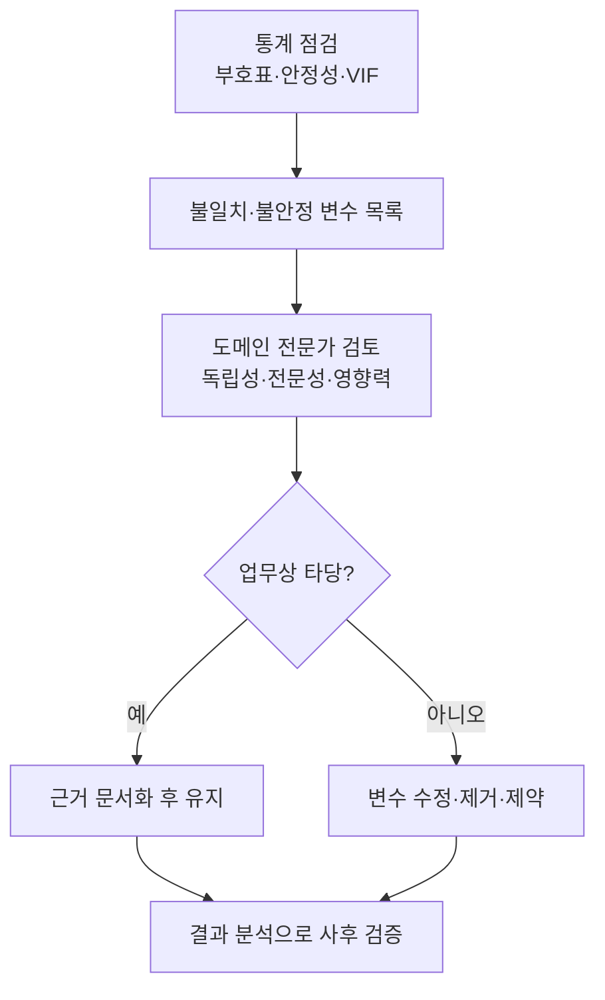

# 도메인 전문가 검토

> 모델이 학습한 **변수 영향 방향·가정·데이터 선택을 해당 업무를 아는 사람이 직접 읽고 타당성을 판단**하는 절차. 통계 점검(부호표, 안정성)이 "무엇이 다른가"를 찾으면, 전문가 검토는 "그게 업무상 말이 되는가"를 가린다.

## 쉽게 말하면
번역 소프트웨어가 낸 결과를 해당 분야 전문가가 읽어 보는 것과 같다. 기계는 문법 오류를 잘 찾지만, 이 용어가 이 업계에서 그렇게 쓰이는지는 전문가가 안다. 모델 검토도 마찬가지다.

## 자세히
출처: 미국 연준·OCC·FDIC의 개정 모형 위험 관리 지침 SR 26-2(2026-04-17)와 첨부 지침 PDF(텍스트 변환해 직접 확인, 2026-11-18). 법률·규제 자문이 아니다.
- **지침의 위치**: SR 26-2는 SR 11-7(2011-04-04)과 SR 21-8(2021)을 **대체**한다. 주로 총자산 300억 달러 초과 은행에 관련되며, 그 이하 기관은 일반적으로 대상에서 제외하되 모형 위험이 크면 관련될 수 있다고 쓴다.
- **"모델" 정의**: 통계·경제·금융 이론을 입력 데이터에 적용해 정량 추정치를 내는 복잡한 정량 방법. 단순 산술(스프레드시트)과 통계 이론이 없는 결정론적 규칙 기반 소프트웨어는 제외한다.
- **생성형·에이전트형 AI는 범위 밖(각주 3)**: 새롭고 빠르게 변하므로 이 지침의 범위에 들지 않으며, 지침의 원칙은 전통적 통계·정량 모형과 비생성·비에이전트형 AI에 적용된다고 한다. 해설 글마다 AI 범위 해석이 갈렸으므로 이 원문 각주가 기준이다.
- **효과적 도전(effective challenge)**: 객관적 전문가가 모델 위험을 비판적으로 분석하고 모델 수명주기 전반(개발~지속 모니터링)에서 적절한 변경을 이끌어내는 것. 수행자는 ①비판적·객관적 도전을 할 전문성 ②객관성을 지킬 독립성 ③변경을 끌어낼 조직적 지위와 영향력을 갖춰야 한다.
- **개념적 타당성 검증**: 주요 모델링 선택, 가정, **정성적 판단**, 데이터 선택을 평가하고 문서화한다. 이론적 구성 평가가 어려우면 해석 가능성 지표나 다른 모델과의 벤치마킹이 더 실용적일 수 있다.
- **전문가 판단과 결과 분석**: 모델 설계가 전문가 판단에 크게 의존하면 정량적 결과 분석(model outputs vs 실제 결과)이 그 판단의 질을 평가하게 해 준다고 한다. 즉 전문가 검토는 숫자 검증과 짝이다.
- **중요도 비례**: 모델 목적과 노출이 중요도를 정하고, 중요한 모델일수록 더 엄격한 관리를 한다.
- **실무 적용(제안)**: 부호 점검표([계수 부호 점검표](#sign-check-table))의 "불일치·불안정" 줄을 전문가에게 보여 기대 방향의 근거, 변수 정의(코딩 방향), 표본 제약(승인된 사람만 관측 등)을 확인하게 한다. 전문가가 개발자와 독립적이어야 도전이 의미가 있다.
- **한계**: 전문가도 편향이 있어 "상식"이 틀릴 수 있다. 판단을 기록하고 결과 분석으로 사후 검증한다.

## 그림으로 보기

## 예시
- 연체 횟수의 계수가 음수로 나온 변수를 신용 전문가에게 보여 주니 "연체가 많을수록 대출이 거절되어 관측 표본이 줄어드는 선택 편향"이라는 설명이 나왔다(가상 시나리오) → 데이터 정의를 재확인.
- 교육 활용: 모델 검토 회의에서 "누가 반대 의견을 낼 독립성과 권한을 갖고 있는가"를 묻는 체크리스트로 활용.

## 헷갈리는 것과 비교
| 개념 | 차이 |
|---|---|
| 도메인 전문가 검토 | 업무 타당성 판단(질적) |
| [계수 부호 점검표](#sign-check-table) | 방향·안정성 확인(양적) |
| 효과적 도전 | 독립적 전문가가 모델 위험을 비판 분석하는 원칙 |
| 모델 검증 | 개념적 타당성·모니터링·결과 분석 전체 |

## 더 읽을거리
- [Fed SR 26-2 서신](https://www.federalreserve.gov/supervisionreg/srletters/sr2602.htm) — 2026-04-17 개정 지침, SR 11-7 대체
- [SR 26-2 첨부 지침 PDF](https://www.federalreserve.gov/supervisionreg/srletters/SR2602a1.pdf) — 모델 정의, 효과적 도전, 검증 요소
