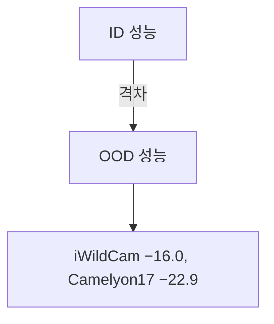

# 도메인 일반화

> 학습에 쓰지 않은 새로운 도메인(병원, 카메라 위치, 지역 등)에서도 잘 동작하도록 하는 문제다. 학습·시험 도메인이 겹치지 않는 것이 핵심이다.

## 쉽게 말하면
한국 병원 사진으로 배운 AI를 일본 병원에 놓았을 때도 잘하게 만드는 일이다. 연습 때 본 적 없는 장소에서의 실전이다.

## 자세히
(WILDS arXiv 2012.07421 3.1절과 표 1을 하위 에이전트가 원문으로 읽은 노트 기준.)
- **정의**: D_train ∩ D_test = ∅(학습·시험 도메인이 서로소), 도메인은 대체로 유사하다고 가정하고 시험 분포에서의 **평균 오류**를 최소화. 예: Camelyon17(일부 병원으로 학습, 다른 병원에서 시험), iWildCam(새 카메라 트랩).
- **WILDS**: 10개 데이터셋 — iWildCam, Camelyon17, RxRx1, OGB-MolPCBA, GlobalWheat, CivilComments, FMoW, PovertyMap, Amazon, Py150. 도메인 수: iWildCam 323, Camelyon17 5, RxRx1 51, OGB-MolPCBA 120,084, GlobalWheat 47, CivilComments 16, FMoW 16×5, PovertyMap 23×2, Amazon 2,586, Py150 8,421.
- **핵심 결과(표 1)**: 표준 학습(ERM)은 모든 데이터셋에서 ID보다 OOD 성능이 훨씬 낮다. iWildCam macro F1 47.0→31.0, Camelyon17 93.2→70.3, RxRx1 39.8→29.9, OGB-MolPCBA AP 34.4→27.2, GlobalWheat 63.3→49.6. 시험된 알고리즘(CORAL, IRM, Group DRO)은 ERM을 안정적으로 이기지 못했다.
- 미확인: Amazon·Py150이 표의 어느 범주에 속하는지는 추출된 표가 깨져 확인하지 못했다.

## 그림으로 보기

## 예시
- 새 매장·새 지역에서 수요 예측 모델이 무너지지 않는지 홀드아웃 지역으로 검증.
- 교육 활용: "학습 데이터의 도메인 목록"을 먼저 적게 하는 모델 점검 습관.

## 헷갈리는 것과 비교
| 개념 | 차이 |
|---|---|
| 도메인 일반화 | 학습에 없던 새 도메인 |
| [소집단 변화](#subpopulation-shift) | 같은 도메인, 비율 변화 |
| 도메인 적응 | 대상 도메인의 (라벨 없는) 데이터를 활용 |

## 더 읽을거리
- [WILDS (arXiv 2012.07421)](https://arxiv.org/abs/2012.07421) — 정의·표 1.
