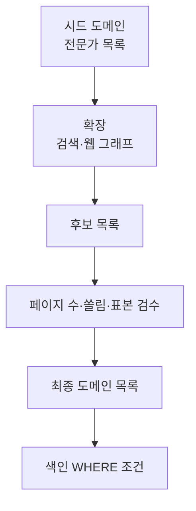

# 도메인 목록 정하기

> 분야별 코퍼스를 만들 때 **어떤 웹사이트(도메인)를 대상으로 삼을지 목록을 정하는 일**. 목록이 곧 코퍼스의 성격과 편향을 결정한다.

## 쉽게 말하면
특정 분야 도서관을 만든다면 어느 출판사의 책을 사들일지부터 정해야 한다. 출판사 목록이 곧 장서의 색깔이다. 목록이 한쪽에 치우치면 아무리 잘 걸러도 서가는 치우친다.

## 자세히
- **왜 분야 데이터인가(Gururangan 외 2020, "Don't Stop Pretraining", ACL 2020, arXiv 2004.10964, 초록 직접 읽음)**: 사전학습 모델에 해당 분야 글로 이어서 학습(DAPT)하면 생의학·컴퓨터과학 논문·뉴스·리뷰 네 분야 8개 분류 과제에서 성능이 오르고, 과제 자체의 비라벨 데이터로 더 학습(TAPT)하면 DAPT 뒤에도 이득이 있었다. 분야 자원이 없을 때는 단순한 데이터 선택으로 과제 코퍼스를 보강하는 것도 효과적이라고 한다.
- **도메인 단위로 고르는 이유**: Common Crawl 색인에는 `url_host_registered_domain` 열이 있어 등록 도메인 단위로 쉽게 거를 수 있다([Athena로 색인 조회](#athena-cc-index-query), 열 기반 색인 문서 확인). 도메인 목록은 곧 SQL의 `WHERE` 조건이다.
- **후보 도메인 찾는 방법(제안)**: ① 분야 전문가가 시드 도메인 작성(공공기관·학회·언론·기업 문서) ② 키워드로 검색해 나온 사이트 추가 ③ Common Crawl 웹 그래프로 시드와 링크가 많은 도메인 확장. 웹 그래프는 호스트·도메인 단위로 공개되고 공개 도메인 그래프는 호스트 그래프를 공용 접미사 목록 기준으로 합친 것이다(Common Crawl 웹 그래프 페이지, 직접 읽음). 순위 지표 종류나 파일 형식은 해당 페이지에 없고, 이번에 데이터 파일을 직접 열어 보지 못했다.
- **목록을 검증하는 방법(제안)**: 도메인별 페이지 수와 평균 길이 분포 확인, 상위 도메인이 전체의 대부분을 차지하는지(쏠림) 점검, 무작위 문서 눈검사, 언어·품질 필터 후 남는 비율 비교([색인 언어 판정](#index-language-accuracy)).
- **함정**: ① 몇 개 대형 도메인이 코퍼스를 지배 ② 크롤은 웹의 무작위 일부라 도메인 대표성이 보장되지 않음 ③ 사이트별 이용 조건·robots·개인정보 점검 필요([FineWeb 이용 조건](#fineweb-license-terms)).
- 이 노드의 기존 시연(이전 노드, 한 행 그룹 기준)에서도 `wa.gov` 같은 도메인이 압도적 비중을 차지한 사례가 있었다. 도메인 목록 하나만으로는 분야 대표성이 보장되지 않는다는 뜻이다.

## 그림으로 보기

## 예시
| 분야 | 시드 예(제안) |
|---|---|
| 공공 정책 | 정부·지자체 도메인 |
| 의학 | 학회·병원·공공 보건 사이트 |
| 마케팅 교육 | 업계 매체·플랫폼 공식 문서 |
- 업무 장면: 직무별 AI 교육 자료를 위한 분야 코퍼스를 만들 때 전문가가 시드 20개를 적고, 상위 도메인 쏠림을 표로 확인한 뒤 상한을 둔다.

## 헷갈리는 것과 비교
| 개념 | 차이 |
|---|---|
| 도메인 목록 | 대상 사이트 선정 |
| [도메인 특화 코퍼스 만들기](#domain-specific-corpus-cc) | 목록을 쓰는 전체 파이프라인 |
| DAPT | 분야 글로 이어서 학습하는 방법 |
| 웹 그래프 | 사이트 간 링크 구조 데이터 |

## 더 읽을거리
- [Don't Stop Pretraining (arXiv 2004.10964)](https://arxiv.org/abs/2004.10964) — 분야 적응 사전학습(초록 직접 읽음).
- [Common Crawl Web Graphs](https://commoncrawl.org/web-graphs) — 호스트·도메인 그래프 설명(직접 읽음).
