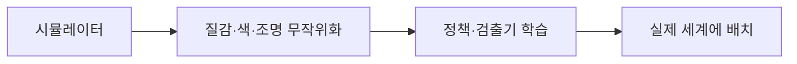
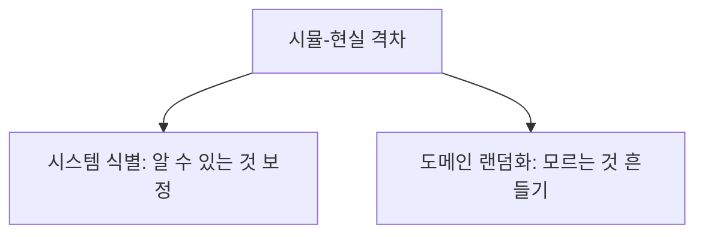

# 도메인 랜덤화

> 시뮬레이션에서 **질감·색·조명 같은 요소를 무작위로 바꿔 가며 학습**시켜, 실제 세계의 모습도 "또 하나의 변형"으로 보이게 하는 방법. 시뮬-현실 격차를 넘는 대표 기법이다. (Tobin 외, arXiv 1703.06907, 초록 읽음)

## 쉽게 말하면
조종 연습을 맑은 날만 하지 않고 비·안개·밤 등 온갖 조건에서 해 두면, 처음 보는 실제 날씨도 연습 중 만난 변형 중 하나처럼 느껴진다.

## 자세히
- 아이디어(초록): 시뮬레이션 이미지를 **무작위 시각 요소**로 렌더링해 현실 이미지가 모델에게 **또 하나의 변형**처럼 보이게 한다.
- 실험: 합성 데이터에서 **비사실적 무작위 질감**으로 물체 위치 검출기를 학습. 실제 물체를 약 **1.5cm** 정확도로 위치 추정하고 방해물·부분 가림에 강하며, 어지러운 장면에서 잡기를 지원한다고 보고.
- 의미(저자 주장): **시뮬레이션 RGB 이미지만으로 학습한 신경망을 실제 로봇 제어로 옮긴 최초 사례**이며 실제 이미지 사전학습이 없었다.
- 보완 관계: [시스템 식별](#system-identification)이 알 수 있는 물리 파라미터를 맞춘다면, 랜덤화는 남은 불확실성을 다룬다. 2026 sim-to-sim 연구 요약은 식별 후 그 주변을 랜덤화하는 편이 넓은 랜덤화보다 낫다고 보고했다.
- 주의(검색 요약): 과도한 랜덤화는 학습을 어렵게 하고 보수적·고분산 정책을 낳을 수 있으며, 무엇을 얼마나 바꿀지 전문 지식이 필요하다. NVIDIA 문서는 임의의 극단이 아니라 **그럴듯한 범위**로 랜덤화하라고 한다.
- 한계: 이 논문(2017)은 시각 랜덤화 중심이며, 물리 랜덤화는 다른 연구에서 다룬다.

## 그림으로 보기

## 예시
- 시뮬에서 책상 위 물체의 질감과 조명을 매번 바꿔 로봇이 실제 물체 위치를 맞히도록 학습.
- 교육: 다양한 환경에서 연습하면 낯선 환경에 강해진다는 학습 원리 비유.

## 헷갈리는 것과 비교
| 개념 | 차이 |
|---|---|
| 도메인 랜덤화 | 조건을 다양화해 강건성 확보 |
| [시스템 식별](#system-identification) | 파라미터를 현실에 맞게 보정 |
| 데이터 증강 | 기존 데이터를 변형, 시뮬 기반이 아님 |

## 더 읽을거리
- [Domain Randomization 논문](https://arxiv.org/abs/1703.06907) — 개념과 실험(초록 읽음).
- [NVIDIA Isaac Lab: Simulation to Reality](https://docs.nvidia.com/learning/physical-ai/getting-started-with-isaac-lab/latest/robot-learning-fundamentals/08-simulation-to-reality.html) — 실무 가이드(검색 결과 확인).
