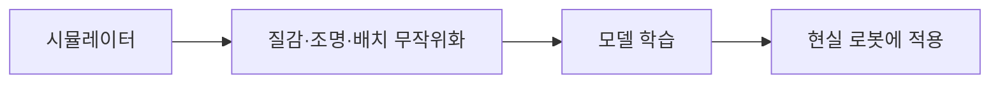
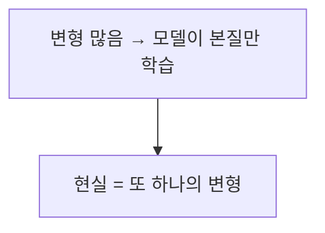

# 도메인 랜덤화

> **도메인 랜덤화**는 시뮬레이션의 질감·조명·물체 배치 같은 조건을 마구 바꿔 학습시켜, 현실을 "또 하나의 변형"으로 느끼게 만드는 sim-to-real 기법이다.

## 쉽게 말하면
운전 연습을 비 오는 날, 밤, 눈길 등 온갖 조건으로 해 두면 처음 가는 도로에서도 당황하지 않는다. 시뮬레이터를 일부러 "엉망으로 다양하게" 만들어 모델이 사소한 겉모습에 의존하지 않게 한다.

## 자세히
(Tobin 외, arXiv 1703.06907 초록 확인)
- 시뮬레이터에서 **비현실적인 무작위 질감**으로 렌더링한 이미지로만 학습한다.
- 물체 위치 추정 과제에서 **실제 이미지 사전학습 없이** 시뮬 RGB만으로 학습한 검출기가 현실에서 약 **1.5cm** 오차로 위치를 맞혔고, 방해물·부분 가림에도 견뎠다.
- 저자들은 이를 이용해 어수선한 장면에서 물체를 집는 데 성공했고, 이런 종류의 전이로는 처음이라고 주장한다.
- 왜 필요한가: 로봇 실데이터는 비싸고 위험하지만 시뮬은 공짜로 무한히 만들 수 있다. 차이(현실 격차)를 무작위성으로 덮는다.
- 한계(일반 지식): 범위를 너무 넓히면 학습이 어려워지고, 물리 파라미터까지 랜덤화해야 하는 과제도 있다.

## 그림으로 보기

## 예시
- 큐브 위치 추정: 매 에피소드 바닥·벽 색, 카메라 각도, 조명을 무작위로 바꿔 렌더링.
- 교육 활용: "데이터가 부족하면 가짜 환경을 다양하게 만든다"는 사례.

## 헷갈리는 것과 비교
| 개념 | 차이 |
|---|---|
| 도메인 랜덤화 | 시뮬 조건을 무작위로, 현실에 대한 노출 없이 |
| 도메인 적응 | 실제 데이터를 일부 써서 간극을 줄임 |
| 데이터 증강 | 기존 이미지를 변형 |
| [교차 로봇 학습](#cross-embodiment) | 여러 로봇 데이터를 합침 |

## 더 읽을거리
- [Domain Randomization for Transferring Deep Neural Networks from Simulation to the Real World](https://arxiv.org/abs/1703.06907) — 원 논문.
